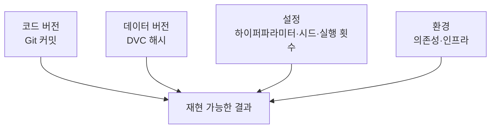

# 실험 재현성

> 같은 코드·데이터·설정으로 다시 돌렸을 때 **같은 결과를 얻을 수 있는 성질**이다. 코드 버전, 데이터 버전, 설정(하이퍼파라미터·시드·환경)을 함께 기록해야 가능하다.

## 쉽게 말하면
요리 레시피에 "소금 적당히"라고만 적으면 같은 맛이 안 난다. 재료 원산지·분량·불 세기·시간까지 적어야 다른 사람이 똑같이 만든다. 모델 실험도 코드(레시피), 데이터(재료), 설정(분량·불 세기)을 같이 남겨야 한다.

## 자세히
- **ML 재현성 체크리스트(Pineau 외, v2.0, 2020-04-07, PDF 본문 직접 확인)**: 항목이 다섯 묶음이다.
  - **모델·알고리즘**: 수학적 설정·가정·복잡도(시간·공간·표본 크기) 설명.
  - **이론적 주장**: 주장 서술과 완전한 증명.
  - **데이터셋**: 예시 수 등 통계, train/validation/test 분할 상세, 제외한 데이터와 전처리 전부, 내려받을 수 있는 링크, 새로 모은 데이터면 어노테이터 지침과 품질 관리 방법.
  - **공유 코드**: 의존성 명세, 학습 코드, 평가 코드, (사전)학습된 모델, 결과 표와 그 결과를 내는 **정확한 명령어**가 있는 README.
  - **실험 결과**: 고려한 하이퍼파라미터 범위와 선택 방법·실제 사용값 전부, **정확한 학습·평가 실행 횟수**, 사용한 지표의 정의, 평균 같은 중심 경향과 오차 막대 같은 변동, 결과별 평균 실행 시간이나 에너지 비용 추정, 컴퓨팅 인프라 설명.
  - v2.0은 논문과 코드를 별개 산출물로 보고 코드 제출 체크리스트와 함께 쓰도록 이름을 바꿨다고 밝힌다. 사용 팁: 질문마다 Yes/No/해당 없음과 자유 서술 칸을 두고, 학회 제출에서는 초록 제출 시점에 체크리스트를 먼저 받아 두라고 제안한다.
- **프로그램 배경(arXiv 2003.12206, 초록 확인)**: NeurIPS 2019는 ① 코드 제출 정책 ② 커뮤니티 재현 챌린지 ③ 체크리스트를 제출 절차에 넣는 세 요소의 재현성 프로그램을 도입했다. 구체 결과는 초록에 없어 확인하지 못했다. (검색 요약은 코드 제출 준수율 74.4%라고 하나 원문에서 직접 확인하지 않았다.)
- **도구와 연결(해석)**: 데이터 버전은 [DVC](#dvc)·[Git LFS와 DVC 비교](#git-lfs-vs-dvc), 코드 버전은 Git, 환경은 의존성 파일·컨테이너로 고정, 시드·실행 횟수는 결과표에 기록한다.
- **한계**: 체크리스트는 형식 요건이라 결과가 맞다는 보증이 아니며, GPU 연산의 비결정성은 시드만으로 완전히 통제되지 않을 수 있다(일반적 지적, 이번에 출처 미확인).

## 그림으로 보기

## 예시
- 모델 보고서에 "데이터 해시, 코드 커밋, 시드 5개, 평균±표준편차, 실행 명령어"를 한 표로 남긴다.
- 교육 소재: 동료가 만든 노트북을 처음부터 재실행해 같은 숫자가 나오는지 확인하는 실습.

## 헷갈리는 것과 비교
| 개념 | 차이 |
|---|---|
| 재현성(reproducibility) | 같은 코드·데이터로 같은 결과 |
| 일반화·견고성 | 다른 데이터·조건에서의 성능 |
| [DVC](#dvc) | 데이터·실험 버전 도구 |
| [RAG 인덱스 버전](#rag-index-versioning) | 검색 인덱스의 시점 기록 |

## 더 읽을거리
- [ML Reproducibility Checklist v2.0 (Pineau)](https://www.cs.mcgill.ca/~jpineau/ReproducibilityChecklist.pdf) — 항목 전체(PDF 직접 확인).
- [Improving Reproducibility in ML Research (arXiv 2003.12206)](https://arxiv.org/abs/2003.12206) — NeurIPS 2019 프로그램(초록 확인).
