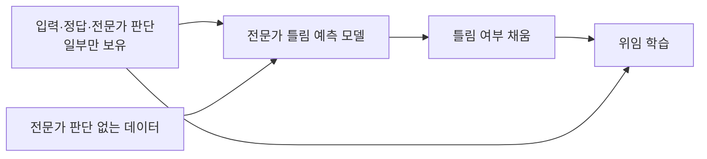
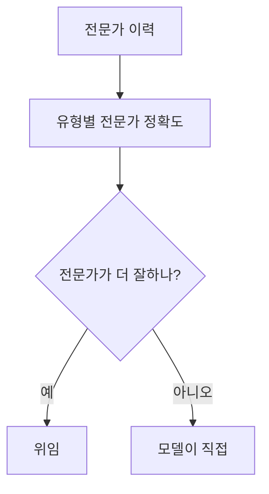

# 전문가 판단 이력

> 전문가 판단 이력은 입력마다 사람 전문가가 실제로 어떤 결정을 내렸는지 기록한 데이터다. 위임 학습은 이 이력으로 "이 유형에서는 사람이 AI보다 잘하는가"를 배워 넘길 건을 고른다.

## 쉽게 말하면
병원이 의사 개개인의 과거 판독 기록을 갖고 있다면 "이 의사는 폐 사진에 강하고 뼈 사진에 약하다"를 알 수 있다. AI는 그 기록을 보고 자기가 잘하는 건은 직접 하고, 의사가 더 잘하는 건은 의사에게 맡긴다.

## 자세히
- **필요한 데이터**: Mozannar·Sontag(ICML 2020, arXiv 2006.01862, 본문 열람)은 위임 학습에 입력 x, 정답 y, 전문가 판단 m의 조합이 필요하다고 설정한다. 방법 자체는 기반 과제의 정답 라벨 없이 전문가의 과거 판단 표본만으로도 가능하다고 초록은 밝힌다.
- **전문가 라벨이 일부만 있을 때**: 전체 데이터에 전문가 판단을 받는 것은 비용이 커서, 일부만 갖고 있는 상황을 실험했다. 전문가 판단이 있는 일부(S_l)로 "전문가가 틀리는지"를 예측하는 모델을 학습해 나머지에 전문가 틀림 여부를 채워 넣은 뒤(L_CE impute) 위임 학습을 했다. 손실이 전문가가 무엇을 골랐는지가 아니라 틀렸는지만 필요로 해, 문제를 이진 분류로 단순화한다.
- **실험 수치(저자 보고, CIFAR-10H)**: 사람 주석자 50명의 응답 분포에서 표집한 모의 전문가(평균 정확도 95.22%, 클래스별로 고양이 91.0%·말 97.8%). 결과는 체계 정확도 L_CE impute 96.29%, 2단계 방식 96.03%, 확신 기반 기준 95.09%. 모델이 직접 예측한 건의 정확도는 99.2% 대 96.09%였다. 단, 전문가는 실제 사람이 아니라 분포에서 표집한 모의 전문가다.
- **표본 효율**: 논문은 위임 학습이 reject 학습보다 표본이 더 많이 필요한 문제라는 이론 증거를 든다.
- **이력의 위험(해석)**: 전문가가 편향되거나 일관되지 않으면 그 습관을 배운다. 또 AI 표시가 전문가 판단을 바꾸는 효과는 과거 이력에 없다. 수집 시점의 업무 환경과 지금이 다르면 낡는다.
- **수집 팁(해석)**: 상담·심사·판독 업무에서 결정과 이유, 결정자 ID, 시각을 남겨 두면 나중에 위임 학습이나 [검토 큐 설계](#review-queue-design)에 쓸 수 있다.

## 그림으로 보기

## 예시
- 보험 심사: 심사역별 과거 승인·거절 결정과 최종 손실 결과를 기록해, 고액 건에서만 전문가 정확도가 높다면 그 구간만 사람에게 보낸다.
- 교육 활용: "업무 기록을 어떤 형식으로 남겨야 나중에 AI 학습에 쓸 수 있나?"를 데이터 설계 실습으로 쓴다.

## 헷갈리는 것과 비교
| 개념 | 차이 |
| --- | --- |
| 정답 라벨 | 진짜 정답. 전문가 판단은 사람이 낸 답으로 틀릴 수 있음 |
| [위임 학습](#learning-to-defer) | 이 데이터를 쓰는 방법 |
| [위임용 대리 손실](#surrogate-loss-defer) | 학습 손실. 입력으로 전문가 틀림 여부를 사용 |

## 더 읽을거리
- [Consistent Estimators for Learning to Defer to an Expert (arXiv 2006.01862)](https://arxiv.org/abs/2006.01862) — 6.4절 CIFAR-10H·제한된 전문가 데이터 실험
