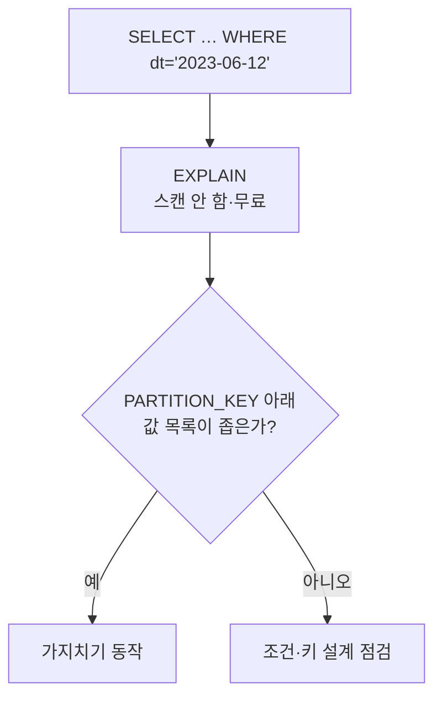
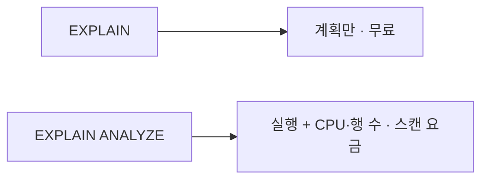

# EXPLAIN으로 읽는 범위 확인

> 쿼리를 **실제로 돌리기 전에** `EXPLAIN`으로 실행 계획을 보고, 파티션 가지치기가 동작해 필요한 파티션만 읽는지 확인하는 방법이다. 읽는 데이터가 줄었는지 숫자로 보려면 `EXPLAIN ANALYZE`를 쓴다.

## 쉽게 말하면
택배 기사가 출발 전에 "오늘 경로: 서울 한 곳만 방문"이라는 경로표를 먼저 본다면 쓸데없이 전국을 돌 일이 없다. EXPLAIN은 쿼리의 경로표를 미리 보여 줘서 "내 조건이 진짜 파티션을 걸러 내고 있나"를 돈을 쓰기 전에 확인하게 해 준다.

## 자세히
(AWS Athena의 "Using EXPLAIN and EXPLAIN ANALYZE in Athena"와 결과 해설 페이지를 직접 읽었다. Athena(Trino 계열) 기준이며 다른 엔진은 출력 형식이 다르다.)
- **EXPLAIN 문법(문서)**: `EXPLAIN [ (option [, ...]) ] statement`. 옵션은 `FORMAT { TEXT | GRAPHVIZ | JSON }`, `TYPE { LOGICAL | DISTRIBUTED | VALIDATE | IO }`. 기본은 TEXT. `IO` 타입은 질의가 읽는 테이블과 스키마 정보를 준다. **EXPLAIN은 데이터를 스캔하지 않아 Athena 요금이 없다**(다만 Glue 메타데이터 호출은 무료 한도를 넘으면 Glue 요금이 날 수 있다).
- **EXPLAIN ANALYZE(문서)**: 분산 실행 계획에 더해 **런타임 통계**(CPU 사용, 입력 행 수, 출력 행 수, 입력 데이터 크기 등)를 보여 준다. 옵션은 `FORMAT { TEXT | JSON }`이고 `TYPE`은 없다(항상 DISTRIBUTED). **실제로 실행되므로 스캔한 데이터만큼 요금이 부과**된다. SELECT·CTAS·INSERT에 쓸 수 있다.
- **파티션 가지치기 확인(문서 예 3)**: `o_orderdate`로 파티션된 `tpch100.orders_partitioned`(파티션 값 1992~1998, 2015)에 `WHERE o_orderdate = '1995'`로 질의한 EXPLAIN 결과에 `o_orderdate := o_orderdate:string:-1:PARTITION_KEY` 줄과 그 아래 `:: [[1995]]`가 나타난다. 이는 조건이 **PARTITION_KEY에 적용**되어 1995 파티션만 읽는다는 뜻이다. 문서는 콘솔 그래프에서 일부 파티션 필터가 보이지 않을 수 있으니 EXPLAIN·EXPLAIN ANALYZE로 확인하라고 안내한다.
- **성능 가이드의 같은 팁(Athena 최적화 문서, 직접 읽음)**: `EXPLAIN`을 질의 앞에 붙여 각 테이블의 `Fragment N [SOURCE]` 조각에서 파티션 키로 정의된 할당을 찾으면, 아래 줄에 스캔할 파티션 키 값 목록이 나온다. 예: `dt := dt:string:PARTITION_KEY` 아래 `:: [[2023-06-11], [2023-06-12], [2023-06-13]]` — 3일 범위에서 플래너가 3개 값을 찾았다는 뜻이다.
- **스캔 연산자 해설(문서)**: `TableScan`은 S3·Hive 커넥터에서 원본을 읽고 필터 조건에서 만든 파티션 가지치기를 적용한다. `ScanFilter`는 거기에 가지치기로 처리되지 않은 추가 필터까지 적용하며, `ScanFilterProject`는 그 뒤 출력을 새 투영으로 바꿔 이후 단계 성능을 높인다.
- **한계**: 이 문서의 EXPLAIN ANALYZE 예시는 CloudFront 로그 `LIMIT 10` 질의로 입력 행·CPU만 보여 주며, "읽은 파일 수"를 직접 표시하는 항목은 읽은 페이지에 없다. 파일 수 확인은 별도 방법(쿼리 통계 등)이 필요하다. 쿼리 통계 페이지는 열어 보지 않았다.
- **효과 없는 조건 찾기(문서 예 5)**: EXPLAIN으로 `filterPredicate`를 보면 옵티마이저가 조건을 합치거나 순서를 바꾼 결과가 보이고, 효과 없는 조건(예: 이미 `= 1500`이 있는데 `BETWEEN 1000 AND 2000`)을 제거할 수 있다.

## 그림으로 보기



## 예시
```sql
EXPLAIN
SELECT o_orderkey, o_custkey, o_orderdate
FROM tpch100.orders_partitioned
WHERE o_orderdate = '1995';
-- 결과에서: o_orderdate := o_orderdate:string:-1:PARTITION_KEY  :: [[1995]]
```
- 교육 소재: "돌리기 전에 경로표 보기" 습관 — 비용이 큰 쿼리 전에 EXPLAIN부터.

## 헷갈리는 것과 비교
| 개념 | 차이 |
|---|---|
| EXPLAIN | 계획만 출력, 데이터 스캔·요금 없음(Glue 호출 제외) |
| EXPLAIN ANALYZE | 실제 실행 후 런타임 통계, 스캔 요금 발생 |
| [Hive식 파티셔닝](#hive-style-partitioning) | 가지치기의 전제가 되는 폴더 구조 |
| [파티션 키 고르기](#partition-key-selection) | 가지치기가 잘 되도록 설계 |

## 더 읽을거리
- [Using EXPLAIN and EXPLAIN ANALYZE in Athena](https://docs.aws.amazon.com/athena/latest/ug/athena-explain-statement.html) — 문법·가지치기 확인 예(직접 읽음).
- [Understand Athena EXPLAIN statement results](https://docs.aws.amazon.com/athena/latest/ug/athena-explain-statement-understanding.html) — TableScan·ScanFilter 해설(직접 읽음).
- [Optimize data (AWS Athena)](https://docs.aws.amazon.com/athena/latest/ug/performance-tuning-data-optimization-techniques.html) — 파티션 호환 검증 팁(직접 읽음).
