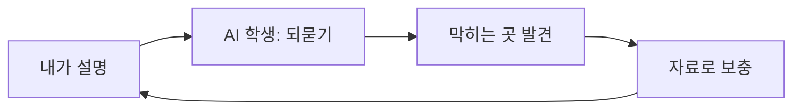
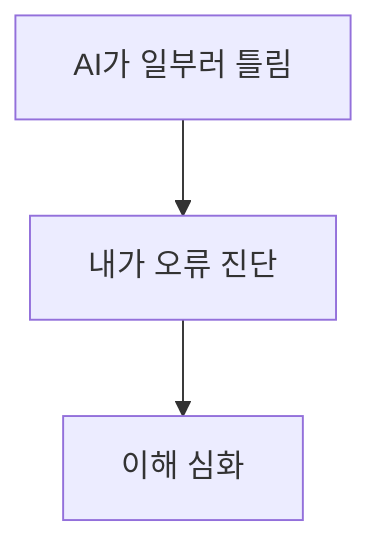

# AI를 학생으로 두고 가르치기

> AI에게 **아무것도 모르는 순진한 학생 역할**을 시키고 내가 설명하면서, 내 이해의 빈틈을 찾아내는 학습 방식. "가르치며 배운다"는 프로테제 효과를 AI로 구현한 것이다.

## 쉽게 말하면
스터디 친구에게 개념을 설명하다가 "그건 왜 그런 거야?"라는 질문에 막히면 내가 모르는 부분이 드러난다. AI를 그 친구로 세우는 방법이다.

## 자세히
(검색 요약 기준.)
- 배경: Vanderbilt·Stanford의 **Betty's Brain** 연구에서 가상 학생을 가르친다고 믿은 학생들은 학습 활동(읽기 등)에 더 많은 시간을 쓰고 더 많이 배웠으며, 하위 성취 학생에게 효과가 컸다고 보고됐다(**프로테제 효과**).
- 에이전트 설계: 에이전트는 초보자 역할로 학생 교사를 학습 경로로 이끌고, 항상 어떻게 답에 이르렀는지 설명해 학생이 그 사고방식을 따라 하게 만든다.
- LLM 연구는 초기 단계: 2025 BEA 논문 "LLMs Protégés"는 학생이 **일부러 틀리게 프롬프트된 LLM의 오류를 진단**하게 했고, 오류를 찾은 학생의 점수가 1~6점 척도에서 평균 0.72점 올랐다(저자도 예비 결과라고 함). 2025 Curiosity Notebook 연구는 자연어로 가상 에이전트를 가르치는 효과를 다뤘다.
- 한계: 대부분 소규모 실험이고, LLM 효과는 풀 논문 확인이 필요하다.
- 프롬프트 요령(내 제안, 검증 아님): "너는 이 주제를 처음 듣는 학생이다. 내 설명에서 이해 안 되는 점을 한 번에 하나씩 질문하라. 정답을 알려 주지 마라."

## 그림으로 보기

## 예시
- "RAG가 뭐야?"를 AI 학생에게 설명하다가 "임베딩이 뭔데요?"에서 막혀 해당 노드를 다시 공부.
- 교육: 수강생이 AI 학생에게 업무 용어를 설명하게 하는 실습.

## 헷갈리는 것과 비교
| 개념 | 차이 |
|---|---|
| AI를 학생으로 | 내가 가르치는 쪽 |
| AI 튜터 | AI가 가르치는 쪽 |
| [소크라테스 세미나](#socratic-seminar) | 사람들 간 질문 토론 |

## 더 읽을거리
- [Teachable Agents and the Protégé Effect](https://purl.stanford.edu/zm369yx3532) — Stanford 연구(검색 결과 확인).
- [LLMs Protégés (BEA 2025)](https://aclanthology.org/2025.bea-1.19) — LLM 오류 진단 실험(검색 요약).
