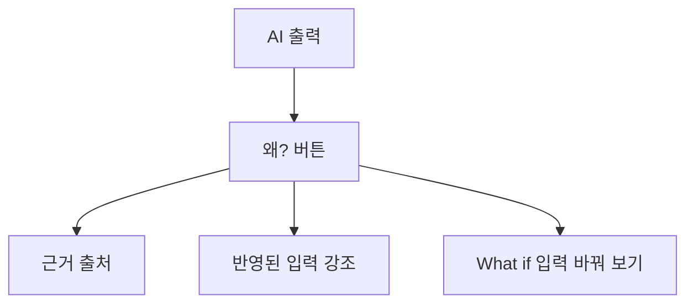

# 왜 그랬는지 설명 패턴

> 왜 그랬는지 설명 패턴은 HAX 지침 G11("시스템이 왜 그렇게 했는지 접근하게 하라")을 화면에서 구현하는 방식이다.

## 쉽게 말하면
내비게이션이 "공사 중이라 우회합니다"라고 한마디 알려 주면 믿고 따를 수 있다. 이유 없는 지시는 불안하다.

## 자세히
- G11 원문: 사용자가 AI가 그렇게 행동한 이유에 대한 설명에 접근할 수 있게 한다.
- HAX Design Library에는 "What if?" 설명 사례가 있다(입력을 바꾸면 출력이 어떻게 달라지는지 보여 줌, 예: Jasper.ai — 2차 검색 결과 기준).
- 구현 선택지: 근거 출처 표시, 반영된 입력 강조, 반사실적("X였다면") 설명, 요청 시에만 펼치는 상세 보기.
- 주의: 모델이 말하는 "이유"가 실제 내부 계산과 다를 수 있으므로 출처·입력처럼 검증 가능한 근거를 우선한다(일반적 지적).

## 그림으로 보기

## 예시
RAG 답변 옆에 인용 문서 링크와 "질문 중 이 부분을 반영함"을 표시한다.

## 헷갈리는 것과 비교
| 개념 | 차이 |
|---|---|
| 설명 패턴 | G11 구현 |
| [틀렸을 때 5개 지침](#hax-when-wrong) | 상위 묶음 |
| 답변 인용 | 설명의 한 방식 |

## 더 읽을거리
- [Guidelines for Human-AI Interaction (MS Research 블로그)](https://www.microsoft.com/en-us/research/blog/guidelines-for-human-ai-interaction-design) — 18개 지침 원문(직접 확인).
- [HAX Toolkit](https://www.microsoft.com/en-us/haxtoolkit/ai-guidelines/) — 지침·Design Library 안내.
