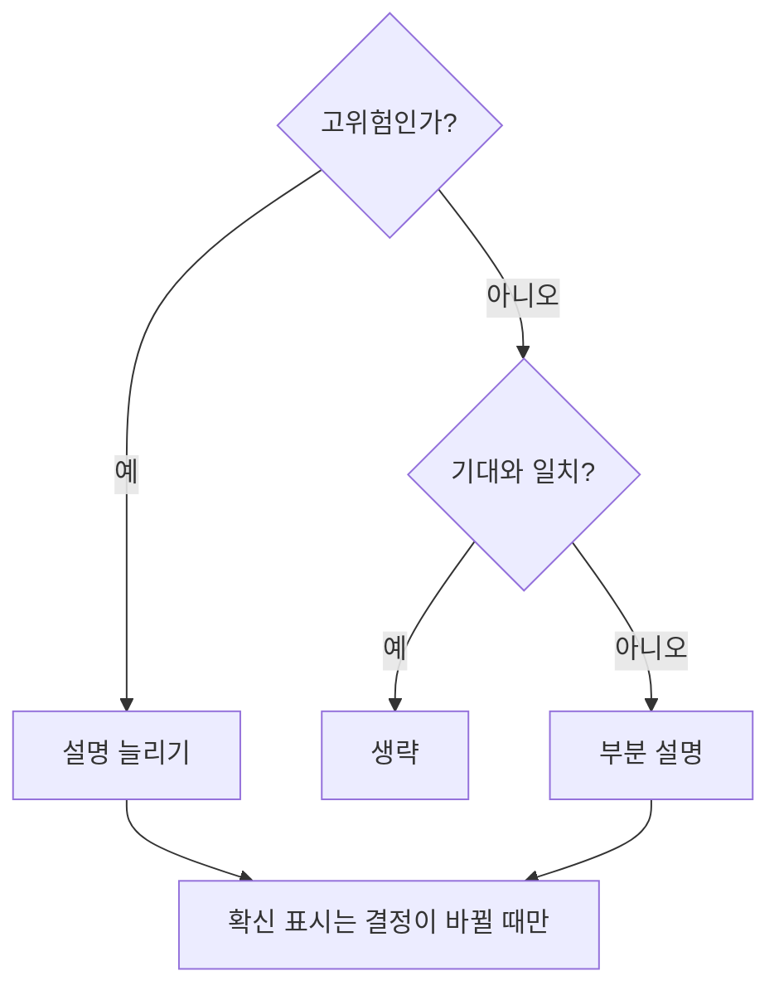
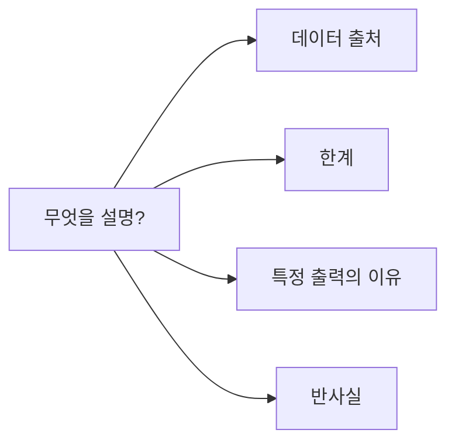

# 설명 가능성 감사

> AI 기능이 사용자에게 보여 주는 설명(언제·무엇을·어떤 형태로)이 사용자 상태와 위험에 맞는지 점검하는 활동. 설명이 많을수록 좋은 게 아니라 "신뢰와 결정에 영향을 주는 부분"만 골라 보여 주는 것이 원칙이다.

## 쉽게 말하면
의사가 환자에게 모든 의학 지식을 늘어놓지 않고 "이 약을 쓰는 이유, 부작용, 확실하지 않은 점"만 짚어 주는 것과 같다. 항목별로 "이 설명이 꼭 필요한가"를 체크한다.

## 자세히
Google PAIR 가이드북의 Explainability + Trust 챕터(열람)를 감사 점검표로 옮긴 것이다.
- **언제 설명하나**: 사용자 행동에 대한 응답으로(즉각 피드백이 인과를 가장 빨리 가르친다), 중요한 일에 의존해야 하는 고위험 상황에서 더 많이. 기대와 맞아 방해만 되는 경우는 생략.
- **무엇을 설명하나**: 데이터 출처(개인용인지 집계인지, 삭제·초기화 가능한지), 한계(데이터 부족 시 사용자 판단 요청), 전체 시스템 개요, 특정 출력의 이유, 다른 결정이 안 나온 이유(반사실).
- **형태**: 부분 설명이 대체로 최선. 확신 표시는 범주 라벨·대안 결과(N-best)·숫자·시각화가 있으며 숫자는 맥락이 없으면 퍼센트를 오해한다. 비슷한 학습 예시를 보이는 예시 기반, "만약" 시나리오를 시험하는 상호작용형도 있다.
- **신뢰 보정**: 시스템의 실제 능력에 맞는 신뢰를 목표로 하고, 초기에 온보딩으로 기대를 정하며, 자동화는 신뢰가 쌓이는 만큼 단계적으로 늘린다. 오류 뒤에는 무슨 일이 있었고 어떻게 처리·개선할지 설명한다.
- **확신 표시 조건**: 사용자 결정을 바꿀 때만, 경험이 적은 사용자를 오도하지 않을 때만. 다양한 사용자로 시험한다.
- **한계**: 예측별 설명이 신뢰 보정에 도움이 안 됐다는 연구도 있다(앞서 [신뢰 보정](#trust-calibration)). 가이드북은 실무 지침이지 효과를 입증한 연구가 아니다.

## 그림으로 보기

## 예시
- 추천 영상: "최근 본 영상 때문에 추천됨"(특정 출력 이유) + "시청 기록 삭제" 링크(데이터 통제).
- 교육 실습: 자기 AI 기능 화면 3개에서 위 5가지 설명 항목이 있는지 표로 점검.

## 헷갈리는 것과 비교
| 개념 | 차이 |
|---|---|
| 설명 가능성 감사 | 보여 줄 설명의 적합성 점검 |
| [오류 감사](#errors-audit) | 어떤 오류가 나는지 점검 |
| [통제 감사](#controls-audit) | 사용자가 조절할 수 있는 정도 점검 |
| [신뢰 보정](#trust-calibration) | 설명이 지향하는 목표 |

## 더 읽을거리
- [PAIR: Explainability + Trust](https://pair.withgoogle.com/chapter/explainability-trust/) — 언제·무엇을·어떻게 설명할지(열람)
