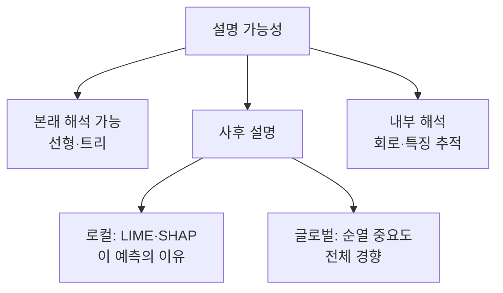
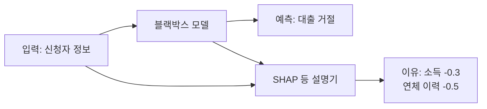

# 설명 가능성(Explainability)

> AI가 왜 그런 판단을 했는지 사람이 이해할 수 있는 형태로 보여 주는 기법과 성질. 대출 거절 이유 같은 개별 판단의 근거를 대는 일부터, 모델 내부 회로를 들여다보는 연구까지 포함한다.

## 쉽게 말하면
의사가 "약을 먹으세요"라고만 하면 불안하다. "혈압 수치와 가족력 때문에"라고 이유를 말해 주면 믿고 따르거나 반박할 수 있다. 설명 가능성은 AI에게도 이유를 요구하는 것이다. 다만 AI가 내놓는 이유가 진짜 계산 과정과 같다는 보장은 없어서, 이유가 실제 내부 작동과 맞는지(충실성)를 따로 확인해야 한다.

## 자세히
**두 갈래**
- **본래부터 해석 가능한 모델**: 선형 회귀, 결정 트리처럼 구조 자체가 읽히는 모델(Molnar, Interpretable Machine Learning). 규제가 엄한 금융·의료에서 선호된다.
- **사후(post-hoc) 설명**: 이미 만든 블랙박스를 밖에서 분석. 모델 종류와 무관한(model-agnostic) 방법이 많다.

**범위**: 개별 예측을 설명하는 **로컬** 설명 vs 모델 전반의 특성-예측 관계를 보여 주는 **글로벌** 설명.

**대표 기법**
- **LIME**(2016, Ribeiro·Singh·Guestrin): 설명할 입력 주변에서 단순한 모델을 학습해 "그 예측 근처에서의" 행동을 근사. 텍스트·이미지 분류기에 적용.
- **SHAP**(2017, Lundberg·Lee): 예측마다 각 특성에 중요도 값을 배정하는 통합 틀. 여섯 가지 기존 방법을 하나의 클래스로 묶고 바람직한 성질을 갖는 유일한 해가 있다고 주장([Shapley 값](#shapley-values) 기반).
- **순열 중요도**: 특성 값을 섞었을 때 성능이 얼마나 떨어지는지로 중요도를 잰다.

**LLM 시대: 기계적 해석 가능성**: Anthropic은 Claude 3.5 Haiku 내부를 "AI 현미경"으로 추적했다(2025). 시에서 끝 운율 단어를 미리 정해 두고 줄을 쓴다는 계획 증거, 여러 언어에서 같은 개념 특징이 공유되는 점(모델이 클수록 비율 증가), 어려운 계산에서는 풀었다고 말하지만 실제 계산 흔적이 없고 힌트가 있으면 정답에서 거꾸로 추론하는 "동기화된 추론"이 관찰되었다. 단, 짧은 프롬프트 하나를 추적하는 데도 사람 몇 시간이 걸리고 계산의 일부만 포착한다고 저자들이 밝힌다.

**주의**: 사후 설명은 그럴듯한 이야기일 수 있다. [사고 사슬(CoT)](#chain-of-thought) 설명도 실제 내부 과정을 반영하지 않을 수 있다.

## 그림으로 보기

## 예시
- 은행: 대출 거절 시 상위 3개 요인(연체, 소득 대비 부채 등)을 고객에게 알려야 하는 규정을 SHAP 값으로 충족한다.
- 챗봇 점검: CoT 설명이 그럴듯해도 정답은 우연일 수 있으니, 근거 자료 인용·재현 실험으로 확인한다.

## 헷갈리는 것과 비교
| 개념 | 차이 |
|---|---|
| [해석 가능성](#interpretability) | 모델 구조·내부를 이해하는 쪽에 가까움. 설명 가능성은 사람에게 이유를 전달하는 쪽 |
| LIME vs SHAP | LIME은 주변을 단순 모델로 근사, SHAP은 Shapley 값 기반으로 특성 기여를 배분 |
| [기계적 해석 가능성](#mechanistic-interpretability) | 내부 회로를 직접 추적 |
| [사고 사슬](#chain-of-thought) | 모델이 써 준 추론 과정. 실제 내부 계산과 다를 수 있음 |

## 더 읽을거리
- [Interpretable Machine Learning (Molnar)](https://christophm.github.io/interpretable-ml-book/) — 해석 가능한 모델과 LIME·Shapley·순열 중요도
- [LIME (arXiv 1602.04938)](https://arxiv.org/abs/1602.04938) — 로컬 설명 원 논문
- [SHAP (arXiv 1705.07874)](https://arxiv.org/abs/1705.07874) — 통합 특성 중요도 틀
- [Tracing the thoughts of a large language model (Anthropic)](https://www.anthropic.com/research/tracing-thoughts-language-model) — LLM 내부 회로 추적 결과
