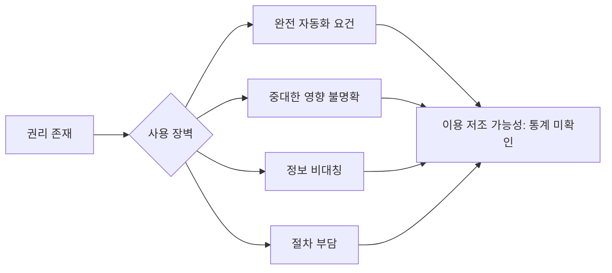

# 설명요구 이용 현황

> 한국에서 자동화평가 설명요구·이의제기 권리가 실제로 얼마나 쓰이는지에 관한 노드. 이번 조사에서는 공식 통계를 찾지 못했고, 권리가 잘 쓰이기 어려운 제도상 요인만 확인됐다.

## 쉽게 말하면
권리가 법에 있어도 사람들이 모르거나 쓰기 어렵다면 소용이 적다. "쓰는 사람이 얼마나 되나"는 제도의 실효성을 보는 질문이다.

## 자세히
- **통계**: 검색에서 2022~2024년 자동화평가 설명요구·이의제기 접수 건수를 따로 집계한 금융감독원·신용정보원·금융위 자료를 찾지 못했다. 금융사 민원 통계는 일반 민원 집계라 이 권리를 분리하지 않는다. 이 노드의 이전 요약 "권리 사용이 줄어드는 이유"는 확인된 사실이 아니므로 확정 표현을 쓰지 않는다.
- **제도상 이용 장벽(해설 기사 추론, 법률신문 기사 확인)**: ① "완전히 자동화된" 결정에만 적용되어 사람 개입이 조금이라도 있으면 거부권 주장이 어려움 ② 동의·법률·계약 이행 예외 ③ "중대한 영향" 기준이 불명확 ④ 정보 비대칭(자동화 결정 사실을 알아야 행사 가능). 기사는 이것이 실제 이용 감소의 원인이라고 단정하지는 않는다.
- **신용정보법 쪽 실무**: 금융사들이 설명요구서·재산출요청서 양식을 공개하고 있어 절차는 있다([신용정보법 36조의2](#credit-info-act-36-2)).
- **확인 방법**: 금융감독원 보도자료·공시, 신용정보원 연차보고서, 국회·금융위 개정 자료, 개인정보보호위원회 통계.

## 그림으로 보기

## 예시
- 금융사가 거절 통지서에 설명요구 방법(양식 링크·연락처)을 함께 안내하면 접근성이 올라가는지 시범 측정(제안).
- 연구 설계: 거절 통지 대상자 중 권리 인지율, 행사율, 처리 기간을 조사.

## 헷갈리는 것과 비교
| 개념 | 차이 |
|---|---|
| 권리 존재 | 법 조문 |
| 권리 이용 | 실제 행사 건수 |
| [PIPA 대응권](#pipa-automated-decision) | 일반법의 권리 |

## 더 읽을거리
- [법률신문 해설](https://www.lawtimes.co.kr/news/articleView.html?idxno=194236) — 제도 구조와 한계(통계는 없음)
