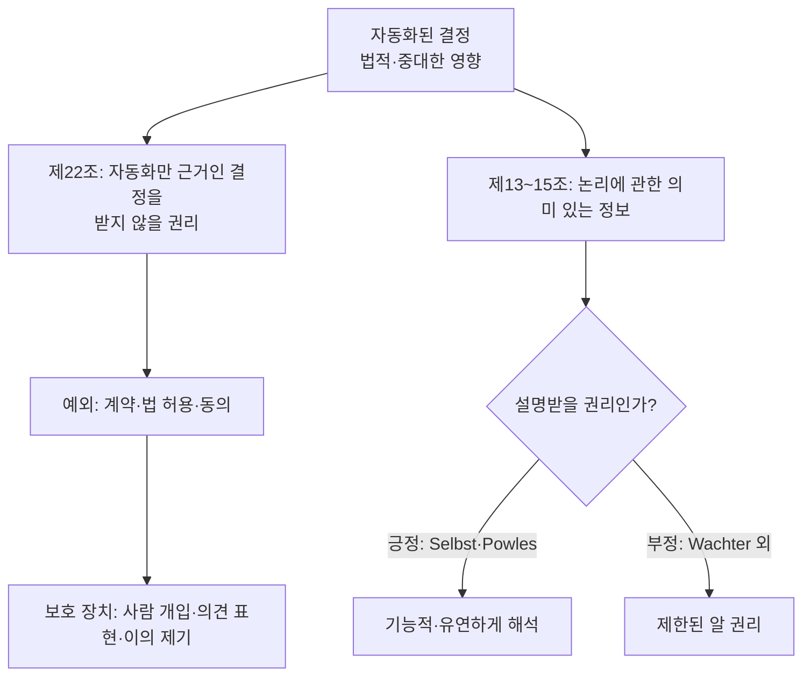

# GDPR 설명받을 권리 논쟁

> EU 개인정보 보호법(GDPR)이 자동화된 결정에 대해 "설명받을 권리"를 주는지에 대한 법학 논쟁. 조문에는 그 말이 없고, 학자들은 제22조·제13~15조·전문 71항을 근거로 정반대로 해석한다. (법률 자문 아님)

## 쉽게 말하면
"AI가 내 대출을 거절한 이유를 설명해 달라고 법적으로 요구할 수 있나?"라는 질문이다. 어떤 학자는 "'논리에 관한 의미 있는 정보'를 받을 권리가 사실상 설명받을 권리"라고 하고, 다른 학자는 "그건 제한된 정보 제공 권리일 뿐 개별 결정에 대한 설명권은 없다"고 한다.

## 자세히
출처: GDPR 제22조(gdpr-info.eu, 열어서 읽음), Selbst·Powles, International Data Privacy Law 2017(OUP 페이지 열어서 읽음), 검색 결과(Wachter·Mittelstadt·Floridi 논문 정보는 SSRN 초록 수준, 본문 미열람).
- **제22조(조문)**: ① 법적 또는 이에 준하는 중대한 영향을 주는, **프로파일링을 포함해 오로지 자동화된 처리에만 근거한 결정**을 받지 않을 권리. ② 계약 이행에 필요하거나 EU·회원국 법이 적절한 보호 장치와 함께 허용하거나 명시적 동의에 근거하면 적용되지 않는다. ③ 계약·동의의 경우 컨트롤러는 **사람의 개입을 얻을 권리**, 자기 견해를 표현하고 결정에 **이의를 제기할 권리** 등 적절한 보호 장치를 제공해야 한다.
- **설명권 부정 쪽**: Wachter·Mittelstadt·Floridi(International Data Privacy Law 2017)는 GDPR이 현재 형태로는 설명받을 권리를 구현하지 않고 **제한된 "알 권리(right to be informed)"**만 있다고 주장한다. 근거 후보로 ① 제22조와 전문 71항, ② 제13~14조 고지 의무, ③ 제15조 접근권을 검토했다(검색 요약, 본문 미확인).
- **설명권 긍정 쪽**: Selbst·Powles는 제13~15조가 요구하는 **"관련 논리에 관한 의미 있는 정보"**가 이름만 없을 뿐 설명받을 권리의 근거라고 본다. "의미 있음"은 전문가가 아닌 정보 주체의 관점에서, 기능적·유연하게 해석한다. 제22조와 전문 71항이 이를 뒷받침하며, 전문은 비구속이지만 해석에 영향을 준다. 영업 비밀이 권리를 자동으로 무력화하지 않는다고도 주장한다.
- **쟁점**: 시스템 기능 설명과 개별 결정 설명, 사전(ex ante)과 사후(ex post) 설명의 구분. Selbst·Powles는 이 구분이 결정론적 모델에선 성립하지 않는다고 비판한다.
- **한계**: 두 입장 모두 법적 요구를 논하며 기술적 가능성은 따로 다룬다. 제22조의 적용 범위(오로지 자동화)가 모호하다는 점도 남는다. 최신 판례·EU AI 법과의 관계는 이번에 확인하지 못했다.
- **기술과의 연결**: 개별 결정의 지역 설명, 반사실 설명이 이 요구를 충족하는지 논의된다(해설).

## 그림으로 보기

## 예시
- 신용 평가 자동 거절: 제22조상 사람 개입과 이의 제기 보호 장치가 필요한지, 어떤 정보를 줘야 하는지가 쟁점.
- 실무 대응: 결정의 주요 요인, 데이터 출처, 이의 제기 절차를 안내문에 담는 것이 보수적 설계.

## 헷갈리는 것과 비교
| 개념 | 차이 |
|---|---|
| 설명받을 권리 | 해석상 논쟁, 조문에 이름 없음 |
| 사람 개입을 얻을 권리 | 제22조 ③ 보호 장치(조문에 명시) |
| [반사실 설명](#counterfactual-explanation) | 설명 방식의 하나 |
| [실행 가능한 구제](#actionable-recourse) | 설명이 실제 행동 가능성으로 이어지는 문제 |

## 더 읽을거리
- [Article 22 GDPR (gdpr-info.eu)](https://gdpr-info.eu/art-22-gdpr/) — 제22조 조문(열어서 확인)
- [Selbst·Powles, "Meaningful information and the right to explanation" (IDPL 2017)](https://academic.oup.com/idpl/article/7/4/233/4762325) — 설명권 긍정 논거(열어서 확인)
- [Wachter·Mittelstadt·Floridi (SSRN 2903469)](https://papers.ssrn.com/abstract=2903469) — 설명권 부정 논거(검색 결과로만 확인)
