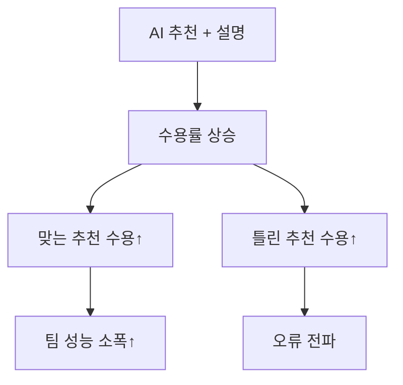

# 설명이 과신을 부르는 문제

> AI의 추천에 설명을 붙이면 사용자가 추천을 더 쉽게 받아들이는데, 맞는 추천과 틀린 추천을 모두 더 받아들여 팀 성능은 늘지 않을 수 있다.

## 쉽게 말하면
"왜냐하면…"이 붙으면 그럴듯하게 들려서 맞는지 따지지 않고 믿게 된다. 이유가 있어 보이는 것과 이유가 맞는 것은 다르다.

## 자세히
- **Bansal 외(CHI 2021, arXiv 2006.14779, 초록 확인)**: 사람-AI 팀이 각자보다 더 잘하는 "보완적 팀 성능"을 세 데이터셋에서 혼합 방법 사용자 연구로 검사. AI 정확도는 사람과 비슷했다. 결과: AI가 도우면 팀이 개선됐지만 설명이 그 개선을 키우지 않았다. 설명은 AI 추천이 맞든 틀리든 수용 가능성을 높였다. 저자들은 적절한 신뢰를 키우는 설명 방식을 요구한다.
- **Buçinca 외(2021)**: 설명이 과의존을 해결하지 못하고 악화시킬 수 있으며, 사람들은 개별 설명을 분석적으로 따지지 않고 어림 규칙을 쓴다([인지적 강제 장치](#cognitive-forcing-function)).
- **설계 시사점**: 설명을 많이 주는 것이 목표가 아니다. 설명이 오류 발견을 돕는지(틀린 추천에서 사용자가 반박하는지)로 평가해야 한다. 정답·오답 건 각각의 수용률을 따로 측정한다.
- 한 연구 결과는 그 실험 조건(과제, AI 정확도, 사용자 집단)에서의 결과이며 모든 설명 방식에 일반화되지는 않는다.

## 그림으로 보기

## 예시
- 평가 지표: 설명이 있는 그룹/없는 그룹에서 (맞는 추천 수용률, 틀린 추천 수용률)을 각각 측정해 틀린 추천의 수용률이 오르면 설계를 바꾼다.
- 대안 설명: 근거를 보여 주되 반대 근거·불확실성도 함께 제시.

## 헷갈리는 것과 비교
| 개념 | 차이 |
|---|---|
| 설명 | 이유 제시, 과신 유발 가능 |
| [근거 일치도 표시](#evidence-agreement-score) | 검증 가능한 증거 연결 |
| [AI 확신도 표시](#ai-confidence-display) | 불확실성 표시 |

## 더 읽을거리
- [Does the Whole Exceed its Parts?](https://arxiv.org/abs/2006.14779) — 설명이 수용을 높이는 연구(초록 확인)
- [To Trust or to Think](https://arxiv.org/abs/2102.09692) — 설명과 과의존
