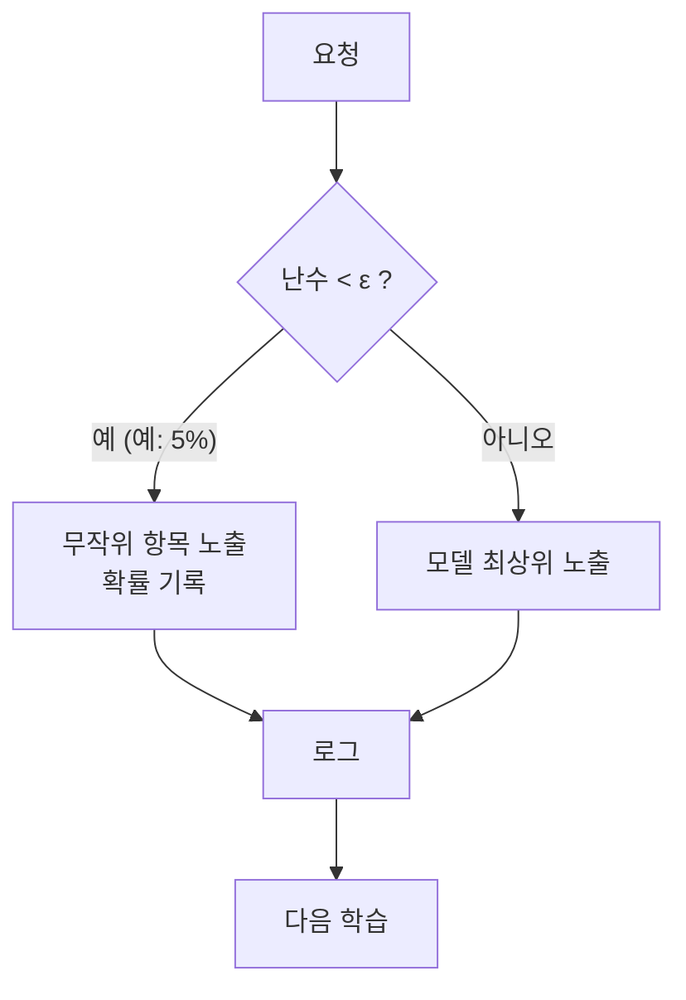
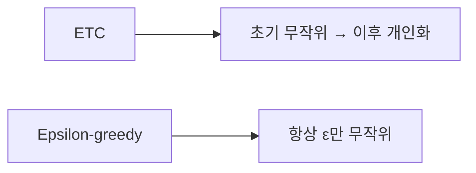

# 탐색용 무작위화

> 전체 트래픽 중 **일부에는 모델의 판단과 상관없이 무작위로 항목을 보여 주어**, 모델이 스스로 만든 편향에서 벗어난 학습·평가용 데이터를 확보하는 방법이다. 대표 방식이 epsilon-greedy와 explore-then-commit이다.

## 쉽게 말하면
단골 메뉴만 추천하는 점원은 새 메뉴가 맛있는지 영영 알 수 없다. 열 번에 한 번은 아무 메뉴나 권해 보는 것이 탐색용 무작위화다. 그 한 번의 손님 반응 덕분에 "새 메뉴도 인기 있다"는 사실을 데이터로 얻는다. 대신 그 한 번은 최선의 추천이 아니므로 비용이 든다.

## 자세히
(NIPS 2015 논문과 Netflix 연구진의 arXiv 2506.03324 도입부를 직접 읽었다.)
- **배경**: Sculley 외(2015)는 [직접 피드백 고리](#direct-feedback-loop)의 완화책으로 "약간의 무작위화"를 든다. 그러면 모델이 고른 노출만 학습되는 편향이 줄어든다.
- **두 대표 전략(Che·Ceylan·McInerney·Kallus, 2025-06, Netflix·Columbia·Cornell)**:
  - **Explore-then-commit(ETC)**: 처음 일정 기간 전체 사용자에게 무작위 배정한 뒤 완전 개인화 정책으로 전환.
  - **Epsilon-greedy**: 늘 일정 비율(ε)의 트래픽만 무작위 항목에 배정하고 나머지는 현재 ML 정책을 사용. 단순하고 어떤 블랙박스 모델과도 호환되어 실서비스에서 흔하다.
- **핵심 질문은 비율**: 트래픽의 몇 %를 무작위로 돌리고 시간에 따라 어떻게 바꿀지. 현실 제약: 배치 갱신(예: 매일 모델 갱신), 변하는 트래픽, 짧은 기간(신규 콘텐츠는 1~2주), 반사실 평가를 위한 최소 탐색량. 이 논문은 베이지안 후회를 SGD로 최소화해 탐색 일정을 정하고 MPC로 조정하는 틀을 제안하며, 실험에서 배치 크기 변화가 최적 전략에 큰 영향을 준다고 보고한다(논문 주장, 본문 실험은 읽지 않았다).
- **로그에 확률을 같이 기록**: 무작위 노출 결과로 정책을 평가하려면 각 노출의 선택 확률(propensity)이 필요하다. epsilon-greedy라면 최상위 항목은 1−ε, 나머지는 ε/후보 수라는 식이다(검색 요약 확인). 비균등이면 중요도 가중이 필요하고, 행동 공간이 크면 확률이 작아 분산이 커진다(특허·논문 요약, 원문 미확인).
- **비용·위험**: 무작위 노출 사용자는 덜 좋은 추천을 받는다. 위험한 도메인(의료·금융)에서는 안전한 후보 집합 안에서만 무작위화한다(일반 원칙).

## 그림으로 보기

## 예시
- 새 영화 공개: 첫 1~2주에 무작위 노출 비율을 높였다가 줄이는 일정(Netflix 논문의 문제 설정).
- 교육 소재: "새 메뉴를 가끔 권해 봐야 하는 이유"로 탐색·활용 균형을 설명.

## 헷갈리는 것과 비교
| 개념 | 차이 |
|---|---|
| 탐색용 무작위화 | 일부 트래픽을 모델과 무관하게 노출 |
| [컨텍스추얼 밴딧](#contextual-bandit) | 상황을 보고 탐색을 똑똑하게 배분하는 알고리즘 |
| [직접 피드백 고리](#direct-feedback-loop) | 이 기법이 막으려는 문제 |
| [모델 비영향 홀드아웃](#holdout-group-no-model) | 평가용 비교 그룹 유지 |

## 더 읽을거리
- [Optimization of Epsilon-Greedy Exploration (arXiv 2506.03324)](https://arxiv.org/pdf/2506.03324) — ETC·epsilon-greedy와 탐색 비율 문제(도입부 직접 읽음).
- [Hidden Technical Debt in ML Systems (NIPS 2015)](https://proceedings.neurips.cc/paper/2015/file/86df7dcfd896fcaf2674f757a2463eba-Paper.pdf) — 무작위화·격리 완화책.
