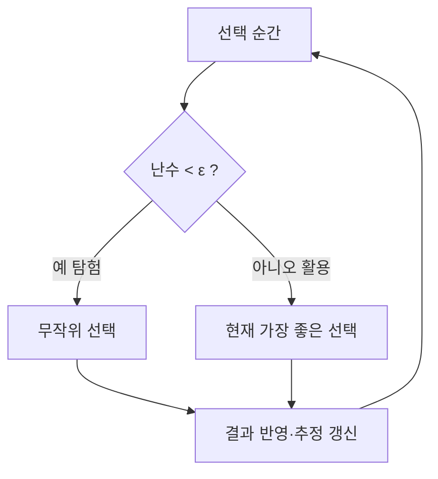
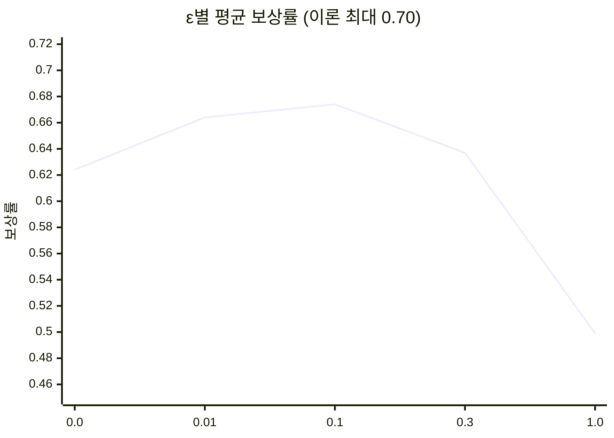

# 탐험과 활용

> 선택지의 좋고 나쁨을 **아직 모를 때**, **지금까지 가장 좋아 보이는 것을 고를지(활용)**, **다른 것을 시험해 더 알아볼지(탐험)** 사이의 균형 문제. 너무 활용만 하면 더 좋은 선택을 놓치고, 너무 탐험만 하면 좋은 선택을 충분히 못 쓴다. 강화학습, 추천, A/B 테스트의 기본 딜레마다.

## 쉽게 말하면
처음 간 동네에서 점심 식당을 고르는 상황이다. 맛있었던 곳만 계속 가면(활용) 더 맛있는 집을 영영 모를 수 있고, 매번 새 식당만 가면(탐험) 실패가 잦다. 가끔(예: 10번에 1번) 새 가게를 시도하는 것이 현실적인 방법이다.

## 자세히
- **다중 슬롯머신(multi-armed bandit)**: 보상 분포가 일부만 알려진 여러 선택지("팔") 중 반복해서 하나를 고르며 **총 보상을 최대화**(= 최선과의 차이인 **후회 regret 최소화**)하는 문제. 이름은 슬롯머신들 사이에서 고르는 도박꾼에서 왔다(Wikipedia 기준). 적용 예: 임상시험(환자 손실을 줄이며 치료법 시험), 네트워크 경로, 포트폴리오, 그리고 **A/B 테스트·추천 시스템**.
- **ε-탐욕(epsilon-greedy)**: 대부분은 현재 가장 좋은 팔을 고르고, **확률 ε**로 무작위 팔을 고르는 단순한 방법(예: ε=0.1).
- **직접 실행**(numpy: 성공 확률 0.3·0.5·0.7인 팔 3개, 2,000번 선택, 300회 반복 평균):

| ε(탐험 확률) | 평균 보상률 | 최선 팔(0.7) 선택 비율 |
|---|---|---|
| 0.0 (처음 한 번씩만 시도 후 탐욕) | 0.624 | 0.699 |
| 0.01 | 0.664 | 0.846 |
| **0.1** | **0.674** | **0.909** |
| 0.3 | 0.637 | 0.791 |
| 1.0 (항상 무작위) | 0.499 | 0.334 |
| (이론 최대 = 최선 팔 0.7) | 0.700 | — |

  **너무 적어도(ε=0), 너무 많아도(ε=0.3 이상) 손해**였고 ε=0.1 부근이 가장 좋았다. 또 ε=0인 탐욕 전략을 1,000번 시험하면 **약 27.6%** 가 최선이 아닌 팔에 굳어졌다(초기 우연한 결과에 속음). 이 수치는 이 설정의 결과이며, 최적 ε는 문제에 따라 다르다.
- **더 나은 방법들**(이름만): 시간이 갈수록 ε를 줄이기, UCB, 톰슨 샘플링(불확실성이 큰 팔을 더 시도).
- **AI 실무 연결**: 추천(새 콘텐츠를 일부에게 보여 반응 보기), 광고 문구 테스트, 프롬프트 변형 A/B, 강화학습의 정책 탐색. 단, 사용자에게 직접 노출되는 탐험은 **비용(나쁜 경험)** 을 고려한다.
- 한계: 위 시뮬레이션은 팔의 확률이 시간에 따라 변하지 않는 단순 환경이다. 실제 환경은 계속 변해 탐험이 항상 필요하다.

## 그림으로 보기



## 예시
```python
import numpy as np
def choose(n, s, eps, rng):
    if rng.random() < eps or n.min() == 0:
        return rng.integers(len(n))          # 탐험
    return int(np.argmax(s / n))             # 활용
```
- 이메일 제목 3개를 보낼 때: 90%는 지금까지 열람률이 가장 높은 제목, 10%는 나머지를 번갈아 시험.

## 헷갈리는 것과 비교
| 개념 | 차이 |
|---|---|
| 탐험(exploration) | 정보를 얻기 위해 다른 선택 시도 |
| 활용(exploitation) | 아는 최선을 사용해 보상 확보 |
| A/B 테스트 | 정해진 기간 동안 균등 시험(탐험 중심) 후 결정 |
| [시드 골라 쓰기](#seed-cherry-picking) | 결과를 보고 고르는 편향(다른 문제) |

## 더 읽을거리
- [Wikipedia: Multi-armed bandit](https://en.wikipedia.org/wiki/Multi-armed_bandit) — 정의·ε-탐욕·응용.
