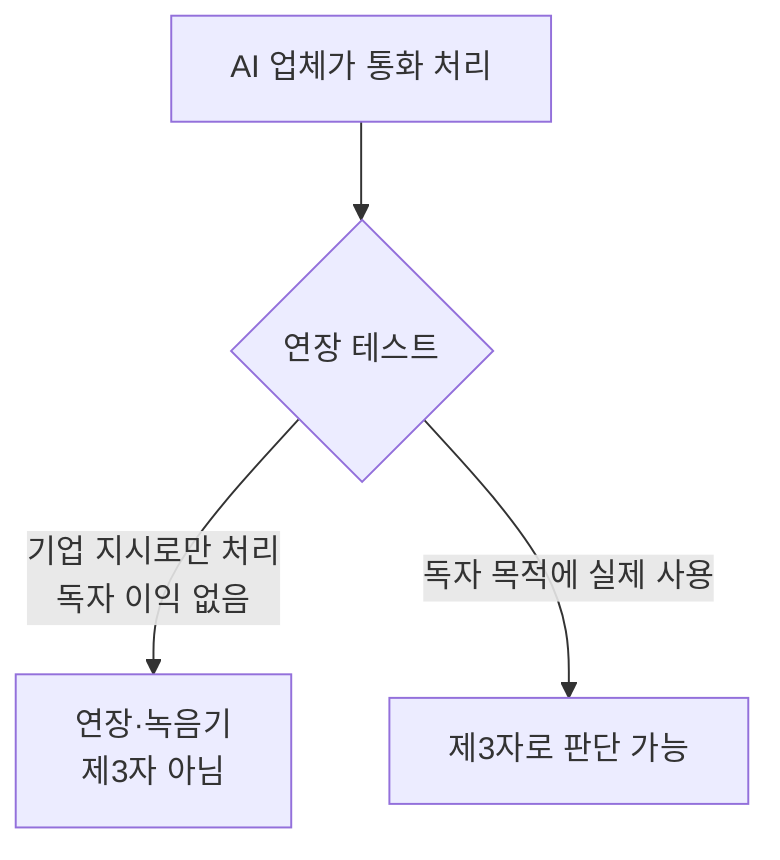
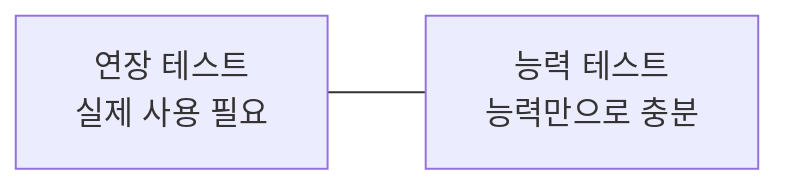

# 연장 테스트

> CIPA §631(a) 소송에서, 소프트웨어 업체가 기업의 "연장(extension)", 즉 녹음기 같은 도구에 불과하면 제3자 도청자가 아니라고 보는 기준. (법률 자문 아님)

## 쉽게 말하면
회사가 통화를 녹음하려고 녹음기를 샀다면, 녹음기는 대화의 제3자가 아니라 회사의 도구다. 연장 테스트는 AI 업체도 같은 도구인지, 아니면 자기 이익을 위해 몰래 듣는 별도 당사자인지를 묻는다.

## 자세히
- **기원**: Graham v. Noom(N.D. Cal. 2021, 533 F. Supp. 3d 823). Goodwin 해설은 제3자 기술 서비스가 통신 데이터를 실제로 받지 않으면 도청이 아니라고 본 사례로 요약한다. 검색에서 본 다른 요약은 업체가 독립 이익을 얻지 않으면 사이트의 연장으로 본 것이라고 설명해, 정확한 요건 표현은 출처마다 다르다(판결문은 열지 못함).
- **쟁점**: 실제 데이터 사용 여부. 일부 법원은 원고가 업체가 독자 목적에 **실제로 썼다**고 주장해야 한다고 본다.
- **반대편**: [능력 테스트](#capability-test)는 쓸 능력만 있으면 족하다. Ambriz v. Google(2025-02)은 Google의 "우리는 녹음기를 제공했을 뿐"이라는 주장을 받아들이지 않고 능력 테스트를 따랐고, Google이 학습에 안 썼다고 해도 소송 초기 단계에서는 충분하다고 봤다(Goodwin 해설).
- **상호 배타 아님**: 두 틀은 배타적이지 않고 언제 어느 쪽을 쓸지 법원마다 갈린다(Epstein Becker 해설). 이 해설은 연장 테스트를 명시 적용한 사건은 따로 거명하지 않았다.
- **방어에 유리한 사실**: 업체가 고객 데이터를 서비스 제공에만 쓰고 학습·자체 분석에 쓰지 않는다는 계약, 데이터 분리·삭제, 고객 지시에 따른 처리. 다만 능력 테스트가 적용되면 이것만으로 안전하지 않다.

## 그림으로 보기

## 예시
- 콜센터 AI가 고객사 통화를 전사만 해서 돌려주고 업체는 보관·학습하지 않는다 → 연장으로 방어 주장 가능.
- 업체 약관이 통화 데이터를 자사 모델 개선에 쓸 수 있게 한다 → 연장 주장이 약해지고 능력 테스트에서는 불리.

## 헷갈리는 것과 비교
| 개념 | 차이 |
|---|---|
| [CIPA 소송](#cipa-lawsuits) | 상위 주제 |
| [능력 테스트](#capability-test) | 능력만으로 제3자, 원고에 유리 |
| 당사자 면제(party exemption) | 자기 대화는 도청이 아니라는 원칙, 연장 주장이 그 근거 |
| [전원 동의](#all-party-consent) | 동의 규칙 자체 |

## 더 읽을거리
- [AI voice products subject to California invasion of privacy claims (Goodwin, 2025-02)](https://www.goodwinlaw.com/en/insights/publications/2025/02/alerts-practices-dpc-ftec-ai-voice-products-subject-to-california-invasion-of-privacy-claims) — Graham 대 Javier, Ambriz의 녹음기 주장 기각(열어서 확인)
- [Eavesdropping by Algorithm (Epstein Becker Green)](https://www.ebglaw.com/insights/publications/eavesdropping-by-algorithm-how-courts-are-applying-decades-old-privacy-laws-to-ai) — 두 틀이 배타적이지 않다는 설명(열어서 확인)
