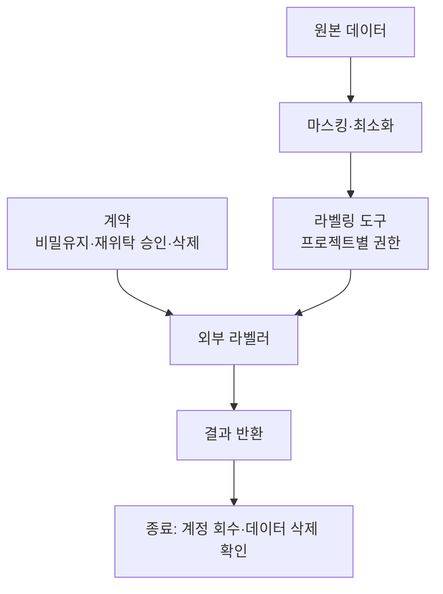
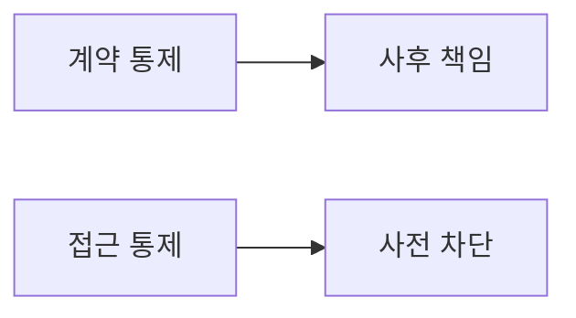

# 외부 라벨러 비밀 유지

> 데이터 라벨링을 외주 업체나 외부 인력에게 맡길 때, **계약(누가 어떤 목적으로만 쓰는가)과 접근 범위(어떤 데이터·프로젝트만 보는가)로** 고객 데이터와 영업 비밀의 유출을 막는 방법이다.

## 쉽게 말하면
이삿짐센터 직원이 집 안을 돌아다니는 것과 비슷하다. 필요한 방만 들어가게 하고, 본 것을 다른 데 쓰지 않겠다는 약속을 서면으로 받고, 끝나면 열쇠를 돌려받는다. 약속(계약)과 출입 통제(권한) 둘 다 있어야 한다.

## 자세히
(GDPR 제28조 원문과 Label Studio 문서·기능 비교표를 직접 열어 확인. 법률 자문이 아니며, 개인정보가 없는 데이터도 계약 구조는 참고할 수 있다.)
- **계약 측(GDPR 제28조 — 개인정보 처리 위탁 때 필수 내용)**: 위탁 계약은 서면(전자 포함, 28조 9항)이며 대상·기간·성격·목적, 개인정보 유형, 정보 주체 범주를 담는다. 수탁자 의무로 (a) 위탁자의 **문서화된 지시에 따라서만** 처리, (b) 처리에 관여하는 인원이 **비밀유지 의무**를 지도록 보장, (c) 제32조 보안 조치 이행, (d) **재위탁(sub-processor)은 사전 서면 승인** 필요(28조 2항)이며 같은 의무를 하위 업체에도 계약으로 부과하고 하위 업체 과실에 대해 원 수탁자가 전적으로 책임(28조 4항), (e)·(f) 정보 주체 요청·침해 통지 지원, (g) 종료 시 **삭제 또는 반환**, (h) 감사 협조가 있다. GDPR 적용 대상이 아니더라도 이 항목은 외주 라벨링 계약 점검표로 쓸 만하다(제안). 한국 개인정보보호법의 위탁 규정은 이 글에서 확인하지 않았다.
- **접근 범위 측(도구 기능)**: Label Studio 기능 비교표(2026-11-22 확인)에서 **프로젝트·워크스페이스 단위 역할 기반 접근 제어(Admin·Manager·Reviewer·Annotator)는 Community Edition에서 ❌**, Starter Cloud와 Enterprise에서 ✅다. "할당된 작업만 보여 주는 라벨러 전용 화면"도 Community는 ❌다. Enterprise 문서는 Manager·Annotator·Reviewer가 워크스페이스·프로젝트에 **멤버로 추가돼야** 볼 수 있다고 설명한다. 즉 오픈소스판으로 외부 인력을 쓰려면 프로젝트마다 별도 인스턴스·계정을 쓰는 식의 우회가 필요하다(제안, 확인 안 됨).
- **운영 체크리스트(제안)**
  1. 비밀유지·목적 제한·재위탁 금지(또는 승인제)·반환/삭제 조항을 계약에 명시
  2. **최소 데이터 원칙**: 개인정보를 마스킹·가명 처리한 뒤 전달([학습 데이터 속 개인정보](#pii-in-training-data))
  3. 계정은 개인별 발급, 프로젝트별 접근, 종료 즉시 비활성화
  4. 다운로드·내보내기 권한 제한, 라벨러 PC가 아닌 **격리된 환경에서만** 접속([라벨링 도구 네트워크 격리](#labeling-tool-network-isolation))
  5. 활동 로그와 정기 감사 권리 확보
  6. 보안 교육·서약서, 퇴사자·계약 종료자 접근 회수 절차
- **한계**: 계약은 사후 책임을 묻는 장치이고, 접근 통제는 사전 차단 장치다. 화면 촬영·구두 유출 같은 인적 위험은 기술만으로 완전히 막지 못한다.

## 그림으로 보기

## 예시
- 고객 문의 3만 건 감정 라벨링을 외주: 이름·연락처를 먼저 마스킹하고, 업체와 재위탁 금지·삭제 확인서 조항을 계약하며, 라벨러별 계정으로 해당 프로젝트만 접근.
- 교육 소재: "AI 데이터 라벨링 외주 체크리스트" 실습 자료로 위 6개 항목을 사용.

## 헷갈리는 것과 비교
| 개념 | 차이 |
|---|---|
| 외부 라벨러 비밀 유지 | 사람·계약·권한 측면 통제 |
| [라벨링 도구 네트워크 격리](#labeling-tool-network-isolation) | 도구의 통신 경로 차단(기술) |
| [자체 호스팅 라벨링과 개인정보](#self-hosted-labeling-privacy) | 전체 틀 |
| [학습 데이터 속 개인정보](#pii-in-training-data) | 데이터 자체의 개인정보 제거 |

## 더 읽을거리
- [GDPR 제28조 Processor](https://gdpr-info.eu/art-28-gdpr/) — 위탁 계약 필수 항목(직접 확인).
- [Label Studio 기능 비교](https://github.com/HumanSignal/label-studio/blob/develop/docs/source/guide/label_studio_compare.md) — Community와 유료 버전의 역할 기반 접근 제어 차이(직접 확인).
- [Label Studio 사용자 관리(Enterprise)](https://github.com/HumanSignal/label-studio/blob/develop/docs/source/guide/manage_users.md) — 역할·멤버 추가 방식(직접 확인).
