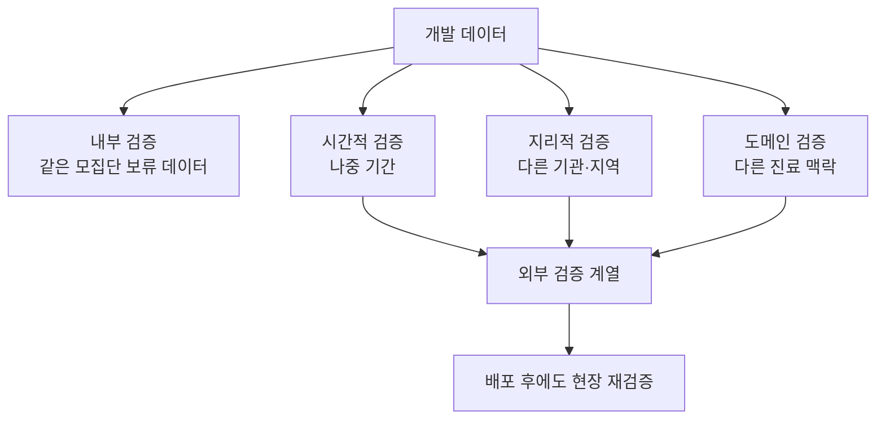

# 외부 검증

> AI 모델을 개발에 쓰지 않은 **다른 시간·다른 병원·다른 환경**의 데이터로 평가해, 개발 데이터 밖에서도 성능이 유지되는지(일반화) 확인하는 검증. 같은 데이터를 나눠 쓰는 내부 검증과 구분된다.

## 쉽게 말하면
학교 모의고사 문제를 외워 푼 학생이 같은 모의고사에서 만점이어도 실제 입시에서 그렇다는 보장은 없다. 외부 검증은 처음 보는 시험지, 다른 시험장에서 점수를 다시 재는 일이다.

## 자세히
출처: de Hond 외, npj Digital Medicine 2023;6:86(열어서 읽음), Youssef 외 arXiv:2305.03219(2023-05, 검색 요약으로만 확인).
- **검증의 종류(de Hond 외 정의)**:
  - **내부 검증**: 개발 데이터와 같은 모집단의 보류 데이터로 평가(교차 검증·부트스트랩 등으로 과대평가 보정). "필요하지만 안전한 임상 적용에는 충분하지 않다."
  - **시간적 검증**: 같은 환경에서 나중 기간의 데이터로 성능이 유지되는지 확인, 데이터 드리프트를 겨냥.
  - **지리적 검증**: 다른 기관·지역에서 일반화되는지 확인. 한 기관씩 빼고 학습·평가(leave-one-site-out)가 한 방법.
  - **도메인 검증**: 다른 진료 맥락(다른 진료과·진료 환경·환자 집단)에서 일반화되는지 확인.
- **권고**: TRIPOD(및 AI 판)를 따르고, 의도한 운영 기간·집단·환경에 맞춰 검증 전략을 정당화하며, 어떤 일반화를 주장하는지와 용도를 밝히고, 일반화 한계를 구현 위험으로 인정한다. 범위상 불필요한 검증 단계는 사유와 함께 적는다.
- **하나의 데이터를 쪼갠 것은 외부가 아니다**: 한 코호트의 무작위 분할을 외부 검증이라 부르면 안 된다는 해설이 있다(2차 자료).
- **현실의 빈도(검색 요약, 미검증)**: 종양학 체계적 문헌고찰에서 예측 모델 연구 287편 중 외부 검증을 한 것은 31%뿐이었다고 한다.
- **반론**: Youssef 외는 외부 검증이 일반화나 임상 유용성을 보장하지 않으며, 환경이 계속 변하므로 배포 전과 이후 **반복적 현장 검증(recurrent local validation)**으로 대체해야 한다고 주장했다(arXiv 초록 수준 확인, 동료심사 여부 확인 못 함).

## 그림으로 보기

## 예시
- 한 대학병원 데이터로 만든 폐렴 판독 AI → 다른 병원·다른 촬영 장비·다른 해 데이터로 성능 확인 후 허가 신청.
- 점검 질문: "검증 데이터가 개발 병원과 겹치지 않는가? 몇 개 기관인가? 시기가 다른가?"

## 헷갈리는 것과 비교
| 개념 | 차이 |
|---|---|
| 내부 검증 | 같은 모집단, 필요조건이지만 일반화는 못 보증 |
| [MRMC 독자 연구](#mrmc-study) | 사람과 함께 쓸 때의 효과, 외부 검증은 데이터 일반화 |
| [임상 검증 근거](#clinical-validation-evidence) | 상위 개념 |
| [외적 타당성](#external-validity) | 결과가 환경 밖에서 통하는 정도라는 개념 |

## 더 읽을거리
- [Perspectives on validation of clinical predictive algorithms (npj Digital Medicine, 2023)](https://pmc.ncbi.nlm.nih.gov/articles/PMC10163568/) — 검증 종류 정의와 권고(열어서 확인)
- [All models are local (arXiv 2305.03219)](https://arxiv.org/pdf/2305.03219) — 반복적 현장 검증 제안(검색으로만 확인)
