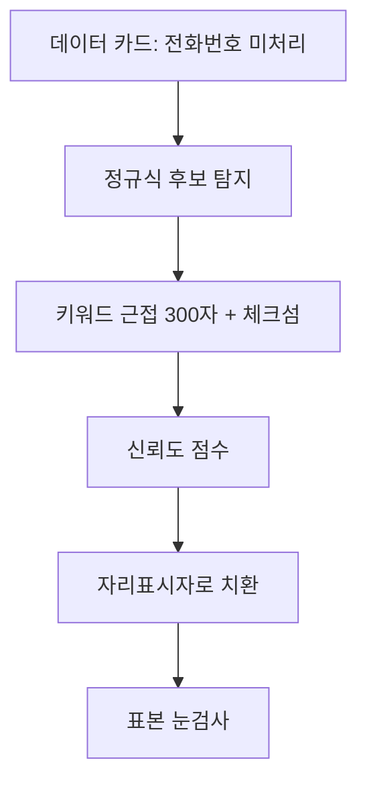
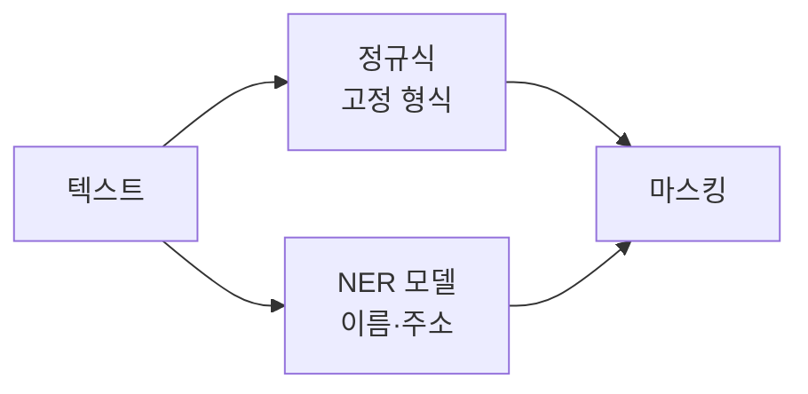

# 추가 PII 단계

> 공개 데이터셋이 처리해 주지 않은 개인정보(예: 전화번호, 한국의 주민등록번호)를 **우리 쪽에서 규칙을 덧붙여 한 번 더 가리는 단계**.

## 쉽게 말하면
이삿짐센터가 "유리병은 포장하지 않았습니다"라고 안내했다면, 유리병은 내가 직접 싸야 한다. 데이터 카드가 "전화번호는 처리하지 않았다"고 적었다면 그 부분은 내 몫이다.

## 자세히
- **왜 필요한가**: FineWeb 카드는 이메일과 공개 IP만 치환하고 전화번호는 오탐이 많아 처리하지 않았다고 밝히며 PII가 남아 있을 가능성이 매우 높다고 경고한다(데이터셋 카드 직접 읽음). 한국어 데이터에는 주민등록번호처럼 지역 고유 형식도 있다.
- **정규식으로 잡을 수 있는 것**: 형식이 고정된 값. 주민등록번호는 YYMMDD 6자리 + 하이픈 + 7자리 13자리다(Microsoft Purview 문서, 직접 읽음). 이름처럼 형식이 없는 정보는 정규식으로 안 되고 개체명 인식(NER) 같은 모델이 필요하다(검색에서 확인한 설명, 본문 미확인).
- **Purview의 신뢰도 방식**(직접 읽음): 패턴 일치만이면 중간 신뢰도(75), 300자 근접 범위 안에 "주민등록번호" 같은 키워드가 함께 있고 체크섬이 통과하면 높은 신뢰도(85)로 구분한다. 문서의 "Checksum: No" 표기와 정의 본문이 서로 어긋나 보이는 부분이 있어, 이 문서만으로 체크섬 사용 여부를 단정하지 않는다.
- **직접 실행한 예(Python 정규식)**:
  - 휴대폰: `(?<!\d)01[016789][- .]?\d{3,4}[- .]?\d{4}(?!\d)` → `010-1234-5678`, `01012345678` 둘 다 탐지.
  - 주민번호 형태: `(?<!\d)(\d{2}(?:0[1-9]|1[0-2])(?:0[1-9]|[12]\d|3[01]))[- ]?([1-8]\d{6})(?!\d)` → `900101-1234568`, `9001011234567` 탐지. 날짜 뒤 7자리(`20240131-1234567`)와 12자리 접수번호는 앞뒤 숫자 검사 덕에 제외됐다.
  - 전통적 검증식(앞 12자리에 2,3,4,5,6,7,8,9,2,3,4,5를 곱해 합산, 11로 나눈 나머지를 11에서 뺀 값의 일의 자리가 13번째 자리)을 적용하니 `900101-1234568`은 통과, `9001011234567`은 불통. 이 값들은 임의로 만든 예시다.
  - 최근 발급·변경 번호는 임의 번호 체계가 적용되어 옛 체크섬과 맞지 않을 수 있다는 보도가 있다(검색 결과 요약, 본문 미확인). 그래서 체크섬 실패를 곧바로 "주민번호 아님"으로 버리지 말고 점수로 반영한다.
- **치환 방식**: 지우기보다 `[PHONE_NUMBER]` 같은 자리표시자로 바꾸면 문장 구조가 유지된다(검색 결과 소개).
- **한계와 법적 주의**: 정규식은 하이픈 없는 표기, 공백 삽입, 부분 마스킹 같은 변형에 취약하다. 주민등록번호는 개인정보 보호법상 엄격한 보호 대상이므로 실제 학습 데이터 구축은 법무 검토가 필요하다(일반 설명).
- 절차(제안): ① 카드에서 미처리 항목 확인 ② 정규식+키워드 근접으로 후보 탐지 ③ 표본 눈검사로 오탐·누락 확인 ④ 치환 후 재검사.

## 그림으로 보기

## 예시
| 원문 | 치환 |
|---|---|
| 연락처 010-1234-5678 | 연락처 [PHONE_NUMBER] |
| 주민번호 900101-1234568 | 주민번호 [RRN] |
| 접수번호 123456789012 | 그대로(12자리라 제외) |
- 업무 장면: 공개 한국어 코퍼스를 교육용 실습에 쓰기 전에, 위 정규식을 돌려 후보 100건을 사람이 확인한다.

## 헷갈리는 것과 비교
| 개념 | 차이 |
|---|---|
| 추가 PII 단계 | 공개 데이터 위에 우리가 더하는 마스킹 |
| [데이터 카드 읽기](#data-card-reading) | 무엇이 미처리인지 아는 단계 |
| [FineWeb 이용 조건](#fineweb-license-terms) | 카드가 밝힌 PII 처리 범위 |
| 비식별화·익명화 | 법적 기준은 별도 검토 필요 |

## 더 읽을거리
- [South Korea resident registration number entity definition (Microsoft Learn)](https://learn.microsoft.com/en-us/purview/sit-defn-south-korea-resident-registration-number) — 형식·신뢰도 정의(직접 읽음).
- [FineWeb 데이터셋 카드](https://huggingface.co/datasets/HuggingFaceFW/fineweb) — PII 처리 범위와 한계(직접 읽음).
