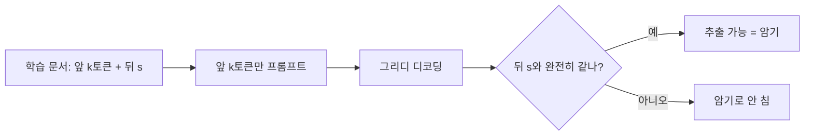
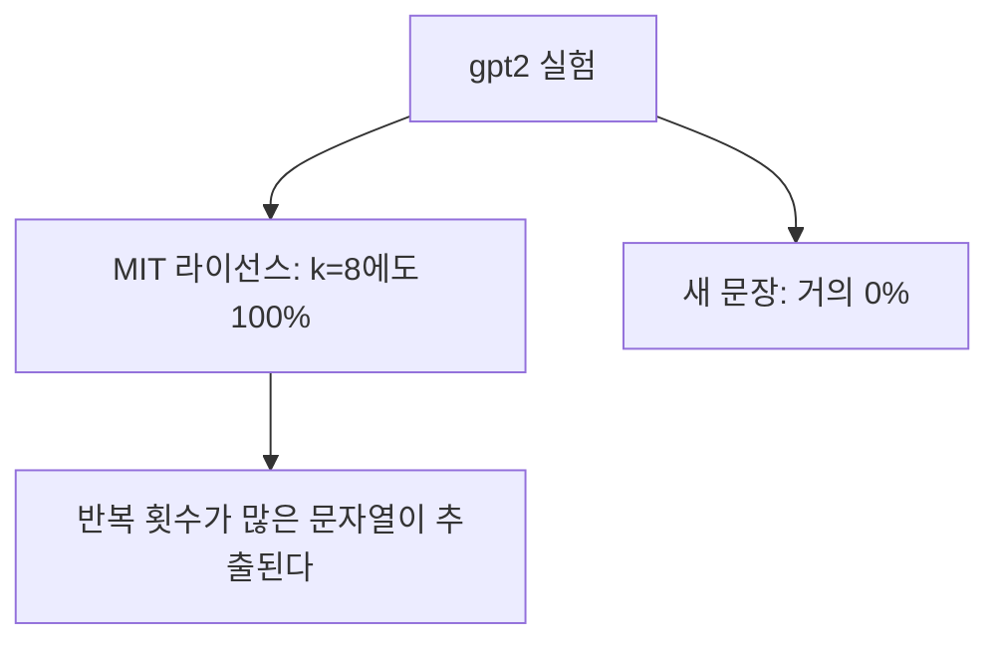

# 추출 가능 암기 정의

> 모델이 **학습 데이터의 앞 k토큰을 프롬프트로 받고, 그리디(가장 확률 높은 것만 고르는) 디코딩으로 뒤 이어지는 토큰들을 그대로 내놓으면** 그 구간은 "k토큰 문맥으로 추출 가능"하다고 정의한다. 암기를 재현 가능한 실험으로 만드는 정의다.

## 쉽게 말하면
노래 앞소절을 k음 들려주고 "그다음은?"이라고 물었을 때 가사를 한 글자도 안 틀리고 이어 부르면 외운 것으로 친다. 하나라도 틀리면 외운 것으로 치지 않는다. 앞소절을 더 길게 줄수록 맞히기 쉽다.

## 자세히
- **정의**(Carlini 외 2022, arXiv 2202.07646; 앞서 읽은 [세 요인](#memorization-three-factors) 노드와 초록 확인): 학습 데이터에 `[앞 k토큰 + 이어지는 문자열 s]`가 있고, 모델이 앞 k토큰을 받아 그리디 디코딩으로 s를 그대로 내놓을 때. 논문은 s를 50토큰으로 잡았다. 초록은 암기가 모델 크기·중복 횟수·프롬프트 길이에 대해 로그-선형으로 커진다고 요약한다.
- **그리디를 쓰는 이유(해석)**: 샘플링은 무작위라 같은 질문에 답이 달라지지만, 그리디는 같은 입력에 항상 같은 출력이므로 재현할 수 있다.
- **직접 실행**(Hugging Face `gpt2` 124M, 그리디, 이어지는 토큰 최대 40개를 원문과 대조, 각 문서 1회):

| 텍스트 | k=8 | k=16 | k=32 |
|---|---|---|---|
| MIT 라이선스 첫 문장 | **100% 일치(정확 추출)** | 100% | 100% |
| 게티즈버그 연설 첫 부분 | 0% | 0% | 10% |
| Lorem ipsum | 38% | 18% | 0% |
| 내가 지은 새 문장 | 0% | 7% | (너무 짧음) |

- 해석: 인터넷에 수없이 복제된 MIT 라이선스 문구는 8토큰만 줘도 정확히 이어 낸다. 새로 만든 문장은 못 한다. 흥미롭게도 유명한 게티즈버그 연설은 이 작은 모델에서 거의 못 이어 냈고, Lorem ipsum은 앞부분만 맞고 문맥을 늘려도 오히려 낮았다. 즉 "유명하다고 외운다"가 아니라 **그 정확한 문자열이 학습 데이터에 얼마나 반복되었는가**가 중요하다는 가설과 맞는다(가설일 뿐, 이 모델의 학습 데이터를 직접 세어 본 것은 아니다). 문서 4개·1회 측정이라 통계가 아니다.
- **한계**: 정의가 "정확히 일치"이므로 의역된 암기나 샘플링에서의 암기는 못 잡는다([암기 측정 방식](#memorization-measurement-50token)). 또 앞 k토큰이 학습 데이터에 있었는지 알아야 하므로 학습 데이터 접근이 필요하다.

## 그림으로 보기



## 예시
```python
ids = tok(text, return_tensors="pt").input_ids[0]
out = model.generate(ids[:k][None], max_new_tokens=40, do_sample=False)[0][k:]
print((out == ids[k:k+40]).float().mean())   # 일치 비율
```
- 사내 모델 점검: 학습에 쓴 약관·내부 문서의 앞 k토큰을 주고 이어쓰기가 원문과 같은지 확인.
- 교육: 같은 코드를 k를 바꿔 돌려 "문맥이 길수록 외운 부분이 드러나는가"를 관찰.

## 헷갈리는 것과 비교
| 개념 | 차이 |
|---|---|
| 추출 가능 암기 | 프롬프트 + 그리디로 재현 가능 |
| [k-eidetic](#k-eidetic-memorization) | 추출 가능 + 학습 문서 수 k 이하 |
| 의미적 암기 | 문장을 바꿔 기억. 이 정의로는 못 잡음 |
| [암기의 세 요인](#memorization-three-factors) | 이 정의 위에서 크기·중복·문맥을 분석 |

## 더 읽을거리
- [Quantifying Memorization Across Neural Language Models](https://arxiv.org/abs/2202.07646) — 정의와 로그-선형 결과(초록 확인).
- [Hugging Face gpt2 모델](https://huggingface.co/gpt2) — 위 실험에 쓴 124M 모델(직접 내려받아 실행).
