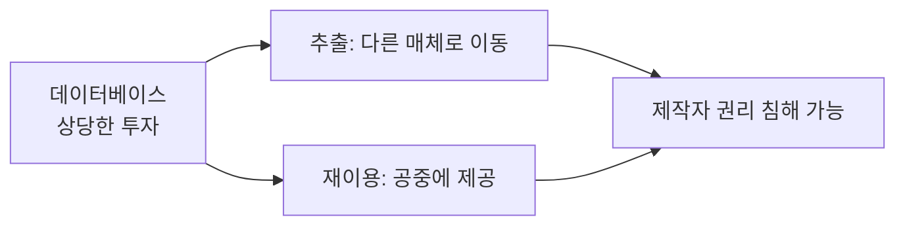
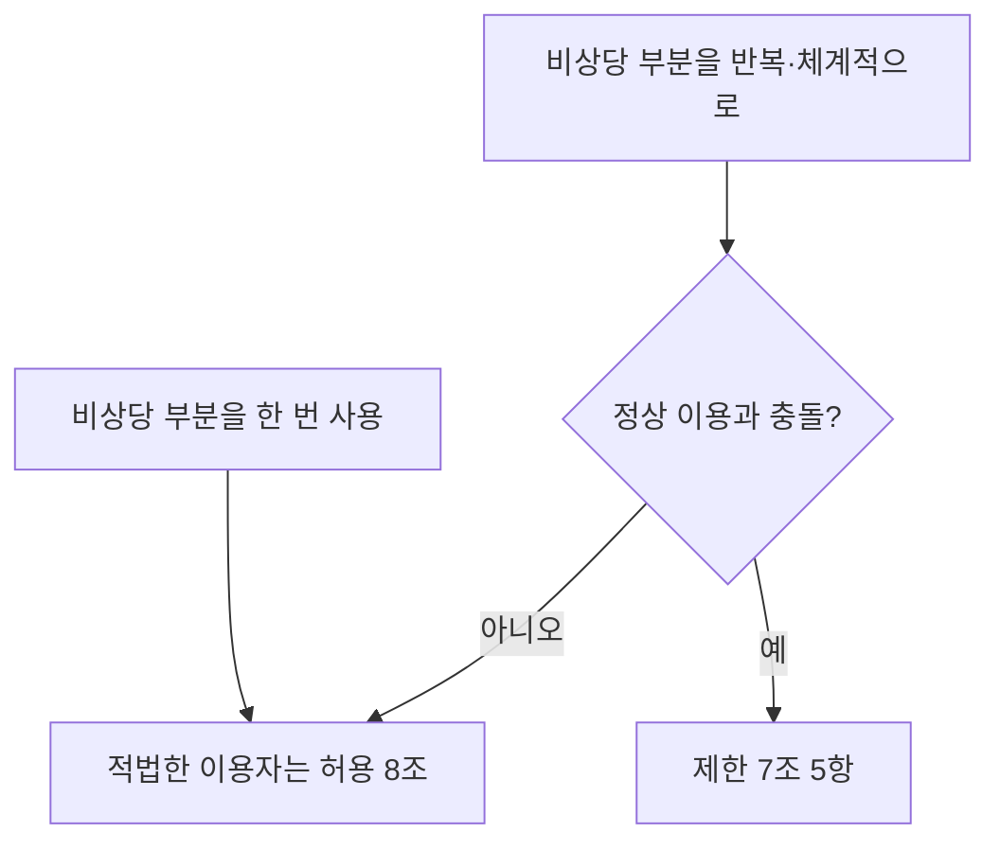

# 추출과 재이용 (extraction · re-utilization)

> EU 데이터베이스 지침(96/9/EC)의 독자적(sui generis) 권리가 막는 두 가지 핵심 행위. **추출**은 내용의 전부·상당 부분을 다른 매체로 옮기는 것, **재이용**은 그 내용을 공중에게 제공하는 것이다. (법률 자문이 아니라 조문 요약이다.)

## 쉽게 말하면
도서관 카탈로그를 통째로 복사해 내 서재로 옮기는 것이 "추출", 그걸 내 웹사이트에 올려 모두가 보게 하는 것이 "재이용"이다. 한두 줄 베끼는 정도는 대체로 문제가 없지만, 조금씩 체계적으로 계속 가져가면 문제가 될 수 있다.

## 자세히
(법령 사이트 legislation.gov.uk의 지침 96/9/EC 제3장, 2019-06-06 개정본을 직접 읽음)
- **보호 대상(7조 1항)**: 내용의 취득·검증·표현에 대한 **상당한 투자**를 한 제작자에게, 내용의 상당 부분의 추출·재이용을 막을 권리를 준다. 저작물의 창작성이 아니라 투자를 보호한다.
- **추출(7조 2항 가)**: 데이터베이스 내용의 전부 또는 상당 부분을 **영구적이든 일시적이든 다른 매체로 옮기는 것**.
- **재이용(7조 2항 나)**: 내용의 전부 또는 상당 부분을 공중에 제공하는 모든 형태.
- **반복적·체계적 추출(7조 5항)**: "비상당" 부분이라도 반복·체계적으로 가져가 데이터베이스의 정상적 이용과 충돌하거나 제작자의 정당한 이익을 부당하게 해치면 제한된다.
- **적법한 이용자(8조 1항)**: 제작자는 적법한 이용자가 내용의 비상당 부분을 추출·재이용하는 것을 막을 수 없다.
- **존속기간(10조)**: 완성 시점이 속한 해의 다음 해 1월 1일부터 15년. 일부가 공중에 공개됐다면 최초 공개 시점 기준으로 계산한다(10조 2항).
- **AI 데이터에서의 의미(일반 설명, 판단은 법무 몫)**: 크롤링·스크레이핑으로 데이터베이스를 대량 복사하는 일은 "추출"에 해당할 수 있다. 어떤 데이터가 "데이터베이스"인지, 학습이 추출인지 등은 국가·사건에 따라 달라 이 글에서 결론을 내리지 않는다. 지침 조문은 EU 법이라서 한국에는 직접 적용되지 않는다.
- 참고: 지침 9조(예외)는 2019년 지침(EU) 2019/790으로 일부 개정됐다는 설명이 있다(검색 요약, 본문 미확인). 사용 전 최신 통합본을 확인한다.

## 그림으로 보기

## 예시
| 행위 | 개념 |
|---|---|
| 상품 DB 전체를 파일로 복사 | 추출 |
| 복사한 내용을 공개 사이트에 게시 | 재이용 |
| 매일 소량씩 계속 긁어 가기 | 반복·체계적 추출 쟁점 |
- 업무 장면: 외부 사이트를 대량 수집해 교육용 데이터셋으로 공개하기 전에, 그 사이트가 EU에 있는지와 수집 범위가 "상당 부분"일지 법무에 문의한다.

## 헷갈리는 것과 비교
| 개념 | 차이 |
|---|---|
| 추출 | 내용을 다른 매체로 옮김 |
| 재이용 | 공중에 제공 |
| [독자적 데이터베이스 권리](#database-right-sui-generis) | 이 두 행위를 막는 권리 전체 |
| 저작권 | 창작성 보호. DB 권리는 투자 보호 |

## 더 읽을거리
- [Directive 96/9/EC 제3장 (legislation.gov.uk)](https://www.legislation.gov.uk/eudr/1996/9/chapter/III) — 7·8·10조 조문(직접 읽음).
