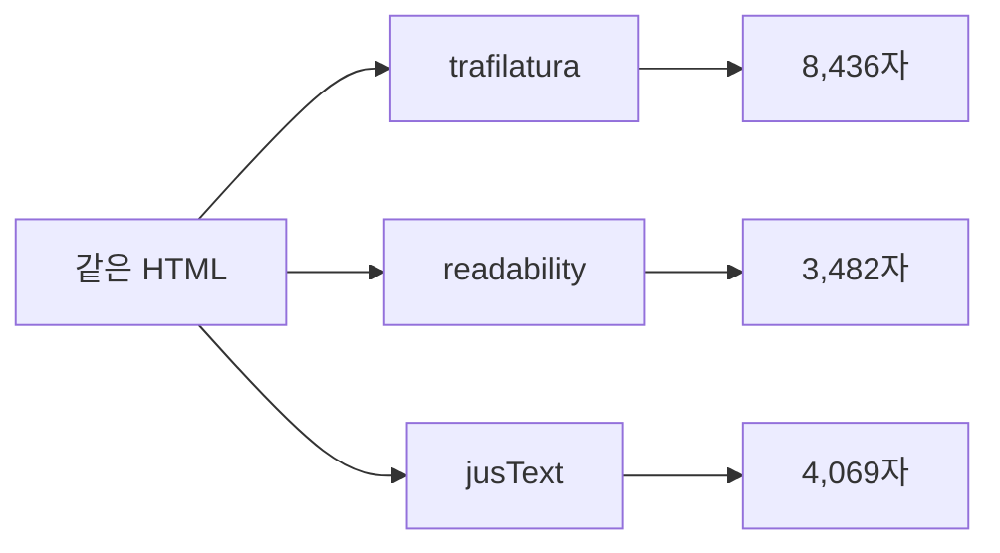
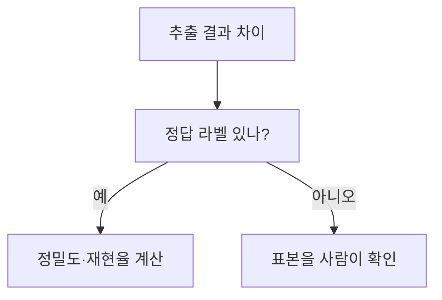

# 추출기 비교

> HTML에서 본문을 뽑는 도구(trafilatura·readability-lxml·jusText 등)는 **같은 페이지에서도 서로 다른 길이·내용을 내놓는다.** 어느 쪽이 맞는지는 정답 라벨이 있어야 정확히 말할 수 있고, 규모 있는 평가는 별도 벤치마크로 한다.

## 쉽게 말하면
같은 신문 면에서 세 사람이 기사를 오려 내면 한 명은 사진 설명까지, 한 명은 본문만, 한 명은 짧은 문장을 빼고 오린다. 누가 "정답"인지는 기준이 정해져야 가려진다.

## 자세히
- 직접 실행(2026-11-27, trafilatura 2.4.0 · readability-lxml · jusText, 영어 stoplist, 페이지 5개, 추출 글자 수):
  | 페이지(HTML 크기) | trafilatura | readability | jusText |
  |---|---|---|---|
  | Wikipedia Common Crawl(146KB) | 8,436 | 3,482 | 4,069 |
  | Wikipedia LLM(1,070KB) | 98,191 | 98,196 | 49,076 |
  | Python docs zlib(67KB) | 16,032 | 15,330 | 7,147 |
  | python.org/about(40KB) | 1,237 | 769 | 667 |
  | Hacker News 첫 화면(31KB) | 3,769 | 0 | 0 |
- 관찰:
  - 길이는 최대 두 배 이상 벌어진다(Common Crawl 문서 8,436 vs 3,482). jusText는 긴 문서에서 절반 정도만 남기는 경향이 보였다(Wikipedia LLM 49,076 vs 98,191·98,196).
  - **Hacker News 같은 목록형 페이지**는 trafilatura만 텍스트를 냈고 readability·jusText는 0자였다. 본문 문단이 없는 페이지를 "빈 페이지"로 볼지 "목록 텍스트"로 볼지는 학습 목적에 달렸다.
  - python.org/about에서 trafilatura 출력 앞머리에 `Can't find what you're looking for?…`, `Notice: This page displays a fallback because interactive scripts did not run…` 같은 **사이트 잡음 문장**이 포함됐다. readability는 본문 문단부터 시작했다. 반면 Wikipedia Common Crawl에서는 trafilatura가 맨 아래 `External links` 항목까지 가져온 반면 readability 출력은 본문 마지막 문장(각주 뒤)에서 끝났다.
  - 속도: 이 환경에서 40KB~146KB 페이지는 trafilatura 19~47ms, readability 17~39ms, jusText 11~20ms. 1MB짜리 페이지도 0.17~0.37초. 한 번 측정한 값이라 대략적 참고만 된다.
- 해석: **어느 도구가 낫다고 결론 내릴 수 없다.** 정답 텍스트 없이 길이만 비교했다. 정밀도(잡음)와 재현율(누락) 사이에서 데이터 목적에 맞춰야 한다. 규모 평가(수천 페이지·사람 라벨)는 학술 벤치마크 논문에서 한다(이 지도에서 열어 읽지는 않음 — 다음 가지로 남김).
- 실무 요령(제안): 대표 페이지 50~100개를 사람이 훑어 "잡음 비율"과 "누락 비율"을 표로 만든 뒤 추출기·옵션을 고른다([trafilatura 옵션](#trafilatura-options)).

## 그림으로 보기



## 예시
```python
from readability import Document
text = lxml.html.fromstring(Document(html).summary()).text_content()
```
- 교육: 같은 페이지에서 도구마다 출력이 다른 것을 나란히 보여 주고 "정제 도구 선택도 데이터 설계"라고 설명.

## 헷갈리는 것과 비교
| 개념 | 차이 |
|---|---|
| trafilatura | 본문·표·메타데이터 추출 폭이 넓음 |
| readability | 읽기 모드용 주 기사 추출 |
| jusText | 문단 단위 보일러플레이트 분류, 긴 문서에서 보수적 |
| [보일러플레이트 제거 효과](#boilerplate-removal-effect) | 추출 단계가 중복 군집에 미치는 영향 |

## 더 읽을거리
- [trafilatura 문서](https://trafilatura.readthedocs.io/) — 평가 섹션 위치.
- [jusText (GitHub)](https://github.com/miso-belica/justext) — 문단 분류 방식.
- 직접 실행: 세 라이브러리를 같은 HTML 5개에 적용.
