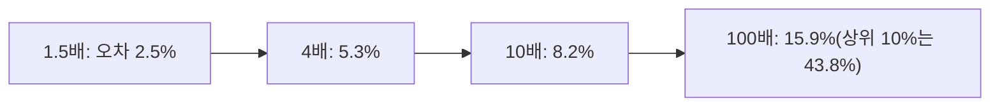
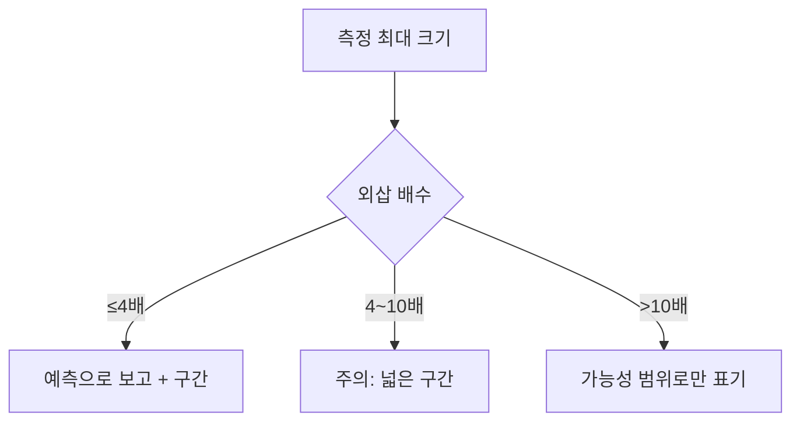

# 외삽 거리 제한

> 학습 곡선을 맞춘 뒤 **측정한 최대 데이터 크기에서 얼마나 멀리 외삽하는가**에 따라 예측 오차가 급격히 커진다. 그래서 외삽은 **측정 범위의 몇 배 이내**로 제한하고, 멀수록 불확실성 구간을 넓혀 보고한다.

## 쉽게 말하면
지금까지 달려 온 속도로 "1시간 뒤 위치"를 예측하는 것은 비교적 믿을 만하지만 "10시간 뒤"는 그동안 교통 상황이 바뀔 수 있어 불안하다. 거리가 멀수록 오차가 커진다.

## 자세히
- **직접 시뮬레이션(순수 파이썬, 300회 반복)**: 진짜 곡선 ε = 2.0·m^(−0.35) + 0.05, 곱셈 잡음 2%, 2배 간격 7점(m = 10³~6.4×10⁴)을 γ 포함 멱법칙으로 맞춘 뒤 최대 크기 6.4×10⁴의 몇 배 지점을 외삽해 **진짜 값과의 상대 오차**를 쟀다(**맞춤 형태는 정확히 맞다는 가장 유리한 가정**).
  | 외삽 배수(최대 크기 대비) | 평균 상대 오차 | 상위 10% 오차(90분위) |
  |---|---|---|
  | 1.5배 | 2.5% | 5.7% |
  | 2배 | 3.3% | 7.6% |
  | 4배 | 5.3% | 13.2% |
  | 10배 | 8.2% | 21.2% |
  | 100배 | 15.9% | 43.8% |
  거리가 4배→100배로 늘면 평균 오차가 약 3배, 나쁜 경우의 오차는 3배 이상이다. **맞춤 형태가 틀리면** 이보다 훨씬 나빠진다([형태 오지정](#model-misspecification-extrapolation)).
- **규칙(권장, 이 시뮬레이션 기반)**: 신뢰 구간 폭 목표가 ±10%이면 **측정 범위의 2~4배까지**(위 표에서 90분위 오차가 7.6~13.2%), ±20%까지 허용하면 10배 정도. 그 너머는 "예측"이 아니라 "가능성 범위"로 표기.
- **Hestness 외(arXiv 1712.00409)와의 관계**: 논문은 학습 곡선이 멱법칙+상수 형태로 예측 가능하다고 보지만(학습 곡선으로 데이터 수집 계획 수립) 지수가 이론과 달라 **경험적으로만 예측**해야 한다고 밝힌다. 따라서 측정 범위를 벗어난 외삽은 형태의 추가 가정을 요구한다.
- **외삽 거리를 줄이는 방법**
  1. 더 큰 데이터 크기를 **한 점이라도 더 측정**(측정 최대 크기를 키우면 외삽 배수가 줄어듦).
  2. 점 수를 늘려 γ·β 추정 오차를 낮춘다([맞춤 범위 안정성](#fit-range-stability)).
  3. 시험 잡음을 줄여 점의 정밀도를 높인다.
- **보고 서식**: "최대 6.4만 건에서 측정, 25만 건(4배) 예측 오류 6.5% (90% 구간 5.6~7.4)"처럼 **외삽 배수와 구간**을 함께.
- **한계**: 위 수치는 잡음 2%, 점 7개, 진짜 곡선이 멱법칙+상수인 이상적 조건이다. 실제는 더 나쁠 수 있다.

## 그림으로 보기



## 예시
```python
ratio = target_size / max_measured_size
if ratio <= 4:   label = "예측"
elif ratio <= 10: label = "주의(넓은 구간)"
else:             label = "가능성 범위"
```
- 6.4만 건으로 맞춘 곡선으로 "100만 건이면 오류 몇 %?"(약 16배 외삽)를 묻는 요청에는 구간을 크게 붙이고, 25만 건 후속 측정을 제안.

## 헷갈리는 것과 비교
| 개념 | 설명 |
|---|---|
| 보간 | 측정 범위 안 |
| 외삽 거리 | 최대 측정 크기 대비 배수 |
| 불확실성 구간 | 맞춤 잡음으로 인한 범위 |
| [외삽 낙관 편향](#extrapolation-optimism) | 외삽을 과도하게 낙관하는 경향 |

## 더 읽을거리
- [Deep Learning Scaling is Predictable, Empirically (arXiv 1712.00409)](https://arxiv.org/abs/1712.00409) — 학습 곡선 예측과 한계(PDF 본문 확인). 배수별 오차 표는 이 글의 직접 시뮬레이션.
