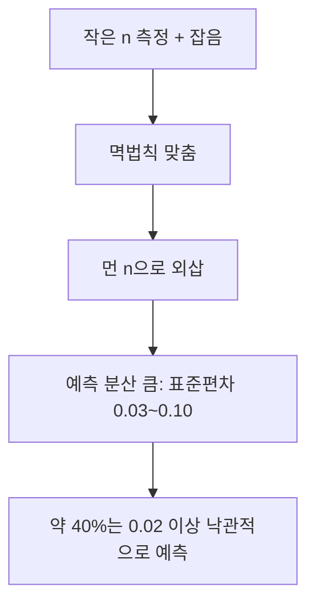
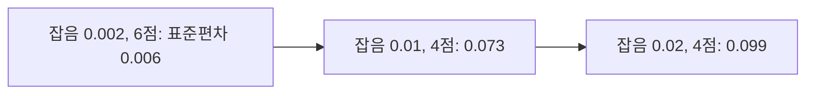

# 외삽의 낙관 편향

> 작은 데이터 구간에서 맞춘 학습 곡선을 **훨씬 큰 데이터 구간으로 외삽하면 결과가 매우 불안정**하고, 측정 잡음이 크면 상당한 확률로 실제보다 **오류를 낮게(낙관적으로) 예측**한다. 외삽은 점 하나가 아니라 범위로 보고해야 한다.

## 쉽게 말하면
처음 4번의 달리기 기록으로 마라톤 기록을 예측하면 잡음 하나에도 예측이 크게 흔들린다. 운 좋은 기록이 섞이면 "이 속도면 2시간 대"처럼 지나치게 낙관적인 예측이 나온다.

## 자세히
(직접 시뮬레이션: 진짜 법칙을 `err = 0.20 + 3·n^(−0.4)`로 두고(n=10만의 진짜 오류 0.230, 점근 0.20), 소표본 점에 측정 잡음을 더해 `a + b·n^(−c)`를 맞춘 뒤 n=10만을 예측, 500회 반복. 이 시뮬레이션은 **맞춤 형태가 진짜와 같다는 가정**이다.)
| 측정 잡음 sd | 맞춤 점 | 예측−진짜 평균 | 예측−진짜 표준편차 | 오류를 0.02 넘게 낮게 예측한 비율 | 점근 오류 a의 5~95% 편향 범위 |
|---|---|---|---|---|---|
| 0.002 | 4점(n≤800) | +0.001 | 0.018 | 13% | −0.046~+0.041 |
| 0.002 | 6점(n≤3,200) | 0.000 | 0.006 | 0% | −0.016~+0.014 |
| 0.010 | 4점 | −0.007 | 0.073 | **41%** | −0.200~+0.136 |
| 0.010 | 6점 | −0.004 | 0.030 | 29% | −0.110~+0.056 |
| 0.020 | 4점 | +0.010 | 0.099 | 42% | −0.200~+0.191 |
| 0.020 | 6점 | −0.007 | 0.054 | 40% | −0.200~+0.100 |
- **해석**: 평균 편향은 거의 0에 가깝다. 문제는 **분산**이다. 잡음 0.01~0.02에서는 예측 표준편차가 0.03~0.10이고, 4점 맞춤의 40% 이상이 오류를 0.02 이상 **낙관적으로** 예측했다(비관적 쪽도 비슷하게 흔들린다). 점근 오류 a의 5~95% 범위가 ±0.1~0.2로 사실상 "개선 여지"를 알 수 없다. 단일 점 예측은 믿을 수 없다. **잡음을 줄이고(반복 평균) 맞춤 점을 늘리면(4→6점, 잡음 0.002) 표준편차가 0.018→0.006으로 줄었다.**
- **낙관이 체계적으로 생기는 경우(일반 위험, 이 시뮬레이션에는 없음)**: ① 곡선이 실제로 일찍 평평해지는데 작은 구간에서는 아직 감소 중이라 멱법칙의 지수가 작게 맞춰짐 ② 큰 구간에서는 데이터 품질·분포·라벨 오류가 달라져 곡선이 꺾임 ③ 시험 세트 재사용으로 작은 구간이 낙관적 ④ 이중 하강 같은 비단조 구간. 이때는 맞춤 형태 자체가 틀려 평균 편향이 생긴다.
- **완화책**
  1. **외삽 거리를 제한**: 측정 구간의 2~4배 이내까지만 신뢰하고 그 너머는 참고용.
  2. **측정 잡음 줄이기**: 각 n마다 여러 번 반복해 평균(분할·시드를 바꿔)([여러 시드](#seed-sweep-reporting)).
  3. **맞춤 점을 로그 간격으로 충분히**(6점 이상) 확보하고 맞춤 범위를 바꿔 a·c의 안정성 확인([안정성](#fit-range-stability)).
  4. **불확실성 구간 보고**: 부트스트랩으로 곡선을 여러 번 맞춰 예측 범위를 제시([부트스트랩 구간](#bootstrap-confidence-interval)).
  5. **작은 추가 실험으로 검증**: 외삽이 가리킨 구간의 일부(예: 2배)를 실제 측정해 예측과 비교.
  6. 개선 목표가 점근값 근처라면 데이터 수집보다 모델·라벨 품질 개선이 맞는지 따로 검토.

## 그림으로 보기

## 예시
- 라벨 1천 개로 만든 곡선으로 "라벨 10만 개면 오류 18%"라고 예측했다면, 불확실성 범위(±몇 %p)와 2배 확장 실측 결과를 함께 제시.
- 교육: 외삽은 내삽보다 훨씬 불확실하다는 통계의 기본 원리.

## 헷갈리는 것과 비교
| 개념 | 차이 |
|---|---|
| 내삽 | 측정 범위 안에서 예측(신뢰 가능) |
| 외삽 | 범위 밖 예측(불확실성 급증) |
| [역멱법칙 맞춤](#inverse-power-law-fit) | 외삽에 쓰는 도구 |
| 편향 vs 분산 | 이 시뮬레이션에서는 분산이 지배적 |

## 더 읽을거리
- [Scaling Laws for Neural Language Models (arXiv 2001.08361)](https://arxiv.org/abs/2001.08361) — 멱법칙이 넓은 범위에서 유지된다는 보고(초록 확인).
- [scikit-learn 학습 곡선 가이드](https://scikit-learn.org/stable/modules/learning_curve.html) — 학습 곡선 해석과 데이터 추가 효과 진단.
