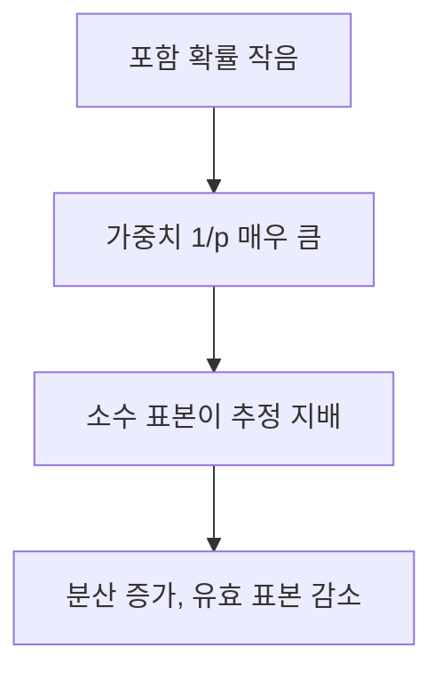

# 극단 가중치 불안정

> 역확률 가중에서 **뽑힐 확률이 매우 작은 표본은 가중치(1/확률)가 폭발적으로 커져**, 소수의 표본이 추정치를 좌우하고 결과가 들쭉날쭉해진다. 가중치를 잘라 안정시키면 분산은 줄지만 **편향이 생긴다**.

## 쉽게 말하면
전국 여론조사에서 응답 확률이 0.1%인 사람이 한 명 들어오면 그 한 명이 1,000명을 대표한다. 그 사람이 우연히 극단적인 답을 하면 전체 결과가 확 바뀐다. 한 사람의 목소리가 너무 커지는 문제다.

## 자세히
(이 세션에서 numpy로 **직접 시뮬레이션**한 결과. 모집단 N=200,000, 결과 x~N(50,10)(진짜 평균 50.010). 포함 확률은 x가 클수록 커지는 로지스틱 모형이며, 포함 확률의 **하한(floor)**을 바꿔 가며 각 500회 반복했다. 추정은 Hájek 정규화 가중 평균. Wikipedia IPW 문서는 "극단적인 가중치를 가진 소수 표본이 추정을 지배할 수 있다"고 설명하며, 이 실험은 그 현상을 수치로 본 것이다.)
- **확률 하한에 따른 불안정(실행 결과)**
  | 포함 확률 하한 | 편향 | 표준편차 | 평균 최대 가중치 | 평균 유효 표본 크기 | 표본 수 |
  |---|---|---|---|---|---|
  | 0.1 | 0.001 | **0.053** | 10 | 23,178 | 28,447 |
  | 0.01 | 0.021 | 0.155 | 100 | 5,616 | 19,391 |
  | 0.001 | 0.016 | 0.271 | 914 | 3,418 | 19,257 |
  | 0.0001 | 0.007 | 0.310 | 1,157 | 3,317 | 19,335 |
  | 제한 없음 | 0.002 | **0.320** | 1,151 | 3,338 | 19,424 |
  → 확률이 아주 작은 표본을 허용할수록 표준편차가 **0.053 → 0.320으로 약 6배** 커졌고, 유효 표본 크기는 실제 표본(약 19,000)의 **약 17%(3,338)**까지 줄었다. 편향은 거의 0으로 유지된다(역확률 가중의 장점) — 문제는 **분산**이다.
- **가중치 절단(truncation)의 대가(실행 결과, 하한 없는 설정)**
  | 상한 | 편향 | 표준편차 |
  |---|---|---|
  | 없음 | −0.015 | 0.325 |
  | 99.9백분위로 자름 | +0.383 | 0.234 |
  | 99백분위 | +1.385 | 0.172 |
  | 95백분위 | +3.081 | 0.125 |
  → 가중치를 더 세게 자를수록 **분산은 줄지만 편향이 커진다**(분산-편향 맞교환). 어느 수준이 적절한지는 문제에 따라 다르다.
- **대응(제안, 이 노드에서 일부만 확인)**: ① 확률이 작은 집단을 더 많이 뽑도록 **설계 단계에서 개선** ② 가중치 **절단·안정화**(위 표의 대가를 이해하고 사용) ③ **유효 표본 크기**를 항상 보고 ④ 결과 모델을 함께 쓰는 **이중 강건 추정**(Wikipedia IPW 문서가 AIPWE를 대안으로 언급, 이 노드에서는 시험하지 않음). → [이중 강건 추정량](#doubly-robust-estimator)
- **한계**: 정규 결과·로지스틱 포함 확률의 한 가지 설정만 시험했고, 포함 확률을 아는 경우로 한정했다. 확률을 추정할 때의 불안정은 더 크다(해석).

## 그림으로 보기

## 예시
- 응답률이 0.1%인 집단이 응답을 한 건 보냈을 때 가중치 1,000으로 평균이 크게 흔들림 → 가중치 상한과 유효 표본 크기를 함께 보고.
- 교육 활동: 표본 5개 중 하나의 확률을 0.001로 바꿔 가중 평균이 어떻게 변하는지 계산해 보기.

## 헷갈리는 것과 비교
| 개념 | 차이 |
|---|---|
| 극단 가중치 불안정 | 작은 확률 표본이 분산을 폭증시킴 |
| 편향 표집 | 표집 확률이 달라 평균이 틀어지는 문제(이 방법이 해결) |
| [유효 표본 크기](#effective-sample-size) | 불안정의 크기를 재는 지표 |
| [이중 강건 추정량](#doubly-robust-estimator) | 모델과 가중을 결합해 안정화 |

## 더 읽을거리
- [Inverse probability weighting (Wikipedia)](https://en.wikipedia.org/wiki/Inverse_probability_weighting) — 극단 가중치로 추정이 지배되는 문제와 AIPW 대안(직접 확인). 표의 수치는 이 노드의 직접 시뮬레이션이다.
