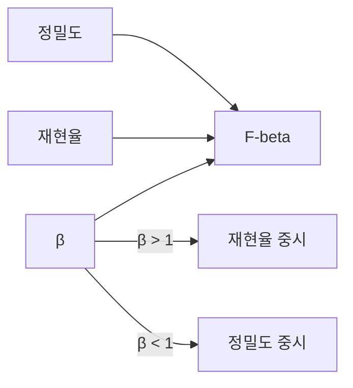

# F-beta

> F-beta는 정밀도와 재현율의 가중 조화 평균으로, β가 1보다 크면 재현율을, 작으면 정밀도를 더 중시한다. β=1이 F1이다.

## 쉽게 말하면
F1이 "정밀도와 재현율 똑같이 중요"라면, F-beta는 "재현율이 베타배 더 중요해요" 같은 가중치를 붙인 점수다. 암 검진처럼 놓침이 치명적이면 β를 키운다.

## 자세히
scikit-learn 문서(2026-11 확인):
- 정의: F_β = (1+β²)·정밀도·재현율 / (β²·정밀도 + 재현율). sklearn은 0 나눗셈을 피하려고 (1+β²)·tp / ((1+β²)·tp + fp + β²·fn)로 계산한다.
- β=1 → F1. β=2는 재현율에 더 무게(예: 정밀도 1.0, 재현율 0.5일 때 F1 0.66, F2 0.55), β=0.5는 정밀도에 더 무게.
- 양성이 전혀 없는 집합에서 F값은 기본 0이며 `zero_division`으로 바꿀 수 있다.
- 사용: `fbeta_score(y_true, y_pred, beta=2)`.
- 해석 주의: F-beta는 진짜 음성(tn)을 쓰지 않으므로 음성 쪽 성능은 보이지 않는다(공식 구조상).

## 그림으로 보기

## 예시
- 법률 문서에서 위험 조항 탐지: 놓치지 않는 게 중요 → F2.
- 자동 계정 차단: 오탐이 비쌈 → F0.5.

## 헷갈리는 것과 비교
| 개념 | 차이 |
|---|---|
| F1 | 정밀도·재현율 동일 가중 |
| F-beta | 가중을 조절 |
| [macro·micro 평균](#macro-micro-average) | 클래스 간 합치는 방식 |
| [정밀도-재현율 트레이드오프](#precision-recall-tradeoff) | F-beta가 요약하는 관계 |

## 더 읽을거리
- [scikit-learn: Model evaluation — precision, recall, F-measures](https://scikit-learn.org/stable/modules/model_evaluation.html) — 정의와 예제.
