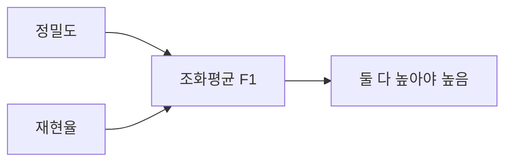
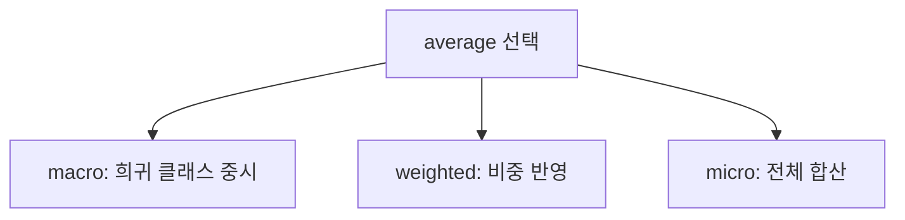

# F1 점수

> F1은 정밀도와 재현율의 조화평균으로, 둘 중 하나만 높고 하나는 낮은 모델을 낮게 평가하는 단일 지표다.

## 쉽게 말하면
시험에서 "아는 문제만 골라 풀어 다 맞힌 학생(정밀도 높음)"과 "다 찍어서 정답을 놓치지 않은 학생(재현율 높음)" 둘 다 만점은 아니다. F1은 둘의 균형을 하나의 점수로 만든다.

## 자세히
scikit-learn 문서 기준:
- F1은 F-beta(β=1)이고 계산식은 `(1+β²)·tp / ((1+β²)·tp + fp + β²·fn)`로, 0으로 나누는 문제를 피한다. tp·fp·fn이 모두 0이면 0(`zero_division`으로 변경).
- 예: y_true=[0,1,0,1], y_pred=[0,1,0,0] → precision 1.0, recall 0.5, F1 ≈0.66.
- **다중 분류 평균**: `macro`(클래스별 평균, 희귀 클래스 성능이 드러남), `weighted`(지원 수 가중, 작은 클래스 실패를 숨길 수 있음), `micro`(전체 합산, 다중 분류에선 정확도와 같음), `None`(클래스별 점수). macro F1은 클래스별 F1의 평균이지 macro 정밀도·재현율의 조화평균이 아니다.
- 모델 선택 시 `scoring='f1_macro'`처럼 지정해 원하는 지표로 튜닝한다([하이퍼파라미터](#hyperparameter)).
- 한계(일반적 지적): TN을 쓰지 않으므로 음성 클래스 성능은 반영하지 않는다.

## 그림으로 보기



## 예시
```python
from sklearn import metrics
metrics.f1_score([0,1,0,1], [0,1,0,0])             # 0.66
metrics.f1_score(y_true, y_pred, average="macro")  # 다중 분류
```
RAG 답변의 "정답 문서 검색" 평가에서 찾은 문서의 정밀도·재현율을 하나로 요약할 때 쓴다.

## 헷갈리는 것과 비교
| 개념 | 차이 |
|---|---|
| 정확도 | 모든 샘플 비중이 동일, 불균형에 취약 |
| F1 | 양성 클래스 중심의 균형 지표 |
| balanced accuracy | 클래스별 recall의 평균 |
| [혼동 행렬](#confusion-matrix) | F1의 재료가 되는 원표 |

## 더 읽을거리
- [sklearn Model evaluation](https://scikit-learn.org/stable/modules/model_evaluation.html) — F-beta 정의, macro/micro/weighted 평균.
