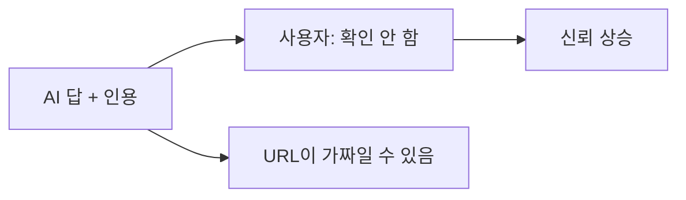

# 가짜 인용

> AI가 **존재하지 않는 출처나 URL을 지어내거나**, 실제 링크가 주장을 뒷받침하지 않는 경우다. 인용 UI로는 해결되지 않는 모델 측 문제다.

## 쉽게 말하면
논문 끝에 그럴듯한 참고문헌 목록이 있는데 책 제목은 지어낸 것이다. 겉모양이 학술적이라 믿기 쉽다.

## 자세히
(Nielsen Norman Group의 "explainable AI" 글을 직접 읽었다.)
- **현상(NN/g)**: 인용은 종종 환각이며 **존재하지 않는 URL**을 가리킨다. 실제 링크가 신뢰할 수 없는 출처나 주장을 뒷받침하지 않는 페이지로 이어지기도 한다.
- **낮은 확인율(NN/g)**: 사용자는 제공된 출처를 거의 확인하지 않는다. 인용은 믿음직해 보여서 **아무도 확인하지 않아도 답에 대한 확신을 높인다.**
- **권고(NN/g)**: 사용자에게 출처가 정확하지 않을 수 있으니 확인하라고 안내, 인용을 본문과 시각적으로 구별, 인용을 지지하는 주장 바로 옆에 배치, 가능하면 출처의 해당 구절로 링크, 설명적 링크 라벨.
- **자동 점검(제안)**: ALCE식 NLI 점검([인용 재현·정밀](#citation-recall-precision))으로 인용 문단이 문장을 뒷받침하는지, URL이 실제로 열리는지 코드로 확인.

## 그림으로 보기

## 예시
- 사내 연구 봇이 낸 논문 인용을 DOI 조회로 자동 검증하고 실패하면 표시(제안).

## 헷갈리는 것과 비교
| 개념 | 차이 |
|---|---|
| 가짜 인용 | 존재하지 않거나 뒷받침 못 하는 출처 |
| [충실하지만 틀린 답](#faithful-but-wrong) | 출처는 실재하나 출처가 틀림 |

## 더 읽을거리
- [NN/g — Explainable AI](https://nngroup.com/articles/explainable-ai/) — 직접 읽음.
