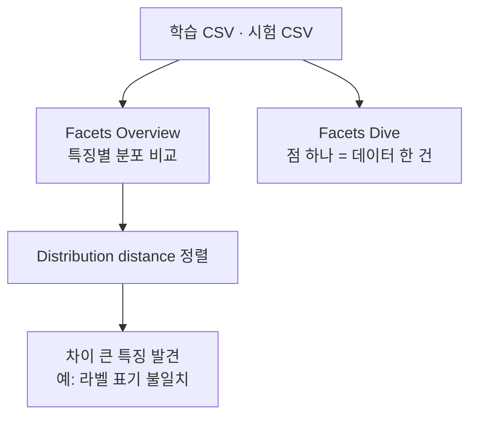

# Facets 데이터 시각화

> Facets는 Google PAIR가 만든 **데이터셋 시각화 도구 두 가지**다. Overview는 특징별 분포를 여러 데이터셋에 걸쳐 나란히 보여 주고, Dive는 수천~수만 개 데이터 점을 한 화면에서 면(facet)으로 나눠 탐색한다. 표를 보다가 놓치는 버그를 눈으로 찾게 해 준다.

## 쉽게 말하면
엑셀 숫자만 훑는 대신, 학습용·시험용 데이터의 컬럼별 히스토그램을 나란히 놓고 "어, 이 컬럼은 두 데이터가 왜 이렇게 다르지?"를 눈으로 발견하는 도구다. Dive는 데이터 한 건 한 건을 점으로 뿌려 놓고 묶음별로 쪼개 보는 확대경이다.

## 자세히
(공식 사이트 pair-code.github.io/facets와 GitHub 저장소를 직접 확인. 이번에 설치·실행은 하지 않았다.)
- **Facets Overview**: 입력 데이터를 특징 하나씩, 하나 이상의 데이터셋에 걸쳐 분포로 시각화. 예상치 못한 값, 결측, 학습/서빙 skew, 학습/시험/검증 skew를 드러낸다. "Sort by"의 **Distribution distance**로 데이터셋 간 가장 다른 특징을 맨 위로 올린다(거리 계산 방법은 페이지에 설명 없음).
- **Facets Dive**: 데이터 점 하나가 항목 하나. 특징값으로 버킷팅(faceting)해 위치를 정하고 다른 특징으로 색을 입힌다. 항목을 누르면 키·값 쌍이 보인다. 사이트는 분류기 실패, 체계적 오류, 정답 라벨 평가, 순위 신호 발견 같은 용도를 든다.
- **공식 예시**: UCI Census Income의 학습 vs 시험을 비교하니 Target 라벨이 학습에서는 `>50K`, 시험에서는 끝에 마침표가 붙은 `>50K.`로 달라 Distribution distance 정렬로 곧바로 드러났다. 라벨 표기 불일치 같은 사소한 버그를 찾는 전형적 사례다.
- **입력과 설치**: 웹 데모는 첫 행이 헤더인 CSV를 받는다. 노트북용은 `pip install facets-overview`(1.1.0 이상은 protobuf 3.20.0 이상). Polymer 웹 컴포넌트로 노트북·웹페이지에 삽입한다. 라이선스 Apache-2.0, 별 약 7.3k.
- **중요한 상태 정보**: GitHub 저장소는 **2024-07-27에 소유자가 아카이브**해 읽기 전용이다(확인 시점). 시각화는 Chrome에서만 동작한다는 이슈(Issue 9)가 있고 "공식 Google 제품이 아니다"라는 고지가 있다. 새 프로젝트에 쓰기 전에 대체 도구(예: 프로파일링 라이브러리나 TFDV의 통계 시각화)와 비교하는 것이 안전하다(이 대체 도구 비교는 이번에 하지 않았다).
- **TFDV와의 관계**: TFDV 문서는 통계 시각화에 Facets Overview를 쓴다고 소개한다([TFDV 스키마 환경](#tfdv-schema-environments)).

## 그림으로 보기

## 예시
- 학습·시험 CSV를 Overview에 올려 라벨 철자·결측 비율 차이를 먼저 점검한 뒤 학습을 시작.
- 교육 소재: Census 예제에서 마침표 하나 차이로 라벨이 갈리는 버그를 직접 찾아보는 실습(도구가 아카이브 상태임을 함께 안내).

## 헷갈리는 것과 비교
| 개념 | 차이 |
|---|---|
| Facets Overview | 특징별 분포 비교 |
| Facets Dive | 개별 데이터 점 탐색 |
| [TFDV 스키마 환경](#tfdv-schema-environments) | 스키마 검증 도구 |
| [Great Expectations](#great-expectations) | 규칙 기반 검증 |

## 더 읽을거리
- [Facets (공식 사이트)](https://pair-code.github.io/facets/) — Overview·Dive 설명과 예(직접 확인).
- [PAIR-code/facets (GitHub)](https://github.com/PAIR-code/facets) — 설치·아카이브 상태(직접 확인).
