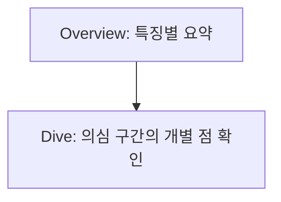

# Facets Dive

> **Facets Dive**는 데이터셋의 **개별 데이터 점 하나하나를 화면에 점(또는 이미지)으로 놓고, 특징 값에 따라 행·열 면(facet)으로 나누거나 색을 입혀 탐색**하는 시각화 도구다. 평균 같은 요약이 아니라 "어떤 점들이 어디에 몰려 있는지"를 직접 본다.

## 쉽게 말하면
학생 1,000명 각자를 작은 카드로 만들어 책상에 펼친 뒤, "학력별로 줄을 세우고, 소득 50K 이상은 빨간색으로 칠해 보자"며 카드를 재배치하는 것이다. 숫자 표로는 안 보이던 패턴이 눈에 들어온다.

## 자세히
(공식 사이트 pair-code.github.io/facets와 GitHub 저장소 첫 화면을 WebFetch로 직접 확인. 도구를 설치·실행하지는 않았다.)
- **무엇을 하나(사이트)**: 한 점이 데이터 하나이며, 특징 값에 따라 **면 나누기(faceting)** 또는 여러 차원으로 **구간화(bucketing)**해 위치를 정한다. 데이터셋의 모든 특징에 걸친 점 사이의 관계를 드러내는 것이 목적이다.
- **상호작용(사이트)**: 항목을 클릭하면 키/값을 보여 주고, 왼쪽 메뉴로 구성을 바꾼다. 예: Faceting 메뉴에서 행 기준 나누기, Color 메뉴에서 라벨 같은 특징으로 색칠.
- **규모(저장소)**: **수만 개의 다차원 데이터 점**까지 탐색하도록 설계됐고 확대·애니메이션·필터를 지원한다. Jupyter에서 큰 시각화를 쓰려면 노트북 서버를 IOPub 데이터 전송률 한도를 올려 시작해야 한다(예: `--NotebookApp.iopub_data_rate_limit=10000000`).
- **입력(사이트)**: 하나 이상의 CSV를 불러올 수 있고 첫 행이 헤더여야 한다.
- **사용 예(사이트)**: UCI Census Income 데이터에서 "Education-num"으로 행 기준 면 나누기, "Target"(연 5만 달러 초과 여부)으로 색칠해 학력과 소득의 관계를 본다. 사이트가 드는 용도는 **분류기 실패 탐지, 체계적 오류 식별, 정답(ground truth) 평가, 랭킹의 새 신호 탐색**이다.
- **Overview와의 차이(저장소·사이트)**: Overview는 특징별 통계를 요약하고, Dive는 개별 점을 탐색한다. → [Facets Overview](#facets-overview)
- **현황 주의**: 저장소는 2024-07-27에 아카이브되어 읽기 전용이고 Chrome에서만 동작한다고 알려져 있다. → [아카이브된 도구 사용 위험](#archived-tool-risk)
- **확인하지 못한 것**: 이미지 스프라이트 지원 같은 세부는 사이트 본문에 없어 확인하지 못했다.

## 그림으로 보기

## 예시
- 분류 오류가 난 샘플만 색을 달리해 특정 학력·직군에 몰려 있는지 확인.
- 교육 활동: 학급 데이터를 엑셀에서 "학년별 줄, 성적별 색"으로 정렬해 Dive와 같은 관점으로 읽어 보기.

## 헷갈리는 것과 비교
| 개념 | 차이 |
|---|---|
| Facets Dive | 개별 점 단위 탐색 |
| [Facets Overview](#facets-overview) | 특징별 통계 요약·비교 |
| 산점도 | 두 축 위의 점. Dive는 다차원 면 나누기+색상 |
| [아카이브된 도구 사용 위험](#archived-tool-risk) | 유지보수가 끝난 도구를 쓸 때의 점검 |

## 더 읽을거리
- [Facets 사이트 (pair-code.github.io/facets)](https://pair-code.github.io/facets/) — Dive 설명, Census 예시, 용도(직접 확인).
- [PAIR-code/facets (GitHub)](https://github.com/PAIR-code/facets) — 규모, 사용법, 아카이브 상태(직접 확인).
