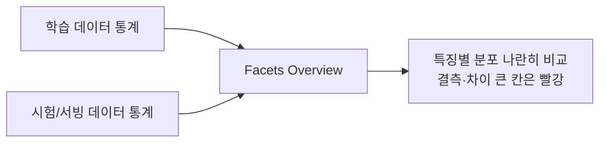
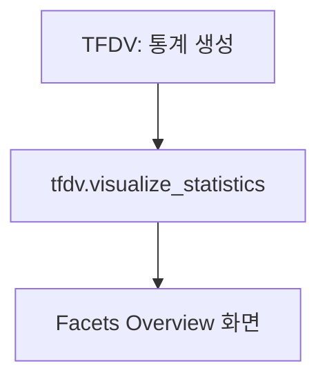

# Facets Overview

> **Facets Overview**는 머신러닝 데이터셋의 **특징(컬럼)별 통계(분포·결측·최솟값 등)를 한 화면에 보여 주고, 여러 데이터셋(학습/시험/서빙)을 나란히 비교**하게 해 주는 시각화 도구다. 데이터에 문제가 있는지 눈으로 먼저 훑는 용도다.

## 쉽게 말하면
반 전체 성적표에서 과목마다 히스토그램을 그려 놓고, 1반과 2반을 나란히 비교하는 대시보드다. 어느 과목에서 결측이 많은지, 두 반의 분포가 크게 다른지 빨간색으로 표시해 준다.

## 자세히
(GitHub `PAIR-code/facets` 저장소 첫 화면을 WebFetch로 직접 확인. 도구를 설치·실행하지는 않았다.)
- **기능(저장소)**: 하나 이상의 데이터셋에 대한 **특징별 통계 뷰**를 제공하고 데이터셋 간 통계를 **비교**한다. 숫자형·문자열 특징을 지원하며 **예상 밖 값, 결측 데이터, 학습/서빙 또는 학습/시험 skew**를 찾도록 돕는다. 결측이 많거나 분포 차이가 크면 **빨간색으로 강조**한다.
- **사용(저장소)**: Colab 노트북으로 설치 없이 실행하거나 Jupyter에서 사용한다. 둘 다 HTML import로 로드되므로 먼저 **webcomponents 폴리필**을 cdnjs에서 불러와야 한다. Overview용 파이썬 패키지는 `pip`(`facets-overview`)로 설치하며 **protobuf 3.20.0 이상**이 필요하다. 직접 빌드하려면 Bazel(`bazel build facets:facets_jupyter`)을 써서 결과를 `facets-dist/`에 두고 Jupyter nbextension으로 설치한다.
- **TFDV와의 관계(TensorFlow 문서)**: TFDV 문서는 TFDV가 만든 통계를 Facets Overview로 시각화할 수 있다고 안내한다(`tfdv.visualize_statistics(stats)`). → [TFDV skew 비교기](#tfdv-skew-comparator)
- **현황 주의(저장소)**: 저장소는 **2024-07-27에 소유자에 의해 아카이브**되어 읽기 전용이다. 릴리스는 페이지에 표시되지 않았다. 라이선스는 Apache-2.0이며 "공식 Google 제품이 아니다"라고 적혀 있다. 알려진 이슈로 **Chrome에서만 동작**한다고 한다. → [아카이브된 도구 사용 위험](#archived-tool-risk)
- **쓰임(해석)**: 새 데이터셋을 받았을 때 학습/시험 분포가 어긋나지 않는지, 결측이 몰려 있지 않은지를 코드를 쓰기 전에 훑는 용도. 최신 환경에서 쓰려면 의존성(protobuf, 브라우저) 호환을 먼저 확인해야 한다.

## 그림으로 보기

## 예시
- 학습 셋과 시험 셋을 같은 화면에서 비교해 `age`의 분포가 크게 다르다는 것을 눈으로 확인.
- 교육 활동: 두 CSV의 컬럼별 히스토그램을 그려 Facets Overview와 같은 비교 화면을 직접 만들어 보기.

## 헷갈리는 것과 비교
| 개념 | 차이 |
|---|---|
| Facets Overview | 특징별 통계의 요약·비교 |
| [Facets Dive](#facets-dive) | 개별 데이터 점을 면으로 나눠 탐색 |
| [TFDV](#tfdv-skew-comparator) | 통계로 이상·skew를 자동 감지 |
| 일반 BI 대시보드 | 업무 지표용. ML 데이터 점검 전용 아님 |

## 더 읽을거리
- [PAIR-code/facets (GitHub)](https://github.com/PAIR-code/facets) — Overview/Dive 기능, 사용법, 아카이브 상태(직접 확인).
- [Get started with TensorFlow Data Validation (TensorFlow 문서)](https://www.tensorflow.org/tfx/data_validation/get_started) — TFDV 통계를 Facets Overview로 시각화(직접 확인).
