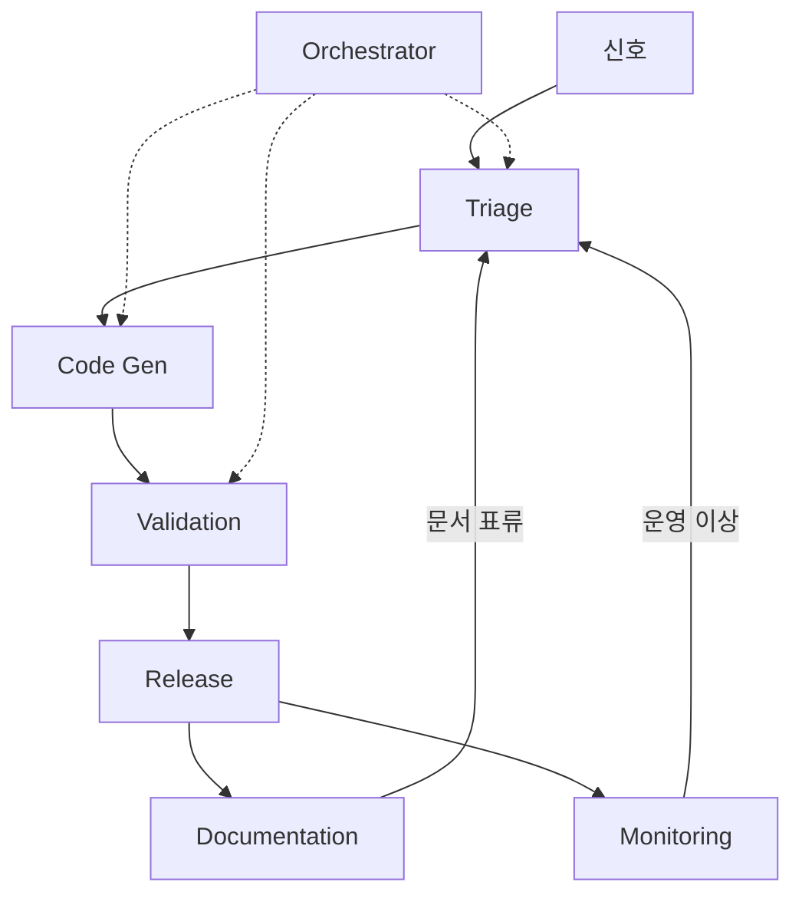

# 팩토리의 에이전트 역할

> AI 소프트웨어 팩토리는 에이전트 하나가 다 하지 않고 **"한 에이전트 = 한 가지 일"** 로 역할을 나눈다. Mastra의 구성은 Triage·Code Gen·Validation·Release·Documentation·Monitoring 여섯 에이전트와 이를 조정하는 Orchestrator다. 한 가지 일만 하면 **하나의 기준으로 성과를 측정**할 수 있기 때문이다.

## 쉽게 말하면
식당에서 주문 받는 사람, 요리사, 맛 검사원, 배달원, 청소 담당을 나누는 것과 같다. 한 사람이 다 하면 누가 어디서 틀렸는지 알기 어렵지만, 역할이 나뉘면 어디가 문제인지 보인다.

## 자세히
(Mastra, "Software factory" 블로그 요약)

| 역할 | 하는 일 |
|---|---|
| Triage | 신호(이슈·에러·Slack)를 분류·우선순위화, 중복 제거, 라우팅 |
| Code Gen | 저장소를 읽고 변경과 테스트를 작성, PR 생성 |
| Validation | PR의 정확성·보안·테스트·성능 검토 |
| Release | 버전·변경 기록·배포·롤백 |
| Documentation | 문서 표류(drift) 감지, 문서 PR 생성 |
| Monitoring | 운영 상태 점검(이 구현에서는 15분마다), 사고 등록 |
| Orchestrator | 애매한 일을 알맞은 에이전트·워크플로로 보내는 감독자 |

- **세 개의 루프**: ① 개발 루프(신호→분류→구현→검증→배포→문서), ② 모니터링 루프(운영 이상이 자동으로 새 작업이 됨), ③ 문서 표류 감지 루프(머지된 PR을 문서와 비교).
- **설계 이유**(원문 주장): 역할이 하나면 **한 가지 기준으로 평가 가능**, 에이전트 사이 **타입이 있는 인계(typed handoff)** 는 경계에서 실패해 하류가 오염되는 것을 막고, 모든 실행의 **추적(trace)** 으로 감사가 가능하다.
- **사람은 어디에**: 아키텍처 결정·breaking change·SEV1 사고 등은 사람에게 올린다([사람 관문 설계](#human-gates)).
- **한계와 비판적 시선**: 위 구성은 한 벤더의 블로그이며 수치(예: 엔지니어가 시간의 50~70%를 조정에 쓴다)는 출처가 제시되지 않은 주장이다. 역할을 많이 나눌수록 에이전트 간 인계·비용·조정 오류가 늘 수 있다. 팩토리는 요구가 자주 바뀌는 초기 제품이나 테스트가 없는 코드베이스에는 잘 맞지 않는다고 원문도 밝힌다.

## 그림으로 보기

## 예시
- 새 버그 리포트 → Triage가 P1로 분류·중복 확인 → Code Gen이 수정 PR → Validation이 보안·테스트 확인 → 사람이 머지 승인 → Release가 배포 → Monitoring이 15분마다 에러율 확인.
- 교육 활용: 사내 업무(마케팅 콘텐츠 제작)를 같은 방식(기획·초안·검수·게시·성과 모니터링)으로 역할 분해해 보는 실습.

## 헷갈리는 것과 비교
| 개념 | 차이 |
|---|---|
| 역할별 에이전트 | 한 에이전트 = 한 일, 평가 쉬움 |
| 범용 에이전트 | 한 에이전트가 전체 수행, 단순하지만 병목·평가 어려움 |
| [서브에이전트](#subagents) | 한 세션에서 일을 위임하는 구현 수단 |
| [AI 팩토리](#ai-factory) | 이런 역할 라인 전체 개념 |

## 더 읽을거리
- [Mastra: Software factory](https://mastra.ai/blog/software-factory) — 6개 에이전트·3개 루프·사람 관문 설명.
