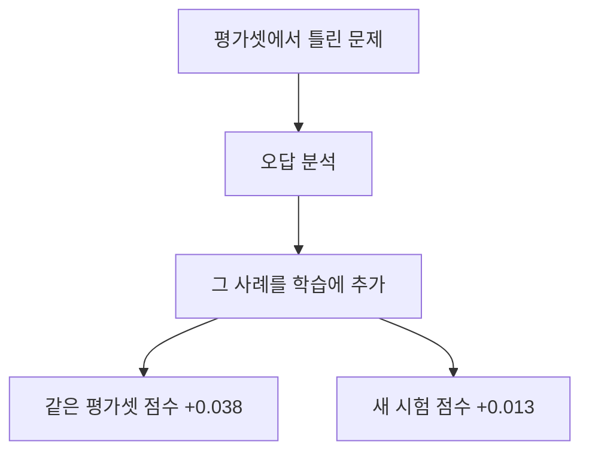

# 실패 사례 분류 누수

> 평가에서 틀린 문제를 분석해 그 사례를 학습 데이터에 넣으면, 같은 평가셋의 점수가 오르지만 그 상승분 일부는 새 데이터에서는 나타나지 않는다. 평가셋이 "고쳐야 할 목록"이 되어 평가 변별력을 잃는 누수다.

## 쉽게 말하면
시험에서 틀린 문제를 오답 노트로 만들어 그 문제의 정답을 외워 다음에 같은 시험을 보면 점수가 오른다. 하지만 같은 시험지로 올린 점수는 실력이 오른 만큼이 아니다. 새 시험지에서는 올라간 폭이 훨씬 작다.

## 자세히
- **직접 해 본 실험(숫자 손글씨 1,797개를 학습 50%, 평가 25%, 새 시험 25%로 분할, 얕은 랜덤 포레스트)**: 처음에는 평가 0.931, 새 시험 0.936으로 두 점수가 같았다. 평가에서 틀린 449개 중 31개의 틀린 사례를 정답과 함께 학습에 추가해 다시 학습하자, 같은 평가 점수는 0.969(+0.038)로 올랐지만 평가에 한 번도 쓰지 않은 새 시험은 0.949(+0.013)에 그쳤다. 평가 점수의 상승 중 약 3분의 2가 평가셋에 맞춘 효과로 새 시험에는 나타나지 않았다. 한 번의 실험이라 비율은 어림이다.
- **왜 문제인가(해석)**: 실패 분석 → 데이터 보강 → 같은 평가셋 재측정을 반복하면 평가셋이 사실상 학습 세트가 된다([테스트 세트 재사용 위험](#test-set-reuse-risk)). 점수는 좋아지는데 실제 성능은 덜 좋아져 개선을 과신한다.
- **지켜야 할 것(해석)**: ① 실패 분석용 개발(dev) 세트와 점수 보고용 시험 세트를 분리한다 ② 실패 분석은 개발 세트에서만, 최종 보고는 한 번도 보지 않은 세트에서 ③ 실패 사례를 그대로 학습에 넣는 대신 같은 유형의 새 사례를 만들어 넣는다(다른 표현·다른 값) ④ 평가셋에서 읽은 사례의 ID를 기록해 학습 데이터와 겹치는지 [CI 겹침 게이트](#ci-overlap-gate)로 점검한다.
- **LLM 평가에서도 같다(해석)**: 프롬프트나 미세조정 데이터를 평가 문제의 오답에 맞춰 고치면 평가 점수가 오르지만 일반화는 덜 오른다. 평가 문제 자체를 학습 예시로 옮기지 않는다.

## 그림으로 보기

## 예시
- 챗봇 평가 100문항에서 틀린 20문항의 정답을 학습 데이터에 넣었다면, 평가는 개발용으로 돌리고 보고는 새로 만든 문항으로 한다.
- 교육 활용: 같은 실험에서 실패 사례를 추가했을 때 평가와 새 시험 점수의 차이를 비교한다.

## 헷갈리는 것과 비교
| 개념 | 차이 |
| --- | --- |
| 실패 사례 분류 누수 | 평가 실패를 학습에 넣어 평가가 오염 |
| 데이터 누수(일반) | 평가 정보가 학습에 섞임 |
| [테스트 세트 재사용 위험](#test-set-reuse-risk) | 평가를 반복해 보며 조정 |
| [평가셋 격리](#eval-set-quarantine) | 접근 자체를 분리 |

## 더 읽을거리
- [scikit-learn: Cross-validation](https://scikit-learn.org/stable/modules/cross_validation.html) — 시험 세트를 튜닝에 쓰면 일반화 추정이 오염된다는 설명
