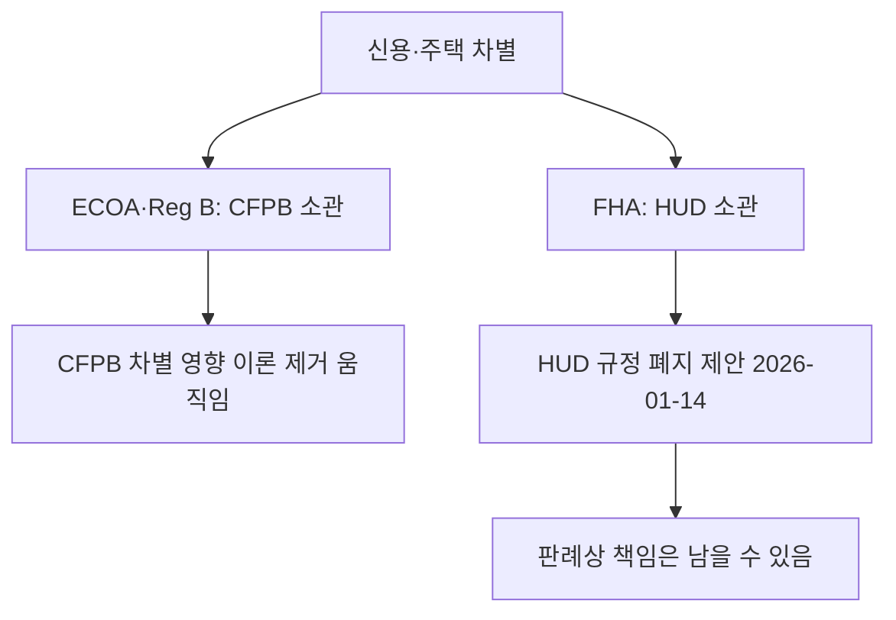

# 공정주택법 FHA

> 주택 거래·대출에서의 차별을 금지하는 미국 연방법(Fair Housing Act). 차별 영향(disparate impact) 책임을 대법원이 인정한 법으로, 신용 분야 규정(ECOA·Reg B)과 별도로 작동한다. (법률 자문 아님)

## 쉽게 말하면
ECOA는 신용 전반, FHA는 주택 관련 거래의 차별을 막는 다른 법이다. 한 법의 해석이 바뀌어도 다른 법은 그대로일 수 있다.

## 자세히
출처: 법률 해설 검색 요약(Nixon Peabody 2026-01-21, Orrick 2026-01-16, NAAHQ 등). 연방관보 원문은 열지 않았다.
- **HUD 규정의 상태(해설 기준)**: HUD가 2026-01-14 FHA 차별 영향 규정을 폐지하는 규칙안을 냈다(91 Fed. Reg. 1475, 의견 마감 2026-02-13). 폐지 대상은 2013년 규정(바이든 행정부가 2023년 88 Fed. Reg. 19450으로 복원). 검색에서 최종 규칙이나 시행일은 확인하지 못했다.
- **핵심 쟁점**: 규정을 폐지해도 차별 영향 책임 자체가 끝나는 것은 아니라는 해설이 많다. HUD도 차별 영향 책임이 FHA상 무효라고 주장하지는 않는다. 이후 발전은 법원 판례에 맡겨진다. 검색 결과는 Loper Bright 판결(기관 해석에 대한 존중 약화)을 HUD가 근거로 삼는다고 요약했다.
- **대법원**: 검색 결과가 대법원이 FHA상 차별 영향 책임을 인정했다고 언급(Texas Dept. of Housing v. Inclusive Communities Project, 2015로 알려져 있으며 이 사건명은 검색 결과가 아니라 일반 지식에서 가져온 것).
- **신용 쪽과의 관계**: CFPB가 ECOA·Reg B의 차별 영향 이론을 제거하려는 흐름은 [신용 차별 영향 분석](#disparate-impact-credit)에 있다. 두 법은 별개라 하나의 변화가 다른 법의 책임을 자동으로 없애지 않는다는 점이 이 노드의 요점이다. 현재 법적 상태는 연방관보에서 확인해야 한다.

## 그림으로 보기

## 예시
- 주택담보대출 모델: ECOA 규정이 바뀌어도 FHA 소송 위험이 남을 수 있어, 모델의 승인율 격차 점검을 계속하는 정책.

## 헷갈리는 것과 비교
| 개념 | 차이 |
|---|---|
| FHA | 주택 관련 차별 금지 |
| ECOA·Reg B | 신용 전반 차별 금지 |
| 규정 폐지 | 법 자체 폐지 아님 |
| [차별 영향 분석](#disparate-impact-credit) | 분석 틀 |

## 더 읽을거리
- [Nixon Peabody: HUD rescinds disparate impact regulations](https://www.nixonpeabody.com/insights/alerts/2026/01/21/hud-rescinds-disparate-impact-regulations) — 규칙안 해설(검색 결과로만 확인)
- [Orrick: HUD moves to eliminate disparate impact rules](https://infobytes.orrick.com/2026-01-16/hud-moves-to-eliminate-disparate-impact-rules-under-fair-housing-act/) — 규칙안 요약(검색 결과로만 확인)
