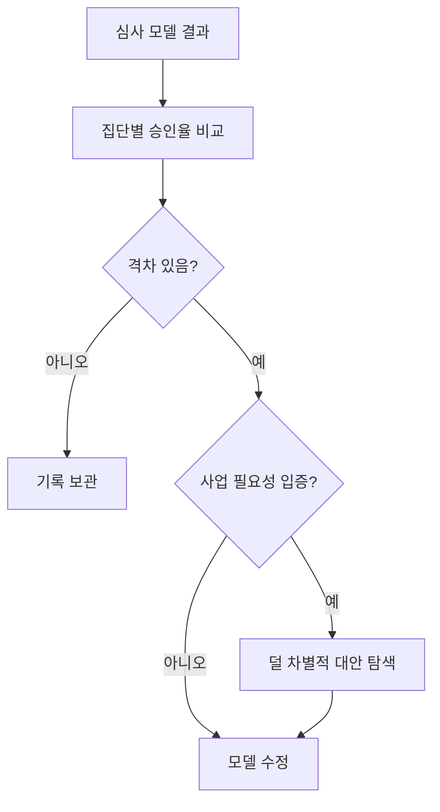

# 공정 대출과 차별 효과

> 겉보기엔 중립적인 심사 기준이 특정 집단(인종·성별 등)에게 불리한 결과를 낳는지 점검하는 일. 법적 근거는 2026년에 크게 흔들려, 최신 상태 확인이 필수다.

## 쉽게 말하면
시험 문제가 모두에게 똑같아도 특정 지역 학생만 계속 떨어진다면 문제 자체를 의심해 볼 수 있다. 심사 모델도 의도 없이 같은 결과를 낼 수 있어 결과의 격차를 따로 잰다.

## 자세히
- **차별 효과(disparate impact)**: 의도와 무관하게 결과가 집단별로 달라지는 현상. 반대는 차별 의도·직접 차별(disparate treatment).
- **4/5 규칙**: 집단 승인율 비가 0.80 아래면 주의 신호로 보는 스크리닝 지표(고용 분야 EEOC 지침에서 유래). 법적 안전선이 아니라는 지적이 있다(FAccT 2022 논문 "The four-fifths rule is not disparate impact").
- **덜 차별적인 대안(LDA) 탐색**: 같은 사업 목적을 달성하면서 격차가 작은 모델이 있는지 찾는 것. CFPB는 2024~2025년 감독 자료에서 이를 권고했다.
- **법적 지형(2026-11 기준, 확인 필요)**: 검색된 로펌 해설에 따르면 CFPB가 2026-04-22 확정한 Reg B 개정(2026-07-21 시행)이 ECOA의 차별 효과 이론을 삭제했다. 단 직접 차별(프록시 변수 포함), 공정주택법(FHA), 주(州)법 위험은 남는다. 1차 출처(Federal Register)로 재확인할 것.
- 한국은 별개 체계이므로 국내 금융당국 지침을 따로 본다.

## 그림으로 보기

## 예시
- 우편번호 변수가 인종의 프록시로 작동 → 변수 제거 후 성능·격차를 비교한다.
- 승인율 비 0.74 → 4/5 규칙 경고, 원인 변수를 SHAP으로 추적.

## 헷갈리는 것과 비교
| 개념 | 차이 |
|---|---|
| 차별 효과 | 결과의 격차, 의도 불문 |
| 직접 차별 | 보호 속성을 직접·프록시로 사용 |
| [거절 사유 설명](#adverse-action-explainability) | 개별 신청자에게 이유 통지 |
| [AI 편향](#ai-bias-ethics) | 더 넓은 개념 |

## 더 읽을거리
- [Consumer Federation: 알고리즘 신용 판단 촉구](https://consumerfed.org/consumer-groups-call-on-cfpb-to-protect-consumers-from-discriminatory-algorithms-used-by-banks-and-other-financial-institutions-to-make-credit-decisions/) — 2024년 LDA 논의 배경
- [Compliance Alliance: CFPB looks at AI in credit scoring](https://compliancealliance.com/?p=74465) — 감독 관점 개요
