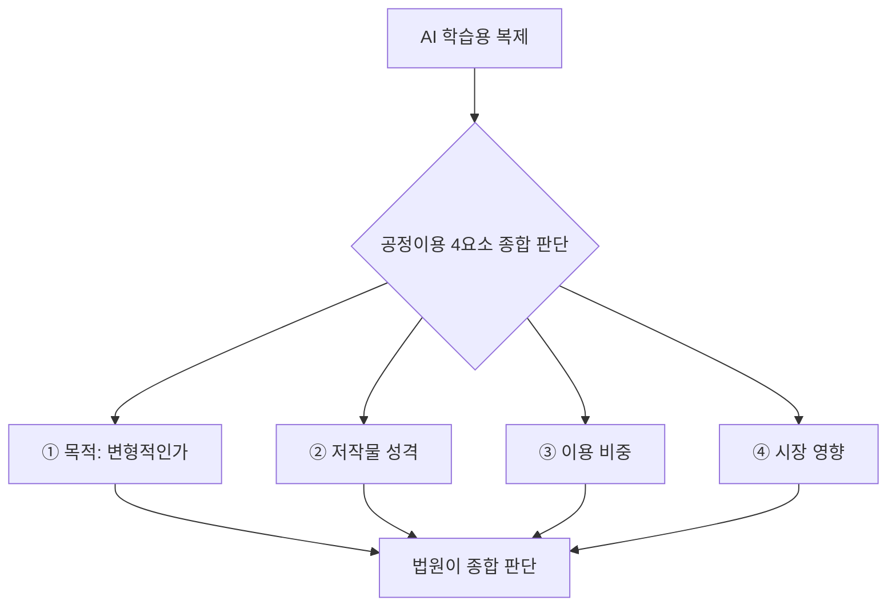
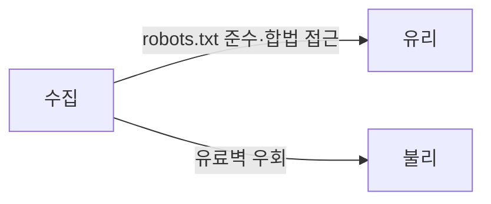

# 한국 공정이용 가이드

> 문화체육관광부·한국저작권위원회가 2026-02-26 발간한 「생성형 AI의 저작물 학습에 대한 저작권법상 공정이용 안내서」. 저작권법 제35조의5(공정이용) 네 요소를 AI 학습에 적용하는 방법을 풀어 쓴 참고자료다.

## 쉽게 말하면
도서관에서 책을 복사하는 것이 허용되는지는 "무엇에, 얼마나, 책 판매를 해치는가"로 따진다. AI 학습도 같은 저울에 올려 보는데, 한국에는 AI 학습 전용 면책 조항이 없어 기존 공정이용 조항으로 판단한다. 안내서는 그 저울 사용법이다.

## 자세히
- **성격**: 유권해석이 아니라 참고자료. 최종 판단은 법원이 사실관계로 한다. 영문본은 2026-05-18.
- **4요소(제35조의5 제2항)**
  1. 이용 목적·성격 — 변형적 이용인가가 핵심. 상업적이라고 자동 배제되지는 않는다.
  2. 저작물의 종류·용도 — 창작성이 높을수록 불리, 사실 중심 자료(공공데이터 등)는 유리.
  3. 이용 비중 — 학습은 대개 전체 복제라 원칙적으로 불리.
  4. 시장 영향 — 원저작물의 판매·라이선스 기회를 해치는가.
- **불리한 사정**: 원작과 유사한 결과물 생성, 유료·로그인 콘텐츠 무단 수집, robots.txt 우회. **유리한 사정**: 기술적 보호조치 존중, 사실 전달 목적.
- **인정 어려운 사례로 제시된 것**: 뉴스 전문을 요약·재생성하는 서비스, 음악·이미지 생성 서비스(출처: 법률신문 보도 요약).
- **계약 동향**: 언론사·이미지 플랫폼·음악 단체와 AI 기업 간 이용허락 계약 확산.
- 실무 권고: 개발사는 학습 데이터 감사, 도입 기업은 외부 AI API 계약에 데이터 적법성 보증·면책 조항을 넣는다.

## 그림으로 보기

## 예시
- 사내 챗봇을 파인튜닝하려는데 외부 뉴스 기사를 통째로 학습 데이터로 쓰려 한다 → 이용량(전체)·시장 영향(기사 판매 대체) 면에서 불리하므로 라이선스 계약이나 공공데이터로 교체를 검토.
- 이미지 LoRA 학습 시 작가 그림 사용 → [학습 데이터 저작권·초상권](#image-training-data-ethics) 점검.

## 헷갈리는 것과 비교
| 개념 | 차이 |
| --- | --- |
| 한국 공정이용 | 일반 조항을 사안별로 판단, TDM 전용 면책 없음 |
| 미국 fair use | 비슷한 4요소지만 판례 중심 |
| EU TDM 예외 | 권리자 opt-out이 있으면 상업 학습 불가([학습 거부](#opt-out-training)) |

## 더 읽을거리
- [법률신문: 문체부, 생성형 AI 저작물 학습 공정이용 안내서 발간](https://www.lawtimes.co.kr/news/articleViewAmp.html?idxno=217415) — 안내서 요약과 실무 시사점
