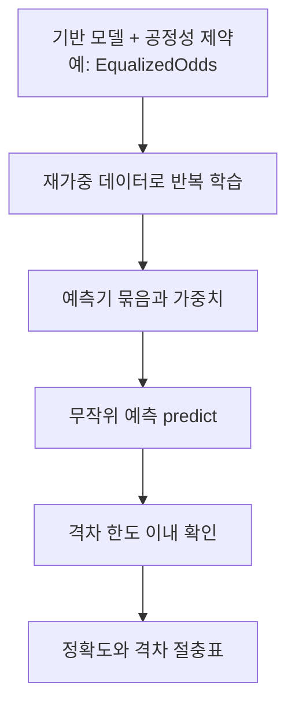

# 공정성 제약 학습

> 모델을 학습하는 단계에서 집단 간 격차(선발률 차이, 오류율 차이 등)를 **일정 한도 이내로 제한**하며 학습시키는 방법. 학습 후 임계값을 고치는 사후 처리와 구분된다.

## 쉽게 말하면
시험 문제를 만들 때 "특정 지역 학생에게만 유리한 문제는 빼라"는 조건을 처음부터 걸고 만드는 것과 같다. 만들고 나서 점수를 보정하는 것보다 설계 단계에서 제약하는 방식이다.

## 자세히
출처: Fairlearn 공식 문서의 완화 기법 개요와 Reductions 페이지(본문 확인, 2026-11-18). 수치 성능 비교는 읽은 페이지에 없다.
- **방식 구분**: 전처리(CorrelationRemover), **학습 중 처리(Reductions: ExponentiatedGradient, GridSearch)**, 적대적 학습(AdversarialFairnessClassifier·Regressor), 사후 처리(ThresholdOptimizer, 이진 분류만).
- **Reductions**: 임의의 기반 모델을 감싸 제약 하에서 재학습한다. 기반 모델은 `fit`과 `predict`가 있고 `fit`이 `sample_weight`를 받아야 한다(재가중에 사용).
- **제약 종류(분류)**: `DemographicParity`(선발률 동일), `TruePositiveRateParity`, `FalsePositiveRateParity`, `EqualizedOdds`(둘 다), `ErrorRateParity`. 회귀는 `BoundedGroupLoss`(집단별 평균 손실 상한). 다중 클래스는 문서 기준 미지원.
- **한도 지정**: `difference_bound`는 각 집단 지표와 전체 값의 허용 차이. 집단이 전체 평균과 비교되므로 두 집단 간 차이는 최대 이 값의 2배까지 갈 수 있다. `ratio_bound`는 비율 허용치. 둘을 동시에 지정할 수 없다.
- **ExponentiatedGradient**: 재가중 데이터셋 열로 재학습해 **예측기들의 확률 분포**를 만든다. `predict()`가 무작위라 같은 입력에서도 결과가 달라질 수 있고(`random_state`로 고정), `predict_proba`는 없다. 예측 시점에 민감 속성은 필요 없다.
- **GridSearch**: 가중치·재라벨 격자마다 예측기를 하나씩 학습해 `predictors_`로 정확도-공정성 절충을 직접 볼 수 있다.
- **경고(문서)**: 알고리즘은 불공정성 지표의 한계를 보장할 뿐 "결과가 공정하다는 뜻은 아니다." 공정성 정의 선택은 별도의 판단이다.
- **LDA와의 관계**: 이 방법은 [LDA 탐색](#lda-search-process)의 후보 생성 수단 중 하나로 쓸 수 있다(해석).

## 그림으로 보기


## 예시
```python
from fairlearn.reductions import ExponentiatedGradient, EqualizedOdds
mit = ExponentiatedGradient(base_estimator, EqualizedOdds(difference_bound=0.01))
mit.fit(X_train, y_train, sensitive_features=A_train)
y_pred = mit.predict(X_test, random_state=42)
```
한도를 0.01, 0.02, 0.05로 바꿔 보며 정확도와 격차의 맞교환 곡선을 그린다.

## 헷갈리는 것과 비교
| 개념 | 차이 |
|---|---|
| 공정성 제약 학습 | 학습 중 격차를 제한 |
| ThresholdOptimizer | 학습 후 집단별 임계값 조정 |
| CorrelationRemover | 입력에서 민감 속성 상관을 제거 |
| [모델 다중성](#model-multiplicity) | 제약 없이도 격차가 다른 동등 모델이 존재 |

## 더 읽을거리
- [Fairlearn 완화 기법 개요](https://fairlearn.org/main/user_guide/mitigation/index.html) — 전처리·학습 중·사후 처리 비교
- [Fairlearn Reductions](https://fairlearn.org/main/user_guide/mitigation/reductions.html) — 제약·difference_bound·사용 예
