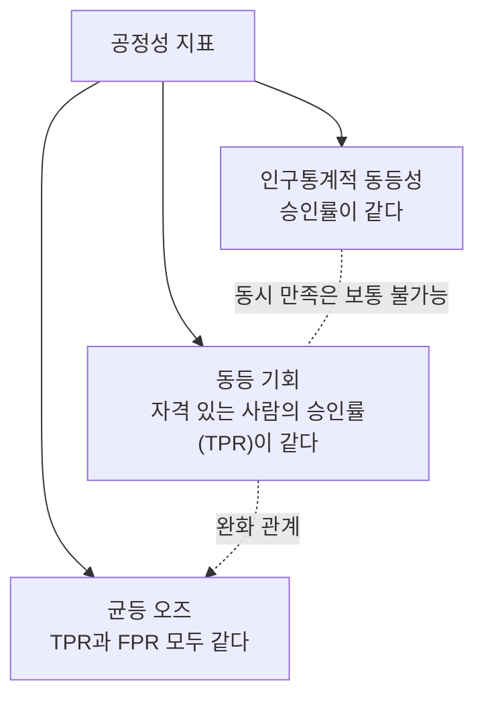
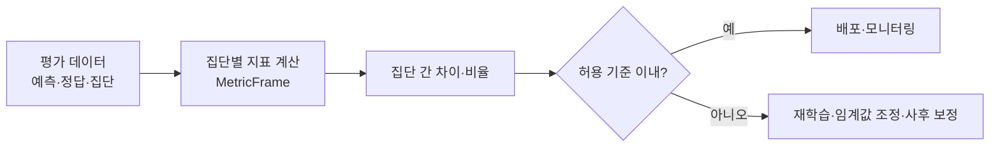

# 공정성 지표

> 모델의 판단이 집단(성별·인종·연령 등)에 따라 불리하게 갈리는지를 숫자로 재는 방법들. 대표 지표로 인구통계적 동등성, 동등 기회, 균등 오즈가 있고, 이들을 동시에 모두 만족시키기는 일반적으로 불가능하다.

## 쉽게 말하면
같은 시험을 보는 두 학교 학생이 있다. "합격률이 두 학교에서 같아야 한다"(결과의 동등), "실력 있는 학생이 합격할 확률이 두 학교에서 같아야 한다"(기회의 동등)는 서로 다른 공정함이다. 어느 쪽을 공정하다고 볼지는 상황과 가치 판단에 달려 있고, 둘이 충돌하기도 한다.

## 자세히
(분류 모델 기준. Fairlearn 사용자 가이드의 정의)
- **인구통계적 동등성(demographic parity)**: 예측이 민감 속성(집단)과 독립. 이진 분류에서는 집단별 선택(승인)률이 같다. Fairlearn의 `demographic_parity_difference()`는 집단 간 선택률의 최대-최소 차(0이면 동등), `demographic_parity_ratio()`는 최소/최대(1이면 동등). 실제 정답 라벨을 고려하지 않아 거친 제약이 될 수 있다.
- **균등 오즈(equalized odds)**: 참 라벨이 주어졌을 때 예측이 집단과 독립. 즉 **참양성률(TPR)과 거짓양성률(FPR)이 집단 간 같다**. `equalized_odds_difference()`는 두 차이 중 큰 값.
- **동등 기회(equal opportunity)**: 균등 오즈를 완화해 **양성 라벨 집단의 TPR만** 같게 한다. "자격 있는 사람이 합격할 확률이 같다". Hardt·Price·Srebro(2016, arXiv 1610.02413)가 제안했고 FICO 신용점수 사례로 시험했다. 이미 만든 예측기를 사후 조정해 차별을 줄이는 방법을 제시하며, 나쁜 분류의 비용을 불리한 집단에서 의사결정자에게 옮기는 효과를 말한다.
- **불가능성 결과**: Kleinberg·Mullainathan·Raghavan(2016)은 세 가지 공정성 조건을 동시에 만족하는 방법이 극히 제한된 특수한 경우를 빼고는 없다고 증명했다. 따라서 어떤 지표를 우선할지는 선택이다.
- **한계(Fairlearn 문서)**: 지표를 만족해도 공정하다는 보장이 아니다. 라벨 자체에 역사적 편향이 있으면 동등 기회·균등 오즈의 가치가 줄고, 집단 크기가 작거나 클래스가 불균형하면 통계적으로 불안정하다. 하위 집단을 많이 볼수록 다중 비교 문제가 생기고, 전체 평균은 심슨의 역설로 오해를 부를 수 있다. 동등 기회는 거짓양성의 비용 차이를 반영하지 못한다.
- **측정 도구**: Fairlearn(`MetricFrame`으로 하위 집단별 지표), IBM AIF360 등.

## 그림으로 보기

## 예시
채용 선별 모델에서 남성 지원자 승인률이 40%, 여성이 30%라면 인구통계적 동등성 차이는 0.10(비율 0.75). 실제로 자격 있는 지원자만 보면 TPR이 남성 80%, 여성 60%라면 동등 기회 위반이다. 이때 집단별 임계값을 조정해 TPR을 맞추는 사후 처리를 검토하되, 법적 허용 여부(차별 금지법)와 정확도 하락도 함께 따진다.

## 헷갈리는 것과 비교
| 지표 | 같게 맞추는 것 | 약점 |
|---|---|---|
| 인구통계적 동등성 | 집단별 승인률 | 정답 라벨 무시, 실제 자격 차이를 덮을 수 있음 |
| 동등 기회 | 양성 집단의 TPR | FPR 차이·비용 무시 |
| 균등 오즈 | TPR + FPR | 더 엄격해 정확도 손실 가능, 라벨 편향에 취약 |
| [설명 가능성](#explainability) | 지표가 아니라 판단 이유를 보여 줌 | 공정성을 보장하지 않음 |

## 더 읽을거리
- [Fairlearn: Common fairness metrics](https://fairlearn.org/main/user_guide/assessment/common_fairness_metrics.html) — 정의·함수·주의점
- [Equality of Opportunity in Supervised Learning (arXiv 1610.02413)](https://arxiv.org/abs/1610.02413) — 동등 기회 제안과 FICO 사례
- [Inherent Trade-Offs in the Fair Determination of Risk Scores (arXiv 1609.05807)](https://arxiv.org/abs/1609.05807) — 동시 만족 불가능성
