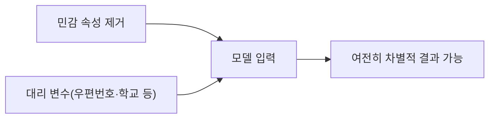
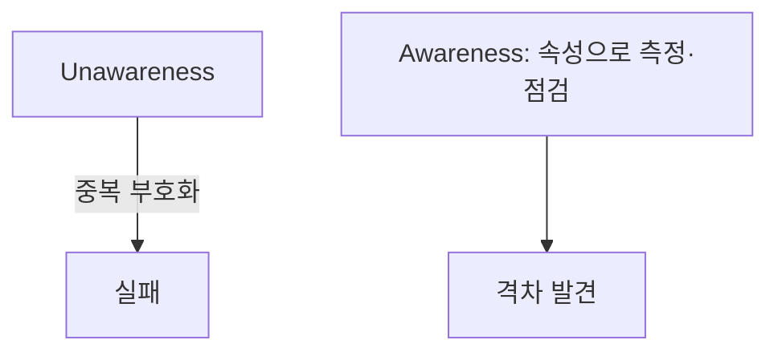

# Fairness through unawareness

> 모델 입력에서 성별·인종 같은 민감 속성을 빼면 공정해진다는 생각이다. 다른 특징이 그 속성을 사실상 담고 있으면(중복 부호화) 효과가 없거나 해로울 수 있다.

## 쉽게 말하면
이력서에서 이름과 성별란을 지워도 "출신 학교·취미·경력 공백"이 성별을 알려 준다면 차별은 사라지지 않는다. 눈을 가린다고 편견이 없어지지 않는다.

## 자세히
(Dwork 외 "Fairness Through Awareness" arXiv 1104.3913과 fairmlbook을 하위 에이전트가 읽은 노트. fairmlbook은 요약으로 읽어 표현은 의역이다.)
- **용어**: Dwork 외는 "fairness through **blindness**"라 부르고, fairmlbook은 "unawareness"라 부른다.
- **Dwork 외의 지적**: 부록 A에서 **중복 부호화(redundant encoding)** 가 "blindness에 대한 성공적인 공격"이라고 한다. 예: 페이스북 프로필에서 성별과 "남성/여성에 관심" 항목을 지워도 성적 지향이 숨겨지는 것은 "거의 확실히 아니다".
- **fairmlbook**: 민감 속성을 빼는 것이 "효과가 없거나 오히려 해로울 수 있다"고 서술.
- **대안 방향(제안)**: 민감 속성을 평가용으로는 수집해 집단별 성능·결과를 측정([교차 평가](#intersectional-evaluation)), 대리 변수 점검, 필요한 경우 유사한 개인은 유사하게 처리하는 "인식을 통한 공정성" 접근(Dwork 외).
- **주의**: 법적·윤리적으로 민감 속성 수집이 제한되는 영역이 있어 설계 시 규정을 확인한다.

## 그림으로 보기

## 예시
- 채용 모델에서 성별 컬럼만 제거했는데 "여대 출신" 특징이 성별을 대신해 결과 격차 지속.
- 교육 활용: "민감 속성을 빼면 공정한가?"를 토론하고 대리 변수 찾기 실습.

## 헷갈리는 것과 비교
| 개념 | 차이 |
|---|---|
| Unawareness | 속성을 입력에서 제거 |
| Awareness | 속성을 사용해 격차를 측정·교정 |
| [대리 변수](#proxy-variables) | unawareness가 실패하는 이유 |

## 더 읽을거리
- [Fairness Through Awareness (arXiv 1104.3913)](https://arxiv.org/abs/1104.3913) — 부록 A.
- [Fairness and Machine Learning (fairmlbook)](https://fairmlbook.org/) — 민감 속성 제거의 한계.
