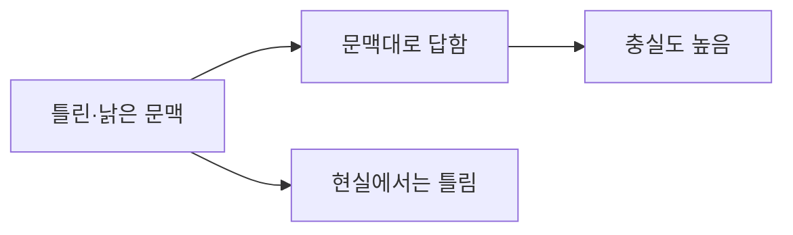

# 충실하지만 틀린 답

> 검색된 **문맥에는 충실한데 현실에서는 틀린 답**이다. 충실도 점수는 높지만 문맥 자체가 틀렸거나 낡았을 때 생긴다.

## 쉽게 말하면
교과서가 틀렸는데 학생이 교과서 그대로 답했다면 "책에 충실"하지만 "정답은 틀림"이다. 충실도는 "책대로 말했나"만 재기 때문이다.

## 자세히
(RAGAS faithfulness 문서와 HHEM 모델 카드를 직접 읽었다.)
- **정의(RAGAS)**: 충실도는 응답의 주장이 **검색된 문맥에서 추론 가능한지**만 본다. 문서는 현실 정확성은 다루지 않는다.
- **결과(해석)**: 문맥이 틀리면 그것을 그대로 옮긴 답도 높은 점수를 받는다. 이 글의 이전 글 [충실도](#groundedness-metric)가 같은 한계를 적었다.
- **반대 방향(HHEM 카드)**: 사실이지만 전제에 없는 주장은 환각으로 표시될 수 있다. 즉 충실도 판정은 "사실 여부"가 아니라 "전제 뒷받침 여부"다.
- **대책(제안, 문서 밖)**: 출처 문서의 신뢰도·최신성을 따로 점검하고, 사실성은 별도 정답 기반 평가나 사람 검토로 잰다.

## 그림으로 보기

## 예시
- 구버전 환불 규정이 검색됐고 챗봇이 그대로 답함 → 충실도 1.0, 실제로는 오안내. 문서 버전 관리가 필요(제안).

## 헷갈리는 것과 비교
| 개념 | 묻는 것 |
|---|---|
| 충실도 | 문맥에서 나온 말인가 |
| 사실성 | 현실에서 맞는가 |
| [문맥 품질](#context-quality-vs-faithfulness) | 검색된 문맥이 좋은가 |

## 더 읽을거리
- [RAGAS — Faithfulness](https://docs.ragas.io/en/stable/concepts/metrics/available_metrics/faithfulness/index.md) — 정의(직접 읽음).
- [HHEM 모델 카드](https://huggingface.co/vectara/hallucination_evaluation_model) — 비대칭·미지지 주장 한계(직접 읽음).
