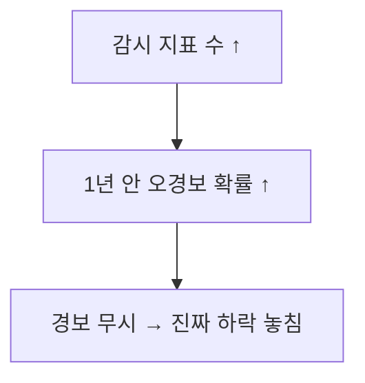
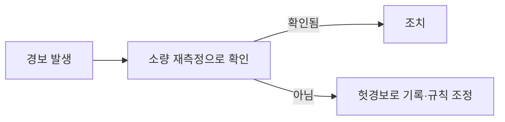

# 헛경보율

> 헛경보율은 라벨 품질에 문제가 없는데도 감시 규칙이 경보를 울리는 비율이다. 지표를 많이 감시할수록, 규칙이 민감할수록 헛경보가 쌓여 팀이 경보를 무시하게 된다.

## 쉽게 말하면
양치기 소년 이야기처럼 늑대가 없는데 자꾸 울리면 진짜 늑대가 올 때 아무도 안 믿는다. 경보는 정확해야 신뢰를 얻는다.

## 자세히
- **기본 성질(Wikipedia, Control chart)**: 3σ 한계선을 쓰면 관리 상태에서도 약 370개 점마다 한 번은 우연히 신호가 난다. 규칙 집합은 데이터를 보기 전에 정해야 한다(사후 선택은 1종 오류율을 키운다). 정상일 때 평균 런 길이(ARL)는 오경보의 비용이다(Wikipedia, CUSUM).
- **직접 계산(주 1회 점검, 지표별 ARL을 가정, 1년 52주)**: 한 지표만 감시해도 ARL이 233주면 1년 안에 오경보가 한 번 이상 날 확률이 20%다. 지표가 5개면 67%, 20개면 98.9%. ARL이 370이어도 5개면 50.5%, 20개면 94.0%다.

| 지표별 ARL | 지표 1개 | 5개 | 20개 |
| --- | --- | --- | --- |
| 233주 | 0.200 | 0.673 | 0.989 |
| 370주 | 0.131 | 0.505 | 0.940 |

  (독립이라는 가정의 계산이다. 실제 지표는 서로 상관이 있어 이보다 낮을 수 있다.)
- **전체 헛경보를 연 1회 정도로 묶으려면(직접 계산)**: 지표 5개면 지표별 ARL이 약 258주, 20개면 약 1,030주여야 한다. 지표가 많을수록 각 지표의 규칙을 훨씬 엄격하게 해야 한다. 엄격하게 하면 탐지 지연이 늘어난다([탐지 지연과 비용](#detection-delay-tradeoff)).
- **줄이는 방법(해석)**: ① 감시 지표를 핵심 소수로(전체 kappa, 가장 위험한 클래스 몇 개) ② 합산·이동 평균으로 흔들림 감소([이동 평균 kappa](#moving-average-kappa)) ③ "두 주 연속" 같은 확인 규칙([재보정 조건](#recalibration-trigger)) ④ 경보 → 바로 조치가 아니라 가벼운 재확인 단계(소량 재측정)를 둔다 ⑤ 경보 기록과 결과(진짜 문제였는지)를 남겨 규칙을 조정한다.

## 그림으로 보기

## 예시
- 클래스 20개를 각각 3σ 규칙으로 매주 감시하면 1년에 거의 확실히 헛경보가 난다. 핵심 5개 클래스만 감시하고 전체 kappa와 함께 본다.
- 교육 활용: 지표 수를 바꿔 가며 1년 오경보 확률을 계산한다.

## 헷갈리는 것과 비교
| 개념 | 차이 |
| --- | --- |
| 헛경보(1종 오류) | 문제 없는데 경보 |
| 미탐지(2종 오류) | 문제가 있는데 경보 안 함 |
| [탐지 지연과 비용](#detection-delay-tradeoff) | 둘을 맞바꾸는 관계 |
| [라벨링 관리도](#control-chart-for-labeling) | 규칙 집합 정의 |

## 더 읽을거리
- [Control chart (Wikipedia)](https://en.wikipedia.org/wiki/Control_chart) — 3σ에서 약 370점마다 우연 신호, 규칙은 사전 선택
- [CUSUM (Wikipedia)](https://en.wikipedia.org/wiki/CUSUM) — 정상 ARL = 오경보 비용
