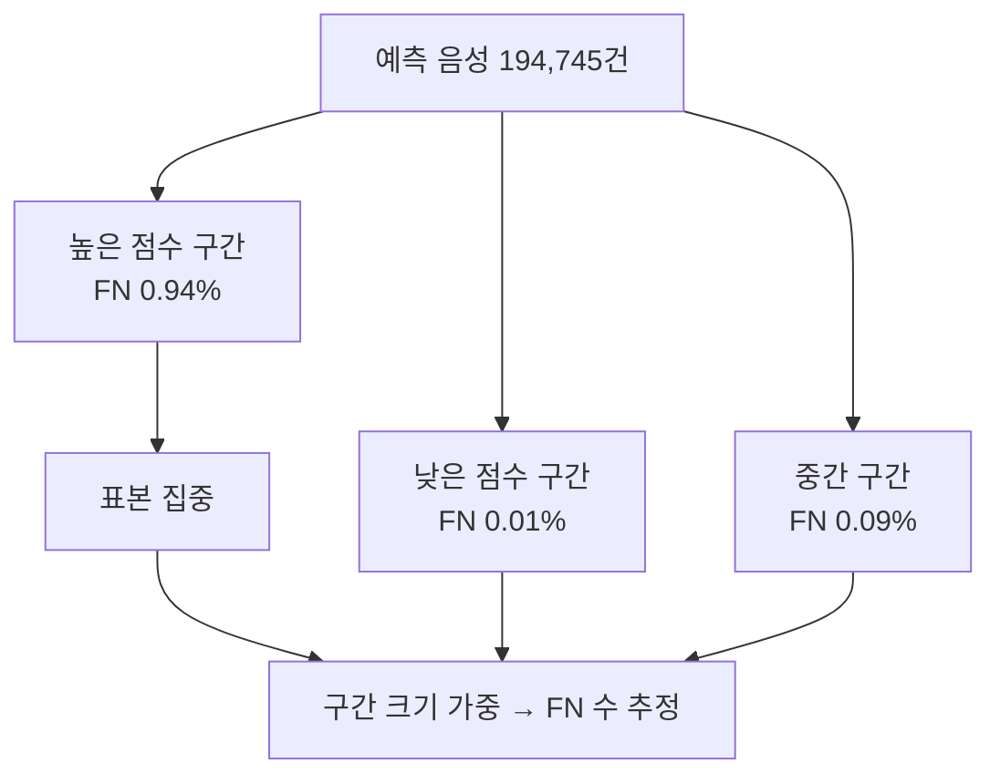

# 거짓 음성 표집

> 모델이 "음성"이라 한 항목 중에서 **놓친 양성(거짓 음성)** 을 찾아내는 표집. 음성 칸은 크고 양성이 극히 드물어 단순 무작위로는 거의 못 잡으므로, **점수가 높은 구간에 표본을 집중**하는 층화가 필요하다.

## 쉽게 말하면
"문제 없음" 도장이 찍힌 서류 20만 장 중 잘못 통과된 것이 몇 장인지 알고 싶다. 아무거나 100장 열어 봐도 한 장 나올까 말까다. 그래서 "거의 의심스러웠던" 서류 더미에서 더 많이 뽑아 본다.

## 자세히
- **직접 실행**(numpy: 200,000개, 양성 0.5%, 임계값 2.0; 예측 음성 칸의 양성(FN) 비율 0.17%, 진짜 재현율 0.676; 예측 양성에서 100개, 예측 음성에서 아래 방식으로 표집, 1,000회 반복):

| 음성 칸 표집 방식 | 재현율 추정 평균 | 표준편차 |
|---|---|---|
| 음성 칸 전체에서 무작위 100개 | 0.874 | 0.284 |
| 점수 구간 3개, 총 300개 균등 | 0.725 | 0.217 |
| 점수 구간 3개, 총 300개 상위 구간 집중(20·60·220) | 0.720 | 0.170 |
| 점수 구간 3개, 총 1,000개 집중(100·200·700) | 0.692 | **0.123** |

  - 음성 칸의 점수 구간별 FN 비율은 0.01%·0.09%·0.94%로 **상위 구간에 몰려 있다**. 그래서 상위 구간에 집중한 표집이 같은 예산에서 분산이 작다.
  - 단순 무작위는 표본이 작을 때 FN을 거의 못 잡아 재현율이 과대 추정(0.874 vs 진짜 0.676)되고 매우 불안정하다. 예산이 커지고 집중할수록 진짜 값(0.676)에 가까워지지만 1,000개로도 표준편차 0.12가 남는다. 재현율 확인이 비싼 이유다.
- **정리**: 정밀도는 예측 양성 칸에서 쉽게 재지만, 재현율은 음성 칸의 희귀 양성을 찾아야 해서 표본이 많이 든다. 가중치(층 크기÷표집 수)를 꼭 곱한다.
- 한계: 이 수치는 합성 정규 점수 분포 하나의 결과이며, 실제 점수 분포에서는 구간 설계가 달라진다.

## 그림으로 보기

## 예시
- 사기 탐지 모델이 통과시킨 거래 중 "사기 점수 상위 5%"에서 사람이 전수 검토 → 놓친 사기 규모를 추정.
- 콘텐츠 필터의 누락 신고(사용자 신고)를 활용한 사후 표집.

## 헷갈리는 것과 비교
| 개념 | 차이 |
|---|---|
| 거짓 음성 표집 | 음성 칸의 놓친 양성 추정 |
| [층화 평가 표집](#stratified-evaluation-sampling) | 예측 층별 표집의 전체 설계 |
| 하드 네거티브 마이닝 | 학습용 어려운 음성 고르기(목적이 다름) |
| [가중 추정의 신뢰구간](#weighted-confidence-interval) | 위 추정의 불확실성 계산 |

## 더 읽을거리
- [Wikipedia: Stratified sampling](https://en.wikipedia.org/wiki/Stratified_sampling) — 층 가중 추정 원리.
- [scikit-learn: Metrics and scoring](https://scikit-learn.org/stable/modules/model_evaluation.html) — 재현율 정의.
