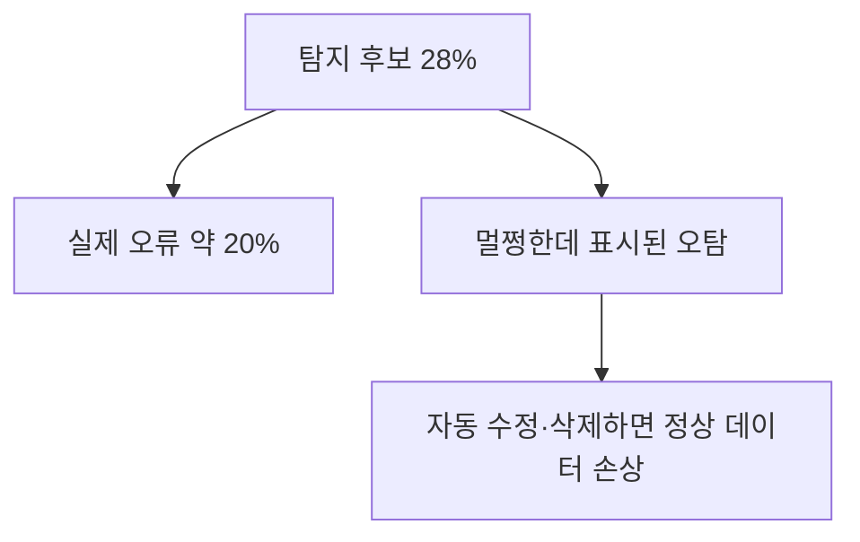
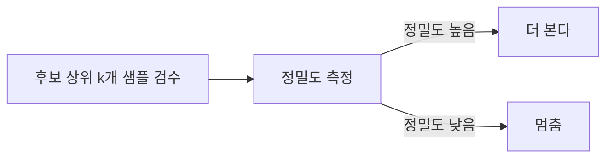

# 라벨 오류 오탐

> 라벨 오류 오탐(false positive)은 라벨이 멀쩡한데 탐지 도구가 오류로 표시하는 경우다. 표시된 후보를 전부 오류로 믿고 수정·삭제하면 정상 데이터를 망가뜨린다.

## 쉽게 말하면
화재경보기가 요리 연기에도 울리는 것과 같다. 경보가 울렸다고 모두 불이 난 것은 아니므로, 소방관(검수자)이 가서 확인해야 한다. 경보가 울릴 때마다 건물을 비워 버리면 오히려 피해가 커진다.

## 자세히
- **실제 수치(cleanlab in-depth 튜토리얼)**: 건강 점수는 라벨의 약 28%를 의심했지만 실제 오류는 약 20%였다. 겹치는 클래스 사이 샘플이 자주 오류로 계산됐다고 문서는 설명한다. 이 예제는 참 라벨을 아는 장난감 데이터이며, 실무에서는 참 라벨이 없어 검수 샘플로만 정밀도를 추정할 수 있다.
- **오탐이 생기는 이유(해석)**: ① 모델 확률이 틀린 경우(모델 약함, 과소학습) ② 클래스가 겹치는 모호한 샘플([모호한 샘플 vs 오류 라벨](#ambiguous-vs-wrong-label)) ③ 드문 하위집단의 정상 샘플을 모델이 못 배운 경우. 관련 연구는 노이즈 처리 기법이 자주 나오는(고빈도) 샘플에는 도움이 되고 드문 샘플에는 덜 도움이 된다고 보고한다(Understanding Instance-Level Label Noise, arXiv 2102.05336).
- **줄이는 방법(해석)**: `filter_by` 옵션을 더 보수적으로 고르거나 `frac_noise`로 일부만 받는다(cleanlab filter 문서). 점수 상위 후보부터 소수만 검수해 정밀도를 재고([precision@k](#precision-at-k-review)) 정밀도가 낮아지는 지점에서 멈춘다.
- **원칙**: 후보는 "검수 대기열"이지 "삭제 목록"이 아니다.

## 그림으로 보기

## 예시
- 후보 500건 중 검수에서 320건만 실제 오류라면 정밀도 64%이며 나머지 180건은 오탐이다(가정한 예). 이 비율을 보고 자동 수정은 금지하고 사람 검토만 한다.
- 교육 활용: 경보 정확도 개념(정밀도·재현율)과 함께 라벨 오류 탐지 결과표를 분석하게 한다.

## 헷갈리는 것과 비교
| 개념 | 차이 |
| --- | --- |
| 오탐 | 정상인데 오류로 표시 |
| 미탐 | 오류인데 못 찾음 |
| [하드 샘플 제거 부작용](#hard-sample-removal) | 오탐을 삭제했을 때의 피해 |
| [삭제 대신 보류](#quarantine-instead-of-delete) | 오탐 피해를 줄이는 처리 |

## 더 읽을거리
- [cleanlab in-depth tutorial](https://docs.cleanlab.ai/stable/tutorials/indepth_overview.html) — 28% 의심 vs 20% 실제 오류 사례
- [cleanlab filter 문서](https://docs.cleanlab.ai/stable/cleanlab/filter.html) — filter_by, frac_noise
- [Understanding Instance-Level Label Noise (arXiv 2102.05336)](https://arxiv.org/abs/2102.05336) — 고빈도 샘플에만 이득이 큰 노이즈 처리
