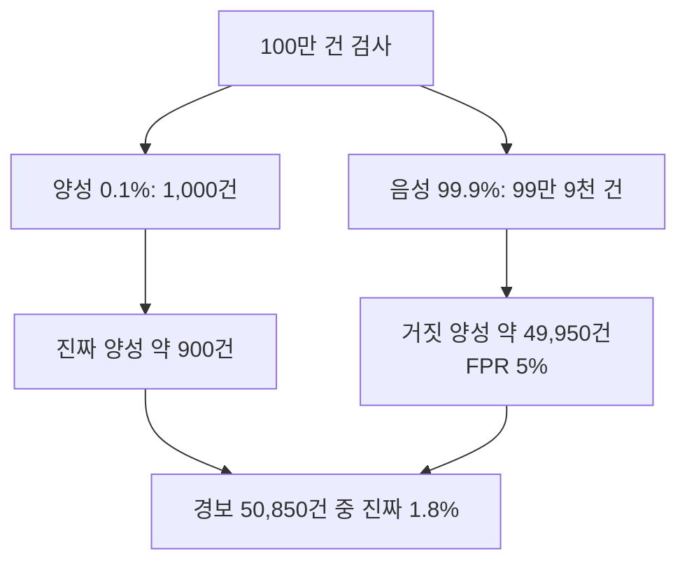

# 거짓 양성 규모

> 양성이 드문 환경에서는 거짓 양성률(FPR)이 작아도 **음성 모집단이 거대해서 거짓 양성의 절대 개수가 진짜 양성을 압도**한다. 경보 처리 인력·비용을 정할 때 비율이 아니라 개수로 계산해야 한다.

## 쉽게 말하면
"건강한 사람의 5%를 잘못 환자로 판정"은 작은 숫자처럼 들린다. 하지만 검사 대상 100만 명 중 환자가 1,000명뿐이면, 건강한 99만 9천 명의 5%인 약 5만 명이 거짓 경보를 받는다. 진짜 환자는 최대 1,000명이다. 비율은 작아도 곱해지는 모수가 크다.

## 자세히
- **개수 공식**: 거짓 양성 수 FP = FPR × N × (1−p), 진짜 양성 수 TP = TPR × N × p (N=검사 건수, p=양성 비율).
- **FP : TP 비** = FPR(1−p) / (TPR·p). p가 작아지면 분모가 작아져 비가 폭증한다.
- **계산 예(TPR 0.90, FPR 0.05, N=100만)**
  | 양성 비율 p | TP | FP | 경보 중 진짜 비율 |
  |---|---|---|---|
  | 10% | 90,000 | 45,000 | 66.7% |
  | 1% | 9,000 | 49,500 | 15.4% |
  | 0.1% | 900 | 49,950 | 1.8% |
- **FPR을 낮추는 효과**: 0.1% 환경에서 FPR을 0.05→0.005로 10배 낮추면 FP 약 4,995개, 경보 중 진짜 비율 약 15%. 희귀 사건에서는 FPR을 한 자릿수 %가 아니라 **0.1% 이하**로 눌러야 쓸 만하다.
- **참고 사례(Wikipedia, 기저율 오류)**: 인구 1,000명 중 2% 감염, 위양성률 5%이면 양성 69명 중 거짓이 49명(진짜는 20명, 약 29%만 진짜).
- **운영 영향**: 사기 탐지·보안 경보·콘텐츠 검수처럼 사람이 경보를 처리하는 시스템에서는 "하루 거짓 경보 수 ≤ 처리 가능 인원"이 실질 제약이다. 이를 넘으면 경보 피로(alert fatigue)로 진짜 경보도 무시된다.
- **대응**: 임계값을 올려 FPR을 낮추기(재현율과 교환), 2단계 검증(저렴한 1차 + 정밀한 2차), 경보 우선순위 정렬, 처리 용량을 기준으로 임계값을 역산.

## 그림으로 보기

## 예시
- 신용카드 사기 탐지: 사기 0.1%, FPR 1%만 돼도 하루 1,000만 건 거래에서 거짓 경보 약 10만 건. 처리 인력 용량에서 임계값을 거꾸로 정한다.
- 교육용 질문: "검사 정확도 95%인데 양성이 나오면 95% 확률로 환자일까?"를 베이즈 정리로 풀어 보게 한다.
- 간단 계산: `fp = fpr*n*(1-p); tp = tpr*n*p; precision = tp/(tp+fp)`

## 헷갈리는 것과 비교
| 개념 | 의미 | 비율 영향 |
|---|---|---|
| FPR | 음성 중 오경보 비율 | 무관 |
| 거짓 양성 수 | 오경보 절대 개수 | N과 (1−p)에 비례 |
| 정밀도 | 경보 중 진짜 비율 | p에 크게 의존([시험 세트 비율 불일치](#test-prior-mismatch)) |

## 더 읽을거리
- [Wikipedia: Base rate fallacy](https://en.wikipedia.org/wiki/Base_rate_fallacy) — 위양성 역설의 수치 예(직접 열어 확인).
- [Saito & Rehmsmeier 2015](https://journals.plos.org/plosone/article?id=10.1371/journal.pone.0118432) — 불균형에서 PR 곡선의 가치.
