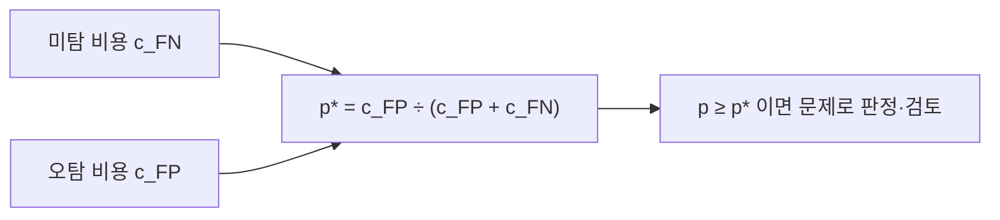
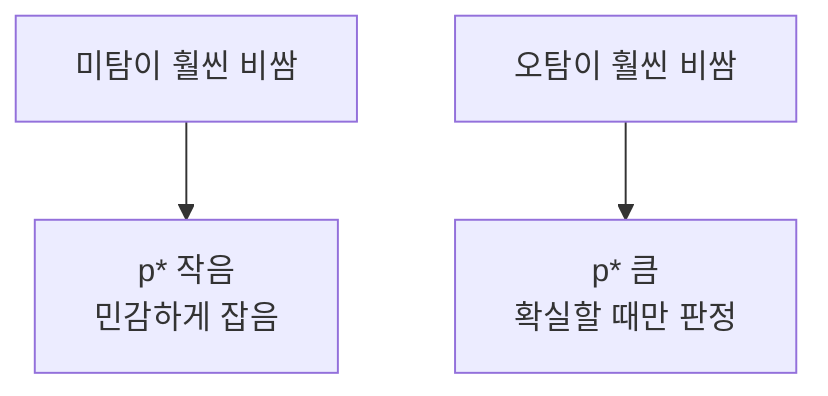

# 오탐 vs 미탐 비용

> 오탐(false positive, 멀쩡한 건을 문제라고 판정)과 미탐(false negative, 진짜 문제를 놓침)은 대개 가격이 크게 다르다. 두 비용의 비율이 곧 "얼마나 의심스러우면 사람에게 넘길지"의 기준선을 정한다.

## 쉽게 말하면
스팸 필터가 중요한 메일을 스팸으로 보내는 것(오탐)과 광고 메일이 받은편지함에 오는 것(미탐)은 크기가 다르다. 보안 검색에서는 위험물을 놓치는 것이 훨씬 비싸다. 비싼 쪽 실수를 줄이려면 반대쪽 실수를 더 감수해야 한다.

## 자세히
- **기준선 공식(Elkan, IJCAI 2001, 본문 열람)**: 2클래스에서 최적 예측은 "클래스 1로 예측했을 때의 기대 비용이 0으로 예측했을 때의 기대 비용 이하일 때"다. 이를 정리하면 임계값 p*가 비용 행렬만으로 정해진다고 논문은 설명한다(PDF 수식이 글자로 추출되지 않아 식은 직접 유도). 오탐 비용 c_FP, 미탐 비용 c_FN일 때 양성으로 예측하는 조건은 (1−p)·c_FP ≤ p·c_FN, 즉 **p ≥ c_FP / (c_FP + c_FN)**이다. 오탐 비용 1, 미탐 비용 5면 p* = 1/6 ≈ 0.17이다.
- **의미**: 비용 비율만 중요하고 금액의 크기는 상관없다. 모든 비용에 양수를 곱하면 최적 결정이 같다(Elkan 논문과 검색 요약). 논문은 2×2 비용 행렬이 행렬로는 자유도 2지만 결정 관점에서는 사실상 자유도 1이라고 설명한다.
- **비용 대신 이득으로 계산하라(같은 논문)**: 비용 표를 쓸 때 칸마다 기준선이 달라 논리적 모순이 생기기 쉽다. 논문은 독일 신용 데이터의 비용 행렬(나쁜 고객을 좋은 줄 알고 승인 5, 좋은 고객을 거절 1, 나머지 0)이 "거절"이라는 행동의 결과가 고객이 좋은지 나쁜지와 무관하게 같아야 한다는 점에서 경제적으로 맞지 않다고 지적한다. 모든 칸을 행동 전 상태를 기준선으로 한 이득으로 적으라고 권한다.
- **예시 의존 비용(같은 논문)**: 신용카드 거래에서 승인한 사기 거래의 비용은 거래 금액이므로 건마다 다르다. 단가를 상수로 두면 부정확할 수 있다.
- **계산 예(직접)**: 검토 비용 3,000원, 놓친 오류 20만 원이면 "검토 vs 방치"의 기대 비용 비교로 p ≥ 3,000/200,000 = 1.5%에서 검토한다. 이 기준은 점수가 아니라 **보정된 확률**에 적용해야 한다. 점수가 확률과 다르면 [결정 임계값 튜닝](#decision-threshold-tuning)처럼 검증 데이터에서 찾는다.
- **한계**: 비용 추정이 어렵고 사람의 신뢰·평판 같은 비재무 비용은 숫자로 옮기기 힘들다. 검토 용량이 한정되면 최적 기준선 대로 못 한다.

## 그림으로 보기

## 예시
- 송장 오류 점검: 오류를 놓치면 건당 20만 원, 검토에 3,000원이면 오류 확률이 1.5% 이상인 건은 모두 검토한다. 정상 송장이 대부분이라 검토량은 많아지지만 기대 비용은 낮다.
- 교육 활용: 같은 모델의 오탐·미탐 단가를 각각 바꿔 기준선이 어떻게 움직이는지 표로 정리하는 실습.

## 헷갈리는 것과 비교
| 개념 | 차이 |
| --- | --- |
| [비용 행렬](#cost-matrix) | 네 칸 단가표. 이 글은 그중 두 오류의 비율에 집중 |
| [결정 임계값 튜닝](#decision-threshold-tuning) | 기준선을 데이터로 찾는 절차 |
| 정밀도·재현율 | 오탐·미탐을 건수 비율로 본 지표. 가격을 반영하지 않음 |

## 더 읽을거리
- [Elkan: The Foundations of Cost-Sensitive Learning (IJCAI 2001)](https://ijcai.org/proceedings/2001/133) — 비용 행렬과 최적 임계값
- [Elkan 논문 PDF](https://cseweb.ucsd.edu/~elkan/rescale.pdf) — 비용 대 이득 기준선 논의
