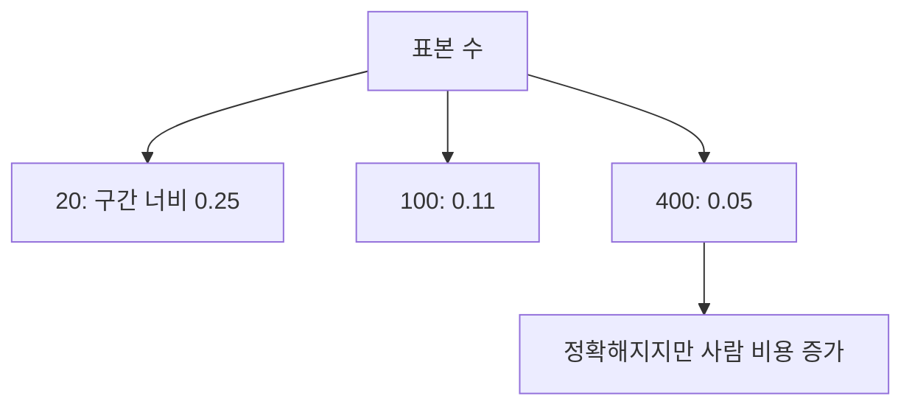

# 오삭제 표본 감사

> 필터가 버린 문서 중 **원래 살려야 했던 것(오삭제)**의 비율을, 제외 파일에서 무작위로 뽑은 표본을 사람이 읽어 추정하는 점검이다. 표본이 작으면 불확실 범위가 넓으니 신뢰구간과 함께 보고한다.

## 쉽게 말하면
쓰레기통을 전부 뒤질 수는 없으니 무작위로 100개를 꺼내 "이건 정말 버릴 것이었나?"를 확인한다. 그중 6개가 아까운 물건이면 전체의 6% 정도가 잘못 버려졌을 것이라고 추정한다. 다만 100개로 본 6%는 3~12%일 수도 있다.

## 자세히
- **절차(제안)**: ① `exclusion_writer`로 필터별 제외 문서를 저장([필터 이유별 통계](#filter-reason-stats)). ② 제외 파일에서 **필터·사유별로** 무작위 N개 추출. ③ 두 명 이상이 "살렸어야 하나"로 판정. ④ 오삭제 비율과 신뢰구간 계산. ⑤ 비율이 높으면 임계값 조정([임계값 조정 루프](#filter-threshold-tuning)).
- **표본 크기와 불확실성**(직접 시뮬레이션: 제외 문서 1만 개, 실제 오삭제 8.3%, 각 크기마다 500번 반복, Wilson 95% 구간):

| 표본 수 N | 평균 구간 너비 | 실제값 포함 비율 |
|---|---|---|
| 20 | 0.248 | 0.99 |
| 50 | 0.155 | 0.94 |
| 100 | 0.109 | 0.97 |
| 400 | 0.054 | 0.96 |

  한 번 뽑은 100개에서 6개가 오삭제였다면 추정 6%, 95% 구간 약 2.8%~12.5%였다. 오차 ±3%p를 원하면 p≈0.08에서 약 315개가 필요하다(1.96²·p(1−p)/0.03²).
- **Wilson 구간을 쓰는 이유**: 단순 정규근사(Wald)는 표본이 작거나 비율이 0 근처면 폭이 0으로 붕괴하거나 범위를 넘을 수 있어 부정확하고, Wilson은 이런 경우에도 안정적이다(Wikipedia 확인). 오삭제가 0건이어도 "0%"가 아니라 대략 3/N 이하로 말한다(rule of three).
- **주의**: 사유별로 나눠 뽑으면 표본이 나뉘어 각 구간이 넓어진다. 비중이 큰 사유부터 표본을 늘린다. 시뮬레이션은 사람이 완벽히 판정한다고 가정했으며 판정자 간 불일치는 반영하지 않았다.

## 그림으로 보기

## 예시
- 한국어 문서가 영어 규칙에 대량 제거되는지 의심될 때: `gopher_enough_stop_words` 제외분에서 150개를 뽑아 한국어 정상 문서 비율을 센다.
- 교육: 합성 코드로 표본 크기별 구간 너비를 그려 보며 "표본이 작으면 왜 확신하면 안 되는가"를 체험.

## 헷갈리는 것과 비교
| 개념 | 차이 |
|---|---|
| 오삭제(false removal) | 버리지 말아야 할 것을 버림 |
| 오통과(false keep) | 버려야 할 것을 남김. 통과 파일 표본으로 측정 |
| [필터 통계](#filter-reason-stats) | 개수만 알려 줌 |
| [exclusion writer](#exclusion-writer) | 감사에 쓸 제외 파일을 만드는 도구 |

## 더 읽을거리
- [Binomial proportion confidence interval — Wikipedia](https://en.wikipedia.org/wiki/Binomial_proportion_confidence_interval) — Wilson 구간, 표본 작을 때의 Wald 한계(열어 확인).
