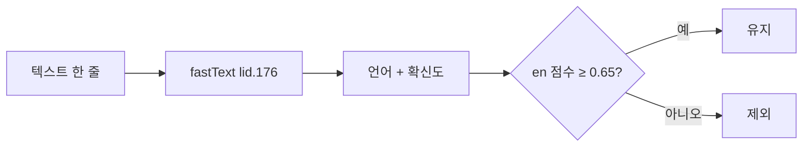
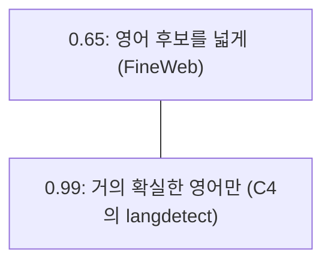

# fastText 언어 식별

> fastText의 `lid.176` 모델은 **176개 언어를 빠르게 식별하는 사전학습 분류기**로, 대규모 웹 데이터 정제에서 langdetect의 대안으로 쓰인다. FineWeb은 이를 이용해 **영어 점수 0.65 이상**인 문서만 남긴다.

## 쉽게 말하면
수천만 장의 문서를 하나하나 읽을 수 없으니 "이 글이 무슨 언어인지"를 한눈에 알려 주는 경량 감별기를 쓰는 것이다. 감별기가 확신하는 정도(점수)를 기준으로 거른다.

## 자세히
- 쓰임(FineWeb 논문 arXiv 2406.17557, 읽음): 기본 필터 단계에서 **fastText 언어 분류기로 영어 점수 ≥ 0.65인 텍스트만 유지**했다. 반면 C4는 langdetect 확률 ≥ 0.99 기준이다([짧은 글 언어 식별](#language-id-short-text)).
- 직접 실행(2026-11-27, `lid.176.ftz` 압축 모델 938,013바이트를 `dl.fbaipublicfiles.com`에서 받고 `fasttext-predict` 패키지로 로드; 정식 `fasttext` 빌드는 이 환경에서 실패해 대체. 영어 문장 13개·타 언어 3개 시험):
  | 문장 | 예측 | 점수 |
  |---|---|---|
  | `Hello` | en | 0.228 |
  | `OK` / `Taxi` | en / en | 0.125 / 0.125 |
  | `Lost Password?` | **fr** | 0.660 |
  | `The lovely Buoy Hostel.` | en | 0.299 |
  | `I love this phone so much!` | en | 0.315 |
  | `The quick brown fox jumps over the lazy dog.` | en | 0.697 |
  | `Photo credit: Getty Images` | en | 0.856 |
  | `Click here to read more` | en | 0.899 |
  | `No problem` | en | 0.923 |
  | `Thanks a lot` / `See you tomorrow at the airport` | en / en | 0.957 / 0.956 |
  | `The battery life is excellent … buy it again.`(18단어) | en | **0.993** |
  | `Das ist ein kurzer Satz.` | de | 1.000 |
  | `오늘 날씨가 정말 좋네요` | ko | 0.992 |
  | `今日は天気がいいですね` | ja | 0.980 |
- 임계값별 통과(영어 13문장): **0.65 이상 7개, 0.9 이상 4개, 0.99 이상 1개.** 같은 문장을 py3langid에서 시험했을 때(0.99 이상 1개)와 경향은 비슷하나 **정답 언어(en)를 맞히는 빈도는 fastText가 더 높았다**(예: `Hello`·`No problem`·`Taxi`는 en으로 예측, py3langid는 다른 언어로 예측). 한국어·일본어·독일어는 짧아도 0.98 이상으로 확신했다.
- 읽는 법: 점수는 **"확률"이라기보다 모델의 확신도**로, 0.65와 0.99는 **서로 다른 목적**(영어 후보를 넓게 / 거의 확실한 영어만)의 기준이다. 짧은 글이 많은 데이터에서 0.99를 쓰면 대량 탈락한다는 점을 이 시험이 다시 보여 준다.
- 사용 요령(제안): ① 줄바꿈을 제거한 한 줄 입력을 쓴다(`predict`는 개행이 있으면 오류) ② 점수 임계값과 최소 길이를 함께 정한다 ③ 혼합 언어 문서는 문단 단위로 식별([문단 단위 언어 판정](#paragraph-level-langid)) ④ 표본에서 오분류를 눈으로 확인.
- 한계: 압축 모델(`ftz`)은 비압축 `bin`보다 정확도가 낮을 수 있고(일반적 설명, 이번에 비교하지 않음), 문장 16개 시험이라 일반화는 금물이다. FineWeb이 사용한 모델 버전과 같은지는 확인하지 못했다.

## 그림으로 보기



## 예시
```python
import fasttext
m = fasttext.load_model("lid.176.ftz")
label, prob = m.predict("Thanks a lot")   # ('__label__en',) [0.957]
```
- 교육: 같은 문장으로 도구 두 개를 비교하고 임계값에 따라 통과 수가 어떻게 달라지는지 표로 정리하는 실습.

## 헷갈리는 것과 비교
| 개념 | 차이 |
|---|---|
| fastText lid.176 | 176개 언어, 빠름, 점수 기반 |
| langdetect | 확률적 n-gram 방식(C4가 사용) |
| py3langid | langid 계열(이번 시험에서 짧은 글 오판 더 많음) |

## 더 읽을거리
- [FineWeb 논문 (arXiv 2406.17557)](https://arxiv.org/abs/2406.17557) — fastText 영어 ≥ 0.65 필터(읽음).
- [fastText 언어 식별 모델](https://fasttext.cc/docs/en/language-identification.html) — lid.176 설명(링크, 모델 파일은 직접 받아 사용).
- 직접 실행: lid.176.ftz로 16개 문장 시험.
