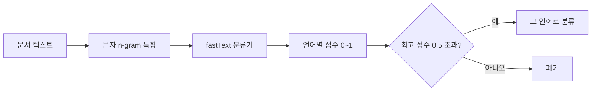
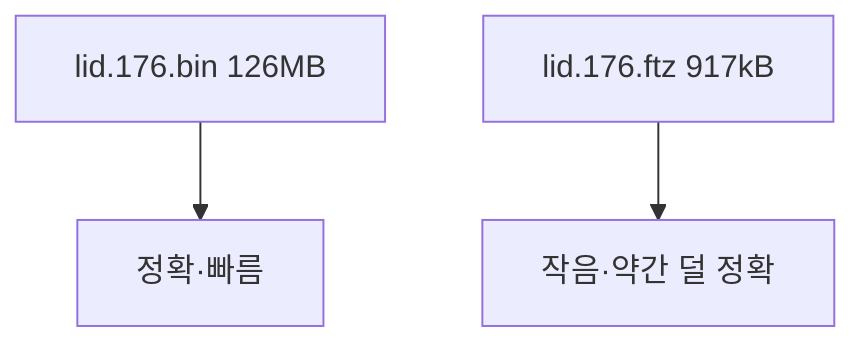

# fastText 언어 식별

> Facebook(Meta)의 fastText 기반 언어 판별 모델. 176개 언어를 알아보며, 데이터 파이프라인(CCNet 등)에서 문서를 언어별로 나누는 표준 도구로 쓰인다.

## 쉽게 말하면
글의 글자 조합(문자 n-gram)을 보고 "이건 한국어, 이건 포르투갈어"라고 찍어 주는 아주 가벼운 판별기다. 한 CPU 코어로도 초당 천 건 정도 처리한다.

## 자세히
(fastText 공식 문서와 CCNet 논문을 직접 열어 확인.)
- **모델 2종**: `lid.176.bin`(약 126MB, 더 빠르고 약간 더 정확) / `lid.176.ftz`(압축판, 약 917kB). 둘 다 176개 언어, UTF-8 입력. 라이선스 CC BY-SA 3.0.
- **CCNet에서의 사용**: Wikipedia·Tatoeba·SETimes로 학습, 문자 n-gram 특징과 계층적 소프트맥스를 쓰며 단일 코어에서 초당 약 1k 문서. 문서의 최고 확률 언어와 점수를 구해 **점수 > 0.5**일 때만 그 언어로 분류, 아니면 폐기.
- **한계(제안)**: 짧은 글, 언어 혼용, 방언·로마자 표기 한국어 등에서 오분류가 늘고 저자원 언어는 학습 데이터가 적어 약하다. 임계값을 올릴수록 정밀도↑·재현율↓.
- **다른 도구**: [cld3](#cld3-language-id)(mC4, 임계값 70%), langdetect(C4, 영어 99%).

## 그림으로 보기

## 예시
- 사내 문서 폴더에서 한국어·영어 문서를 자동 분리.
- 교육 활용: "임계값을 0.5에서 0.9로 올리면 무엇이 사라지는가?" 질문.

## 헷갈리는 것과 비교
| 개념 | 차이 |
|---|---|
| fastText LID | 176개 언어, 가벼움, 점수 임계값 사용 |
| [cld3](#cld3-language-id) | Google 신경망 기반, 107개 라벨 |
| [CCNet](#ccnet) | 이 판별기를 쓰는 파이프라인 |

## 더 읽을거리
- [fastText 언어 식별 문서](https://fasttext.cc/docs/en/language-identification.html) — 모델 2종·언어 수·라이선스.
- [CCNet (arXiv 1911.00359)](https://arxiv.org/abs/1911.00359) — 파이프라인 내 사용.
