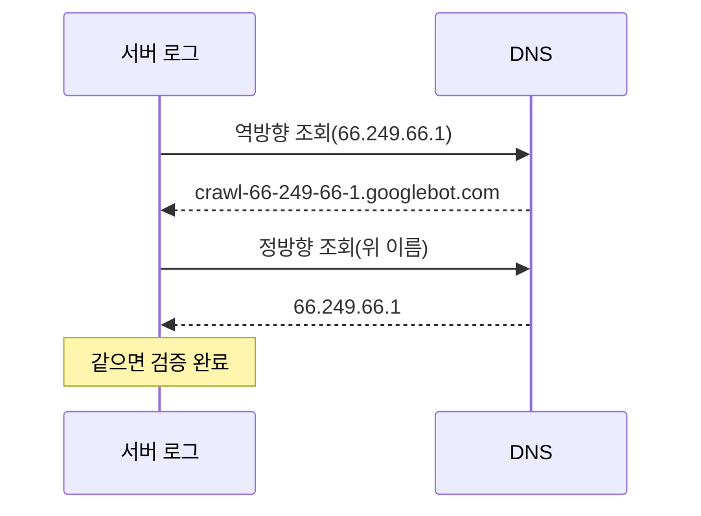
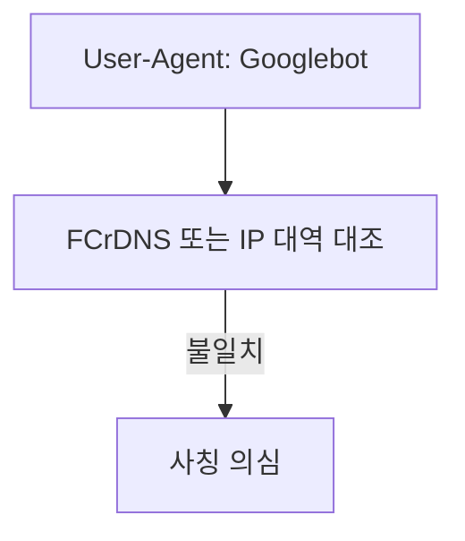

# FCrDNS

> FCrDNS(Forward-confirmed reverse DNS, 정방향 확인 역방향 DNS)는 **접속 IP의 역방향 DNS 이름을 얻고, 그 이름을 다시 정방향 조회해 원래 IP가 나오는지 확인**해 크롤러의 신원을 검증하는 방법이다.

## 쉽게 말하면
전화가 와서 "○○은행입니다"라고 하면 그 말만 믿지 않고, 은행 공식 번호로 직접 걸어 같은 사람이 받는지 확인하는 것과 같다. 이름(역방향)과 주소(정방향)가 서로를 가리켜야 신뢰한다.

## 자세히
- 절차(Google 검색 센트럴 문서 "Googlebot 확인", 2026-11-27 열람):
  1. 로그의 접속 IP에 대해 역방향 DNS 조회(`host <IP>`).
  2. 반환된 호스트 이름이 `googlebot.com`, `google.com`, `googleusercontent.com`으로 끝나는지 확인.
  3. 그 호스트 이름을 정방향 조회(`host <호스트>`).
  4. 정방향 결과가 **원래 IP와 같은지** 확인.
  - 문서 예: `host 66.249.66.1`이 `crawl-66-249-66-1.googlebot.com`을 반환하고, 그 이름을 정방향 조회하면 `66.249.66.1`이 나오므로 검증 완료.
- 크롤러 종류별 호스트 이름 패턴(같은 문서): 일반 크롤러 `crawl-*.googlebot.com` 또는 `geo-crawl-*.geo.googlebot.com`, 특수 크롤러 `rate-limited-proxy-*.google.com`, 사용자 촉발 가져오기 `*.gae.googleusercontent.com`·`google-proxy-*.google.com`.
- **왜 두 번 조회하나**: 역방향 DNS는 IP 주인이 자기 영역에서 마음대로 설정할 수 있어서 `crawl-….googlebot.com`처럼 위장한 이름을 달 수 있다. 정방향 조회가 `googlebot.com` 영역(구글이 통제)에서 같은 IP를 돌려줘야 이름과 IP가 서로 확인된다(일반 DNS 원리에 따른 설명).
- 자동 방법: 구글이 공개하는 IP 대역 JSON 파일과 접속 IP를 대조한다(`common-crawlers.json` 등). 직접 받은 `googlebot.json`(생성 시각 2026-11-26T15:45:48)에는 접두사 **317개**(IPv4 170, IPv6 147)가 있었고 `66.249.66.1`·`66.249.79.70`은 포함, `8.8.8.8`·`203.0.113.5`는 미포함으로 확인했다(파이썬 `ipaddress`). [IP 대역 목록 갱신](#ip-range-list-refresh)도 참고.
- 코드 골격(제안; 이번 실행 환경은 역방향 DNS 조회가 막혀 **실제 DNS 시험은 하지 못함**):
  ```python
  host = socket.gethostbyaddr(ip)[0]
  ok = host.endswith(('.googlebot.com', '.google.com', '.googleusercontent.com')) \
       and ip in socket.gethostbyname_ex(host)[2]
  ```
- 주의: 역방향 DNS는 느리고 캐시가 필요하다. IPv6·여러 A 레코드를 처리해야 하며, 크롤러마다 도메인 규칙이 달라 공식 문서를 확인한다.

## 그림으로 보기



## 예시
- 로그에 `Googlebot` UA가 많이 보이는데 IP가 `203.0.113.5`(문서용 대역)라면 대역 목록에 없으므로 사칭으로 분류.
- 교육: "헤더는 자기 소개일 뿐"이라는 보안 기본기와 DNS 이해 실습.

## 헷갈리는 것과 비교
| 개념 | 차이 |
|---|---|
| FCrDNS | DNS 이름·IP 상호 확인 |
| IP 대역 대조 | 공개 CIDR 목록에 포함되는지(DNS 불필요) |
| [User-Agent 사칭](#spoofed-user-agent) | 헤더만 믿으면 안 되는 이유 |

## 더 읽을거리
- [Google: Verifying Googlebot and other Google crawlers](https://developers.google.com/search/docs/crawling-indexing/verifying-googlebot) — 수동·자동 확인 절차(읽음).
- 직접 실행: `googlebot.json` 317개 접두사와 IP 4개 대조.
