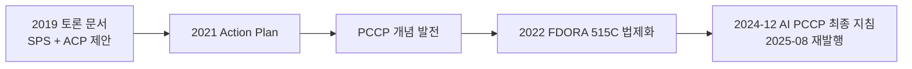

# FDA 2019 AI/ML 토론 문서

> FDA가 2019년 발표한 "Proposed Regulatory Framework for Modifications to AI/ML-Based Software as a Medical Device (SaMD) – Discussion Paper and Request for Feedback". 스스로 학습·변경하는 AI SaMD를 다룰 규제 틀을 제안한 초기 문서로, 이후 PCCP 제도의 사상적 출발점이 됐다.

## 쉽게 말하면
기존 규제는 "허가 받은 제품은 그대로 팔린다"를 전제로 만들어졌다. 쓰면서 배우는 AI는 이 전제에 맞지 않아, FDA가 "이런 식으로 바꾸는 방법을 미리 정해 두고 승인받게 하면 어떨까?"라고 의견을 구한 문서다.

## 자세히
출처: FDA 토론 문서 PDF 전문(내려받아 읽음). 문서의 정확한 발행일은 본문 일부에서 확인하지 못했고 검색 결과는 2019년 4월이라고 안내한다. 법적 구속력은 없는 제안과 의견 수렴 문서다.
- **문제의식**: 전통적 의료기기 규제는 적응형 AI/ML을 염두에 두지 않았다. 대부분의 승인·허가 기기는 배포 전에 "고정(locked)"된 알고리즘이고, 변경하려면 시판 전 검토가 필요할 가능성이 높다. 적응형 알고리즘은 같은 입력에 대한 출력이 변경 전후로 달라질 수 있다.
- **총 제품 수명주기(TPLC) 접근**: Pre-Cert 프로그램의 품질·조직 우수성 평가와 연결해, 변화하는 AI/ML을 수명주기 전체에서 규제한다는 구상.
- **변경의 세 유형**: ① 성능(분석·임상 성능), ② 알고리즘이 쓰는 입력과 그 임상적 연관, ③ 의도한 용도(정보의 중요도·상황 상태). 예: 같은 입력 유형 새 데이터로 재학습해 민감도를 높이는 것은 ①, 다른 제조사 CT 스캐너와 호환은 ②, "진단 보조"에서 "확정 진단"으로의 변화나 소아 환자군 확대는 ③.
- **SPS와 ACP(제안)**: **SaMD 사전 명세(SPS)**는 제조사가 예상하는 변경의 범위, **알고리즘 변경 프로토콜(ACP)**은 변경이 목표를 달성하고 안전·효과가 유지되도록 따를 데이터와 절차의 단계적 서술("알고리즘이 안전하게 학습하고 바뀌는 방법"). 사전 승인에 얼마나 의지할 수 있는지는 변경 유형과 위험에 따라 다르다고 문서가 설명한다.
- **투명성과 실제 성능 모니터링**: 제조사의 정기 보고와 라벨에 변경 근거·입력 변화·갱신된 성능 반영을 기대한다.
- **그 후**: 이 SPS·ACP 구상이 PCCP(변경 설명·변경 프로토콜·영향 평가)로 발전해 2022년 FDORA 515C에 법적 근거가 생겼다([FDORA](#fdora)). 용어와 구조가 다르므로 현행 제도 설명에 2019 용어를 그대로 쓰지 않는다.

## 그림으로 보기

## 예시
- 2019 제안: 조영 CT 폐결절 AI가 "새 병원 데이터 재학습"을 SPS에 적고 ACP에 검증 절차를 적어 두면 그 범위의 변경은 재심사 없이 가능(제안 수준).
- 학습 활동: 2019 SPS·ACP와 2024 PCCP 세 구성 요소를 표로 대응시켜 비교.

## 헷갈리는 것과 비교
| 개념 | 차이 |
|---|---|
| 2019 토론 문서 | 제안과 의견 수렴, 구속력 없음 |
| [AI PCCP 최종 지침](#pccp-ai-final-guidance) | 2024-12 발행·2025-08 재발행된 현행 권고 |
| [FDORA](#fdora) | PCCP를 법에 명시한 2022 법 |
| [고정 vs 지속 학습 AI 감시](#locked-vs-continuous) | 이 문서가 구분한 알고리즘 유형 |

## 더 읽을거리
- [Proposed Regulatory Framework for Modifications to AI/ML-Based SaMD (FDA, 2019)](https://www.fda.gov/media/122535/download) — 제안 문서 전문(내려받아 확인)
