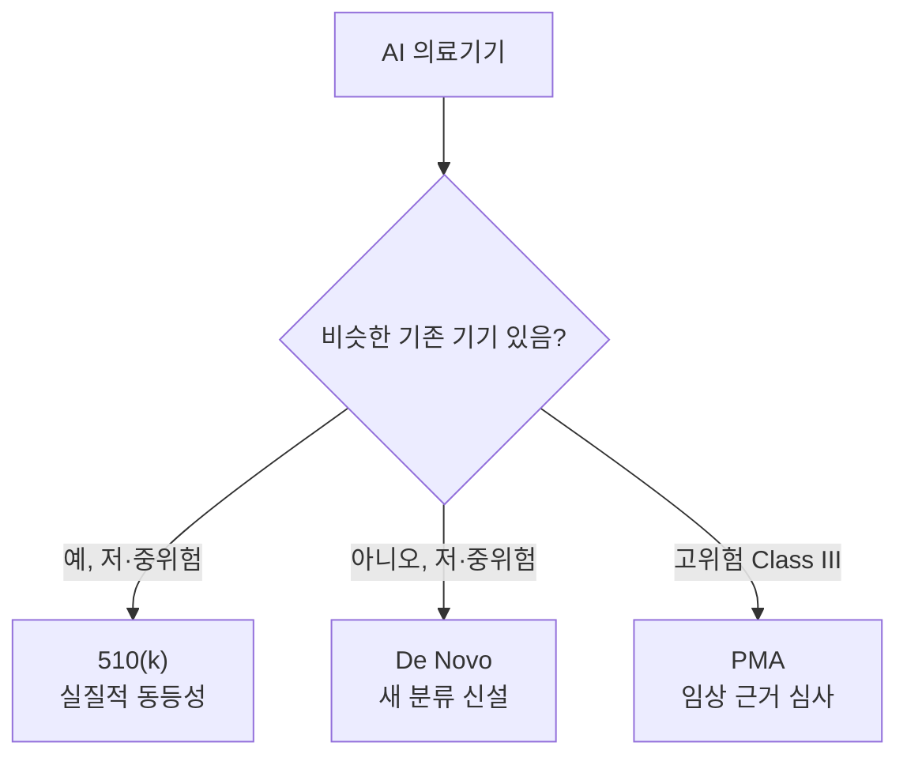

# 510(k)·De Novo·PMA

> 미국 FDA가 의료기기를 시판 허가하는 세 경로. 위험도와 "이미 비슷한 기기가 있는가"로 갈린다. AI 의료기기도 같은 경로를 탄다.

## 쉽게 말하면
식당 개업 허가에 비유하면: 기존 식당과 같은 종류면 간단한 신고(510(k)), 처음 보는 업종인데 위험이 낮으면 새 업종 등록(De Novo), 위험이 큰 업종이면 엄격한 심사 허가(PMA)다.

## 자세히
- **510(k)**: 이미 시판 중인 유사 기기(predicate)와 **실질적 동등성**을 보이는 Class II 기기. AI 의료기기 대부분이 이 경로다.
- **De Novo**: 비슷한 기존 기기가 없는 **새로운 저·중위험** 기기. 허가되면 이후 기기의 predicate가 된다.
- **PMA**(Premarket Approval): 생명 유지·고위험 Class III 기기. 임상 근거를 갖춘 가장 엄격한 심사.
- 세 경로 모두 [PCCP](#fda-pccp)(사전 변경 관리 계획)를 쓸 수 있다는 것이 근거 자료들의 일치된 설명이지만, 실제 사례는 510(k)가 대부분(한 리뷰: 510(k) 24건·De Novo 2건)이고 PMA는 불확실하다.
- [SaMD](#samd)(소프트웨어 자체가 의료기기)인 AI도 위험 등급 분류가 먼저다.
- 주의: 자료들 사이 가이드 날짜 표기가 다르다. 시판 전 FDA 공식 페이지에서 확인.

## 그림으로 보기

## 예시
- 영상 판독 보조 AI가 기존 허가 제품과 비슷 → 510(k). 완전히 새로운 진단 방식의 저위험 AI → De Novo. 이식형 기기를 제어하는 AI → PMA.
- AI 스크라이브는 보통 임상 판단을 대신하지 않는 행정 보조라서 의료기기 규제 대상 여부 자체가 쟁점이다(확인 필요).

## 헷갈리는 것과 비교
| 경로 | 대상 | 부담 |
| --- | --- | --- |
| 510(k) | 유사 기기 존재, Class II | 낮음 |
| De Novo | 새 저·중위험 | 중간 |
| PMA | Class III 고위험 | 높음 |
| [EU AI Act](#eu-ai-act-gpai) | 유럽의 범용 AI 규제 | 별도 체계 |

## 더 읽을거리
- [Vector Labs: 510(k) vs De Novo vs PMA](https://vector-labs.ai/insights/fda-510k-vs-de-novo-vs-pma-choosing-the-right-regulatory-pathway-for-your-ai-medical-device) — 경로 선택(업체 블로그, 검색 요약 확인)
- [IntuitionLabs: FDA Pathways for AI SaMD](https://intuitionlabs.ai/articles/fda-samd-pathways-510k-de-novo-pma-ai) — 세 경로와 AI
