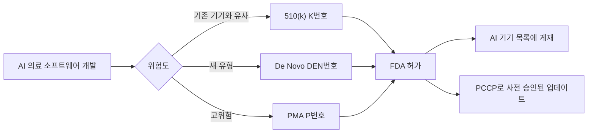

# FDA AI 기기 목록

> 미국 FDA가 시판을 허가한 AI 적용 의료기기를 모아 공개하는 목록. "AI가 의료에서 실제로 어디까지 규제를 통과했나"를 보는 가장 좋은 1차 자료다.

## 쉽게 말하면
의료기기 "합격자 명단"이다. AI가 영상을 읽어 주는 소프트웨어도 약이나 청진기처럼 심사를 받아야 병원에서 쓸 수 있고, 심사를 통과한 제품이 이 명단에 올라간다. 입학 합격자 게시판처럼 날짜순으로 쌓이며, 누구나 내려받아 볼 수 있다.

## 자세히
- **무엇인가**: FDA 웹페이지의 표. 허가 결정일 최신순이며 CSV·Excel·XML로 내려받아 회사·진료 분야(panel)·제품 코드로 거를 수 있다(2026-11 확인).
- **완전한 목록이 아니다**: 허가 요약문에 AI 관련 용어가 있는 기기 위주로 올라간다. 비정기적으로 갱신되고, 아직 결정 요약이 공개되지 않은 기기는 나중에 추가된다.
- **분야 쏠림**: 보이는 항목 대부분이 영상의학(radiology). 심혈관·신경·마취·소화기는 훨씬 적다.
- **허가 경로**: 제출번호 접두어로 구분한다. `K`=510(k)(기존 기기와 실질적 동등성 입증, 대다수), `DEN`=De Novo(새 유형의 저위험·중위험), `P`=PMA(고위험). 접두어 설명은 FDA 일반 지식이며 이 페이지에 직접 적혀 있지는 않다.
- **PCCP**: 2024-12 FDA는 AI 기기용 '사전 변경 관리 계획(PCCP)' 최종 지침을 냈다. 변경 내용·변경 프로토콜·영향 평가 세 부분으로 구성되며, 허가받은 계획 범위 안의 모델 업데이트는 새로 신청하지 않아도 된다. special 510(k)에는 쓸 수 없다.
- 이 목록은 "허가됨"이지 "효과 입증됨"이 아니다. 임상 성능은 기기마다 따로 봐야 한다.

## 그림으로 보기

## 예시
- 병원 도입 검토: 후보 영상 판독 AI 제품명을 목록 CSV에서 검색해 허가 여부·허가일·분야를 확인한다. 없으면 "연구용"이거나 목록 누락일 수 있어 벤더에 제출번호를 요청한다.
- 시장 조사: CSV를 panel별로 집계해 어느 진료과에 허가가 몰렸는지 본다.

## 헷갈리는 것과 비교
| 개념 | 차이 |
|---|---|
| FDA 허가(clearance/approval) | 규제 통과. 임상적 우월성 보증이 아님 |
| CE 마크·[EU AI Act](#eu-ai-act) | 유럽 쪽 규제. 목록은 미국 시판만 |
| [PCCP](#fda-pccp) | 허가 후 모델 업데이트를 미리 승인받는 계획 |

## 더 읽을거리
- [FDA: List of AI-Enabled Medical Devices](http://www.fda.gov/medical-devices/artificial-intelligence-enabled-medical-devices/list-artificial-intelligence-enabled-medical-devices) — 공식 목록(직접 열어 확인)
- [McDermott: FDA Final Guidance on PCCPs for AI-Enabled Devices](https://www.mcdermottlaw.com/insights/fda-issues-final-guidance-on-predetermined-change-control-plans-for-ai-enabled-devices/) — PCCP 최종 지침 해설
- [Foley: FDA's Final Guidance for PCCPs](https://www.foley.com/insights/publications/2025/01/fda-final-guidance-ai-device-software-predetermined-change-control-plan/) — 구조와 제한 정리
