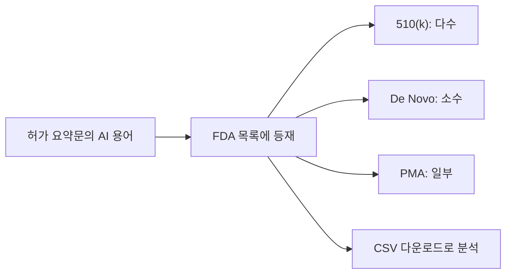

# FDA AI 기기 목록

> FDA가 공개하는 "AI 지원 의료기기 목록". 허가·승인된 AI 기기를 최종 결정일 역순으로 정리했으며, 포괄적이지 않다고 FDA가 명시한다.

## 쉽게 말하면
허가받은 AI 의료기기의 공개 명부다. 전체 시장 지도가 아니라 "AI 관련 용어가 요약문에 나온 것을 모은 목록"이라 빠진 기기도 있다.

## 자세히
출처: FDA 목록 페이지(2026-11-15 확인, 페이지 전체가 커서 앞 10만 자만 읽음).
- **수집 방식**: 마케팅 허가 요약문·기기 분류에서 FDA의 디지털 헬스·AI 용어집 기준 AI 관련 용어로 식별. 항목은 FDA 데이터베이스 기록에 연결(공개 가능한 안전·효과 요약 포함).
- **정렬·갱신**: 최종 결정일 역순, "주기적으로 갱신". 확인한 최신 결정일 항목은 2026-06-29. 결정 요약이 아직 공개되지 않은 기기는 나중 갱신에 추가.
- **경로 구성**: 보이는 항목 대부분 510(k)(K 번호), 소수 De Novo(DEN 번호), 일부 PMA(P 번호). 분야는 영상의학이 다수, 이어서 심혈관·신경·마취.
- **한계(FDA 명시)**: 포괄적 자원이 아님. AI 용어 표기에 의존해 일부 누락 가능. 요약은 제출 내용 대부분을 생략. 파운데이션 모델·LLM 사용 기기를 표시하는 방법을 FDA가 탐색 중이라고 밝힘.
- **다운로드**: CSV·Excel·XML.
- 총 기기 수는 페이지가 잘려 이번에 확정하지 못했다. 필요하면 최신 목록에서 직접 집계.

## 그림으로 보기

## 예시
- 시장 조사: CSV로 받아 분야(영상의학 등)별·연도별 건수 집계, 경쟁 제품의 predicate 번호 확인.
- 도입 검토: 병원이 후보 AI의 K번호가 목록에 있는지 확인(목록 부재가 미허가를 뜻하진 않으니 FDA DB도 함께 조회).

## 헷갈리는 것과 비교
| 개념 | 차이 |
|---|---|
| FDA AI 기기 목록 | 허가된 AI 기기 일부 명부 |
| [predicate](#predicate-device) | 510(k) 비교 대상 |
| [등급](#device-risk-classes) | 위험 분류 |

## 더 읽을거리
- [FDA: AI-Enabled Medical Devices](http://www.fda.gov/medical-devices/artificial-intelligence-enabled-medical-devices/list-artificial-intelligence-enabled-medical-devices) — 목록 원본과 주의 사항
